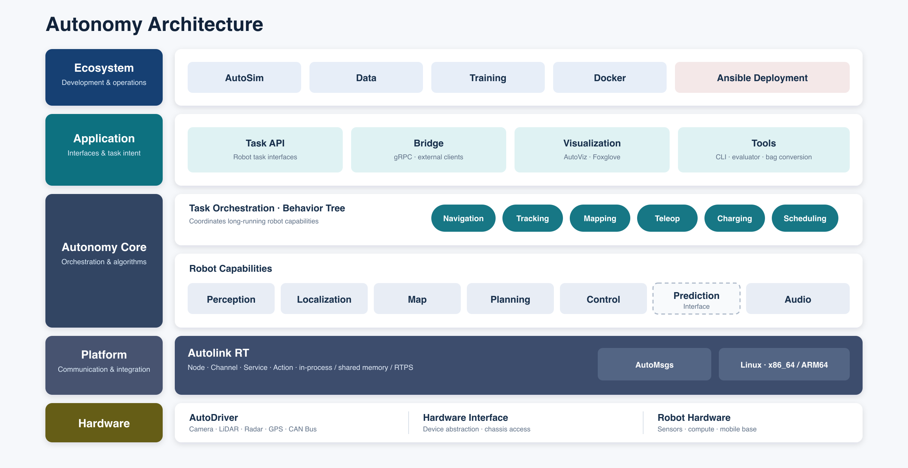
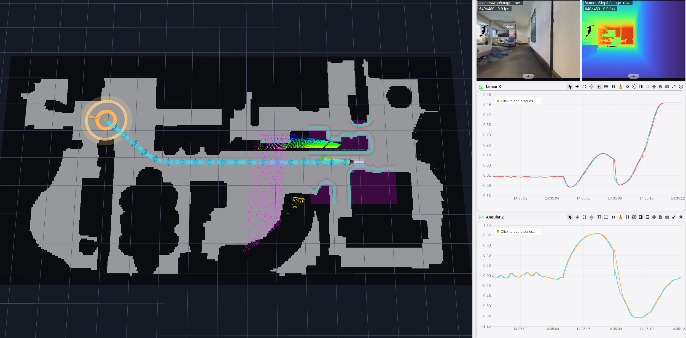
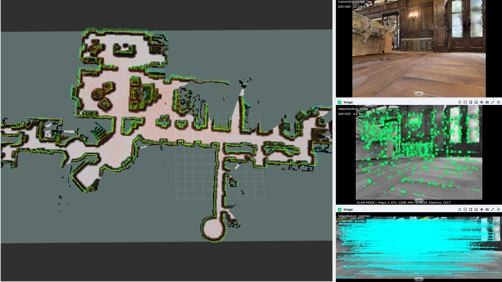
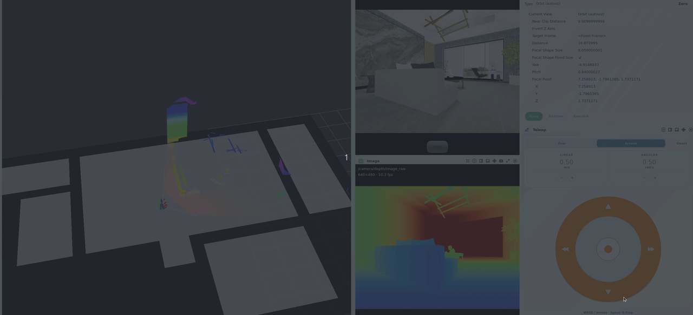
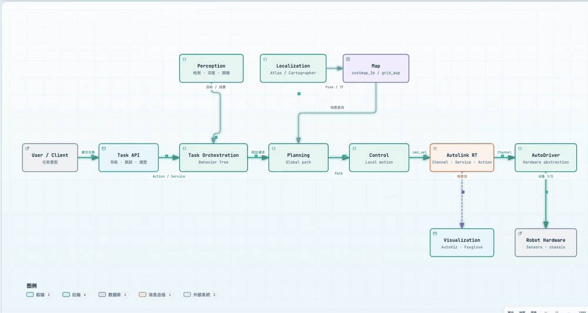
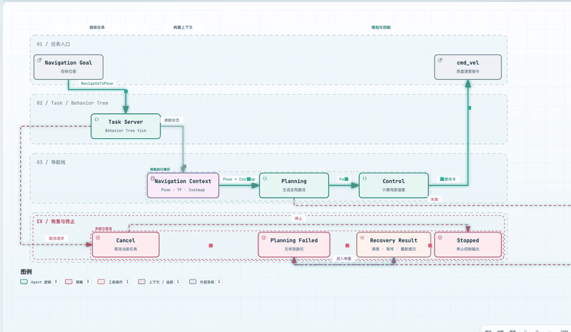
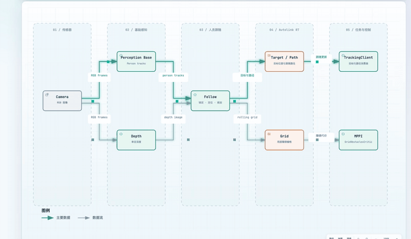

<h1 align="center">Autonomy</h1>

<p align="center">
  <strong>A modular intelligence framework for autonomous mobile robots.</strong>
</p>

<p align="center">
  Modern C++ · Autolink RT · Behavior trees · No ROS runtime required
</p>

<p align="center">
  <a href="version.json"></a>
  <a href="CMakeLists.txt"></a>
  <a href="docs/source/02_Installation/00_guide.md"></a>
  <a href="LICENSE"></a>
  <a href="https://autonomy.readthedocs.io/en/latest/index.html"></a>
</p>

<p align="center">
  <a href="https://autonomy.readthedocs.io/en/latest/index.html">Documentation</a>
  ·
  <a href="#build">Build</a>
  ·
  <a href="#demo">Demo</a>
  ·
  <a href="#architecture">Architecture</a>
  ·
  <a href="#guides">Guides</a>
</p>

<p align="center">
  <a href="docs/source/01_Instructions/03_system_architecture.md">
    
  </a>
</p>

---

## About

Autonomy is an open-source stack for building and shipping autonomous mobile robots — localization, mapping, planning, control, task orchestration, simulation, and visualization — without depending on a ROS runtime.

Everything talks over **Autolink**: Node, Channel, Service, Action, Parameter. Domains stay plugins. You can run the full stack, or trim it with `AUTONOMY_BUILD_*` / `BUILD_*` flags.

**Good for:** indoor navigation demos, SLAM bring-up, MPPI / RPP control, Isaac + AutoViz simulation, and production Docker / Ansible deploys on x86_64 and ARM64.

**Also for machines:** Protobuf messages (`automsgs`), optional gRPC bridge (`BUILD_GRPC`), and launch files that compose multi-process Goal → Task (BT) → Planning → Control.

---

## Highlights

- 🚫 **No ROS runtime required.** Autolink carries Node · Channel · Service · Action · Parameter on SHM / RTPS.
- 🧩 **Modular by design.** Stable plugins across algorithms, drivers, simulation, and visualization.
- 🗺️ **Localization that scales.** Cartographer, Atlas-SLAM, and Argus (ESIKF) in one tree.
- 🧭 **Navigation you can see.** Global plan, MPPI candidates, costmaps, goal rings, and cmd/odom plots in AutoViz.
- 🧠 **Behavior-tree orchestration.** TaskServer + BT navigator for navigate-to-pose, recover, cancel.
- 🎮 **Simulation & sensors.** AutoSim (Habitat · Fake · Isaac + PhysX) and AutoDriver for real hardware.
- 🚢 **Production oriented.** Docker, Ansible, observability — x86_64 and ARM64 ready.

---

## Demo

<p align="center">
  <a href="https://www.bilibili.com/video/BV1wnWe6cEDX/">
    
  </a>
</p>

<p align="center">
  <a href="https://www.bilibili.com/video/BV1wnWe6cEDX/"><b>▶ Navigation demo</b></a>
  ·
  <a href="docs/source/16_Navigator/04_navigate_to_pose.md">Guide</a>
  ·
  <a href="autoviz/README.md">AutoViz</a>
</p>

<table>
  <tr>
    <td align="center" width="50%" valign="top">
      <a href="https://www.bilibili.com/video/BV1qzxX62Ef2/">
        
      </a>
      <p>
        <a href="https://www.bilibili.com/video/BV1qzxX62Ef2/"><b>▶ Atlas-SLAM</b></a>
        ·
        <a href="autonomy/localization/README.md">Guide</a>
      </p>
      <sub>Cartographer · Atlas · Argus (ESIKF)</sub>
    </td>
    <td align="center" width="50%" valign="top">
      <a href="autosim/README.md">
        
      </a>
      <p>
        <a href="autosim/README.md"><b>▶ AutoSim</b></a>
        ·
        <a href="autoviz/README.md">AutoViz</a>
      </p>
      <sub>Habitat · Fake · Isaac Sim + PhysX</sub>
    </td>
  </tr>
</table>

---

## Build

Two ways in:

1. **[Documentation](https://autonomy.readthedocs.io/en/latest/index.html)** — install, run, and architecture guides. Start here if you are new.
2. **Docker quick path** below — clone, enter the container, build, launch.

Autonomy is under active development. [Say so](https://github.com/quandy2020/autonomy/issues) when you find an edge.

**Platforms**

- ✅ **Linux** · x86_64 and ARM64 (primary)
- 🚧 **macOS / Windows** · AutoViz deploy scripts exist; full stack is Linux-first

Work from the **source root** (the directory with top-level `CMakeLists.txt`, `scripts/`, `docker/`). In a monorepo that is often `…/src/autonomy`.

You need a Linux host (or the project Docker image), CMake, Ninja, a C++20 compiler, and the dependencies installed by `scripts/install_dependencies.py`.

**① Clone & enter Docker**

```bash
git clone --recurse-submodules \
  https://github.com/quandy2020/autonomy.git
cd autonomy   # or cd …/src/autonomy

export AUTONOMY_ENV="$PWD"
# optional offline datasets → container /data
# export AUTONOMY_DATASETS=/path/to/datasets

python3 docker/run_autonomy.py -p x86_64
# GPU image:
# python3 docker/run_autonomy.py -p x86_64 -n yes
```

**② Build & launch**

```bash
cd /workspace/autonomy   # inside container

python3 scripts/install_dependencies.py --skip-installed
cmake -S . -B build -G Ninja \
  -DCMAKE_BUILD_TYPE=Release \
  -DCMAKE_PREFIX_PATH=/usr/local
cmake --build build -j"$(nproc)"

source scripts/setup_environment.bash
autolink_launch autonomy.launch
```

Nav-only smoke (planning + control + task — do **not** run together with `autonomy.launch`):

```bash
autolink launch start task.launch
```

<details>
<summary><b>Argus localization</b> (autosim / Oxford Spires → <code>/imu</code> · <code>/points</code>)</summary>

```bash
# Host: mount datasets, then recreate the container if needed
export AUTONOMY_DATASETS=/path/to/datasets
AUTONOMY_FORCE_RECREATE=1 python3 docker/run_autonomy.py -p x86_64 -n yes

# Container: localization
export AUTOLINK_LAUNCH_PATH="$PWD/autonomy/localization/launch"
autolink launch start localization_argus.launch

# Another terminal: publish sequence (under /data)
export LD_LIBRARY_PATH="/workspace/autonomy/install/autonomy/lib:/workspace/autonomy/build/autonomy/lib:${LD_LIBRARY_PATH:-}"
export PYTHONPATH="/workspace/autonomy/src/autonomy:/workspace/autonomy/install/autonomy/python:/workspace/autonomy/install/autonomy/lib/python:${PYTHONPATH:-}"
/usr/bin/python3 -m autonomy.tools.datasets publish \
  --dataset spires \
  --path /data/Oxford/sequences/2024-03-12-keble-college-02 \
  --rate 1.0
```

See [datasets](docs/source/18_Tools/08_datasets.md) and [localization](autonomy/localization/README.md).

</details>

---

## Architecture

<p align="center">
  <a href="docs/architecture/archify/autonomy-runtime.architecture.html">
    
  </a>
</p>

<table>
  <tr>
    <td align="center" width="50%">
      <a href="docs/architecture/archify/navigation-task.workflow.html">
        
      </a>
      <br/>
      <b>Navigation</b> — goal · plan · recover · cancel
    </td>
    <td align="center" width="50%">
      <a href="docs/architecture/archify/person-following.dataflow.html">
        
      </a>
      <br/>
      <b>Person-following</b> — RGB · track · path · control
    </td>
  </tr>
</table>

Multi-process by default: Goal → `task` (BT) → `planning` (Path) → `control` (`cmd_vel`), with TF `map → odom → base_link`.

### Stack

| Area | Path | Notes |
|------|------|--------|
| Runtime | `autolink/` | SHM · RTPS · Action |
| Messages | `automsgs/` | Protobuf · codegen |
| Localization | `autonomy/localization/` | Cartographer · Atlas · Argus |
| Perception | `autonomy/perception/` | Base · Follow · costmap layers |
| Map / Plan / Ctrl | `map` · `planning` · `control` | Costmap · NavFn · RPP / MPPI |
| Tasks | `autonomy/task/` | BT navigator · TaskServer |
| Bridge | `autonomy/bridge/` | gRPC · `BUILD_GRPC` |
| HW / Sim / Viz | `autodriver` · `autosim` · `autoviz` | Sensors · Isaac · Qt |

---

## How to Contribute

> [!IMPORTANT]
> The best way to contribute is to build the stack, run a nav or SLAM bring-up, and [say where it breaks](https://github.com/quandy2020/autonomy/issues) or could be clearer.
>
> Ready to write code? Start from [Getting started](docs/source/01_Instructions/00_guide.md) and [CMake](cmake/README.md). Prefer small, reviewable changes that match existing module boundaries (`autolink`, `automsgs`, `autonomy/*`, `autoviz`, …).
>
> Questions and demos live best next to the module READMEs in [Guides](#guides).

---

## Guides

<p align="center">
  <a href="autolink/README.md">Autolink</a>
  ·
  <a href="automsgs/README.md">AutoMsgs</a>
  ·
  <a href="autonomy/localization/README.md">Localization</a>
  ·
  <a href="autonomy/bridge/README.md">Bridge</a>
  ·
  <a href="autodriver/README.md">AutoDriver</a>
  ·
  <a href="autosim/README.md">AutoSim</a>
  ·
  <a href="autoviz/README.md">AutoViz</a>
  ·
  <a href="ansible/README.md">Ansible</a>
</p>

<p align="center">
  <sub>
    <a href="docs/source/02_Installation/00_guide.md">Install</a> ·
    <a href="docs/source/03_Communication/00_guide.md">Autolink</a> ·
    <a href="docs/source/04_Running/00_guide.md">Run</a> ·
    <a href="docs/source/06_Localization/00_guide.md">Localization</a> ·
    <a href="docs/source/08_Planning/00_guide.md">Planning</a> ·
    <a href="docs/source/09_Control/00_guide.md">Control</a> ·
    <a href="docs/source/15_Bridge/00_guide.md">Bridge</a> ·
    <a href="docs/source/16_Navigator/00_guide.md">Navigator</a> ·
    <a href="docs/source/18_Tools/08_datasets.md">Datasets</a> ·
    <a href="docs/source/19_FAQs/00_guide.md">FAQs</a> ·
    <a href="docs/source/01_Instructions/03_system_architecture.md">Architecture</a> ·
    <a href="cmake/README.md">CMake</a> ·
    <a href="https://autonomy.readthedocs.io/en/latest/index.html">readthedocs</a>
  </sub>
</p>

---

## License

Autonomy is free software under [Apache-2.0](LICENSE).

Inspired by Autoware · Cartographer · Navigation2 · ROS 2 · BehaviorTree.CPP.

<p align="center">
  <em>Autonomy — modular, observable, deployable robot intelligence</em>
</p>
