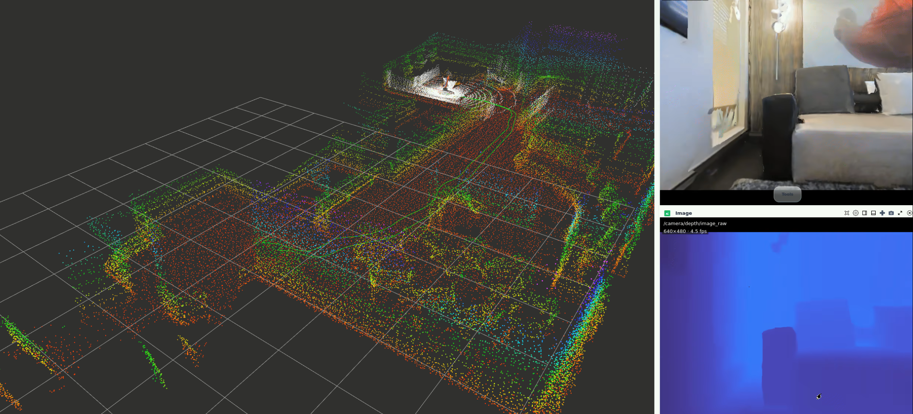
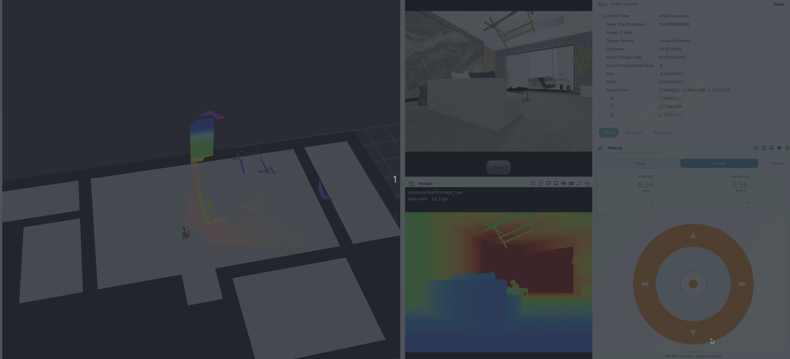
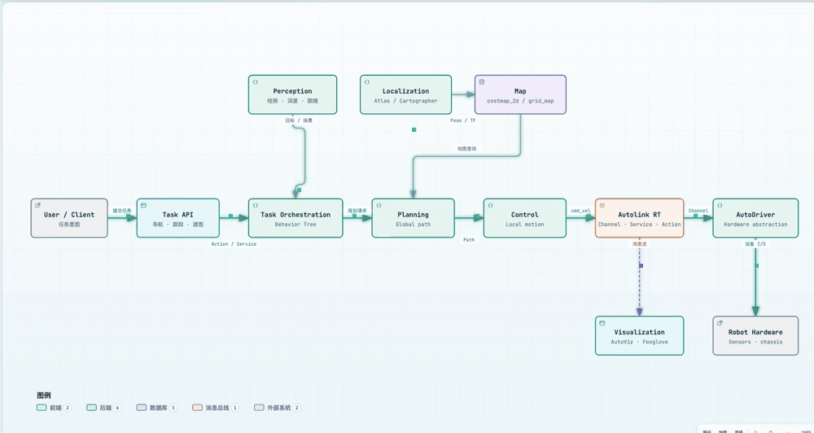
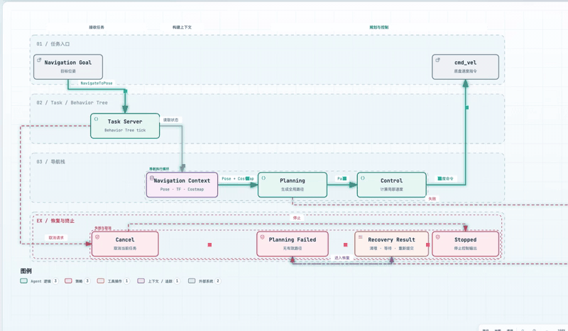
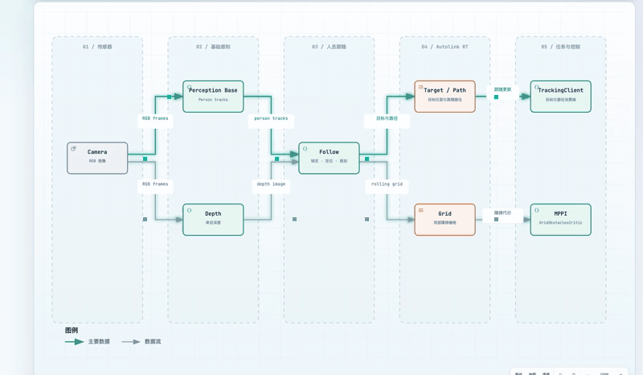

<div align="center">

# AUTONOMY

**A modular intelligence framework for autonomous mobile robots**

Modern C++ · Autolink RT · Behavior trees · *No ROS runtime required*

[](version.json)
[](CMakeLists.txt)
[](docs/source/02_Installation/00_guide.md)
[](LICENSE)

<br/>

[Documentation](https://autonomy.readthedocs.io/en/latest/index.html)
&nbsp;·&nbsp;
[Install](docs/source/02_Installation/00_guide.md)
&nbsp;·&nbsp;
[Quick Start](docs/source/04_Running/02_quickstart.md)
&nbsp;·&nbsp;
[Architecture](docs/source/01_Instructions/03_system_architecture.md)

<br/>


<br/>

`PERCEPTION`&nbsp;&nbsp;`LOCALIZATION`&nbsp;&nbsp;`MAPPING`&nbsp;&nbsp;`PLANNING`&nbsp;&nbsp;`CONTROL`&nbsp;&nbsp;`ORCHESTRATION`

</div>

<br/>

<table>
  <tr>
    <td align="center" width="33%">
      <h3>Runtime Independent</h3>
      <p>Node · Channel · Service · Action · Parameter<br/>without a ROS runtime dependency</p>
    </td>
    <td align="center" width="33%">
      <h3>Modular by Design</h3>
      <p>Stable plugins across algorithms,<br/>drivers, simulation, and visualization</p>
    </td>
    <td align="center" width="33%">
      <h3>Production Oriented</h3>
      <p>Docker · Ansible · observability<br/>x86_64 and ARM64 ready</p>
    </td>
  </tr>
</table>

---

## Gallery

<table>
  <tr>
    <td align="center" width="50%" valign="top">
      <h3>Localization · Argus LIVO</h3>
      <a href="docs/assets/localization/argus_mid25.mp4">
        
      </a>
      <p>
        <a href="docs/assets/localization/argus_mid25.mp4"><b>▶ Mid-360 demo</b></a>
        &nbsp;·&nbsp;
        <a href="autonomy/localization/README.md">Guide</a>
      </p>
      <sub>Cartographer · Atlas · Argus (ESIKF)</sub>
    </td>
    <td align="center" width="50%" valign="top">
      <h3>Simulation · Isaac + AutoViz</h3>
      
      <p>
        <a href="autosim/README.md"><b>AutoSim</b></a>
        &nbsp;·&nbsp;
        <a href="autoviz/README.md">AutoViz</a>
      </p>
      <sub>Habitat · Fake · Isaac Sim + PhysX</sub>
    </td>
  </tr>
</table>

---

## Architecture

<div align="center">

<a href="docs/architecture/archify/autonomy-runtime.architecture.html">
  
</a>

</div>

<br/>

<table>
  <tr>
    <td align="center" width="50%">
      <a href="docs/architecture/archify/navigation-task.workflow.html">
        
      </a>
      <br/>
      <b>Navigation</b> — goal · plan · recover · cancel
    </td>
    <td align="center" width="50%">
      <a href="docs/architecture/archify/person-following.dataflow.html">
        
      </a>
      <br/>
      <b>Person-following</b> — RGB · track · path · control
    </td>
  </tr>
</table>

<p align="center">
  <a href="docs/architecture/archify/autonomy-runtime.architecture.html">Runtime</a>
  &nbsp;·&nbsp;
  <a href="docs/architecture/archify/navigation-task.workflow.html">Navigation</a>
  &nbsp;·&nbsp;
  <a href="docs/architecture/archify/person-following.dataflow.html">Following</a>
  &nbsp;·&nbsp;
  <a href="docs/source/01_Instructions/03_system_architecture.md">System guide</a>
</p>

---

## Stack

<table>
  <tr>
    <td width="25%"><b>Runtime</b><br/><code>autolink/</code><br/><sub>SHM · RTPS · Action</sub></td>
    <td width="25%"><b>Messages</b><br/><code>automsgs/</code><br/><sub>Protobuf · codegen</sub></td>
    <td width="25%"><b>Localization</b><br/><code>autonomy/localization/</code><br/><sub>Cartographer · Atlas · Argus</sub></td>
    <td width="25%"><b>Perception</b><br/><code>autonomy/perception/</code><br/><sub>Base · Follow · costmap layers</sub></td>
  </tr>
  <tr>
    <td><b>Map / Plan / Ctrl</b><br/><code>map · planning · control</code><br/><sub>Costmap · NavFn · RPP / MPPI</sub></td>
    <td><b>Tasks</b><br/><code>autonomy/task/</code><br/><sub>BT navigator · TaskServer</sub></td>
    <td><b>Bridge</b><br/><code>autonomy/bridge/</code><br/><sub>gRPC · <code>BUILD_GRPC</code></sub></td>
    <td><b>HW / Sim / Viz</b><br/><code>autodriver · autosim · autoviz</code><br/><sub>Sensors · Isaac · Qt</sub></td>
  </tr>
</table>

Multi-process by default: Goal → `task` (BT) → `planning` (Path) → `control` (`cmd_vel`), with TF `map → odom → base_link`. Domains can be trimmed via `AUTONOMY_BUILD_*` / `BUILD_*`.

---

## Quick Start

Work from the **source root** (directory with top-level `CMakeLists.txt`, `scripts/`, `docker/`). In a monorepo that is often `…/src/autonomy`.

<table>
  <tr>
    <td width="50%" valign="top">

**① Clone & enter Docker**

```bash
git clone --recurse-submodules \
  https://github.com/quandy2020/autonomy.git
cd autonomy   # or cd …/src/autonomy

export AUTONOMY_ENV="$PWD"
# optional offline datasets → container /data
# export AUTONOMY_DATASETS=/path/to/datasets

python3 docker/run_autonomy.py -p x86_64
# GPU image:
# python3 docker/run_autonomy.py -p x86_64 -n yes
```

</td>
    <td width="50%" valign="top">

**② Build & launch stack**

```bash
cd /workspace/autonomy   # inside container
# host path if building outside Docker

python3 scripts/install_dependencies.py --skip-installed
cmake -S . -B build -G Ninja \
  -DCMAKE_BUILD_TYPE=Release \
  -DCMAKE_PREFIX_PATH=/usr/local
cmake --build build -j"$(nproc)"

source scripts/setup_environment.bash
autolink_launch autonomy.launch
```

Nav-only smoke (planning + control + task):

```bash
autolink launch start task.launch
# do not run together with autonomy.launch
```

</td>
  </tr>
</table>

<details>
<summary><b>Argus localization</b> (autosim / Oxford Spires → <code>/imu</code> · <code>/points</code>)</summary>

```bash
# Host: mount datasets, then recreate the container if needed
export AUTONOMY_DATASETS=/path/to/datasets
AUTONOMY_FORCE_RECREATE=1 python3 docker/run_autonomy.py -p x86_64 -n yes

# Container: localization
export AUTOLINK_LAUNCH_PATH="$PWD/autonomy/localization/launch"
autolink launch start localization_argus.launch

# Another terminal: publish sequence (under /data)
export LD_LIBRARY_PATH="/workspace/autonomy/install/autonomy/lib:/workspace/autonomy/build/autonomy/lib:${LD_LIBRARY_PATH:-}"
export PYTHONPATH="/workspace/autonomy/src/autonomy:/workspace/autonomy/install/autonomy/python:/workspace/autonomy/install/autonomy/lib/python:${PYTHONPATH:-}"
/usr/bin/python3 -m autonomy.tools.datasets publish \
  --dataset spires \
  --path /data/Oxford/sequences/2024-03-12-keble-college-02 \
  --rate 1.0
```


See [datasets](docs/source/18_Tools/08_datasets.md) and [localization](autonomy/localization/README.md).

</details>

<p align="center">
  <a href="docs/source/01_Instructions/00_guide.md">Getting started</a>
  &nbsp;·&nbsp;
  <a href="docs/source/04_Running/02_quickstart.md">Quick Run</a>
  &nbsp;·&nbsp;
  <a href="docs/source/02_Installation/05_docker.md">Docker</a>
  &nbsp;·&nbsp;
  <a href="cmake/README.md">CMake</a>
  &nbsp;·&nbsp;
  <a href="autonomy/localization/README.md">Localization</a>
</p>

---

## Guides

<p align="center">
  <a href="autolink/README.md">Autolink</a>
  &nbsp;·&nbsp;
  <a href="automsgs/README.md">AutoMsgs</a>
  &nbsp;·&nbsp;
  <a href="autonomy/localization/README.md">Localization</a>
  &nbsp;·&nbsp;
  <a href="autonomy/bridge/README.md">Bridge</a>
  &nbsp;·&nbsp;
  <a href="autodriver/README.md">AutoDriver</a>
  &nbsp;·&nbsp;
  <a href="autosim/README.md">AutoSim</a>
  &nbsp;·&nbsp;
  <a href="autoviz/README.md">AutoViz</a>
  &nbsp;·&nbsp;
  <a href="ansible/README.md">Ansible</a>
</p>

<p align="center">
  <sub>
    <a href="docs/source/02_Installation/00_guide.md">Install</a> ·
    <a href="docs/source/03_Communication/00_guide.md">Autolink</a> ·
    <a href="docs/source/04_Running/00_guide.md">Run</a> ·
    <a href="docs/source/06_Localization/00_guide.md">Localization</a> ·
    <a href="docs/source/08_Planning/00_guide.md">Planning</a> ·
    <a href="docs/source/09_Control/00_guide.md">Control</a> ·
    <a href="docs/source/15_Bridge/00_guide.md">Bridge</a> ·
    <a href="docs/source/16_Navigator/00_guide.md">Navigator</a> ·
    <a href="docs/source/18_Tools/08_datasets.md">Datasets</a> ·
    <a href="docs/source/19_FAQs/00_guide.md">FAQs</a> ·
    <a href="https://autonomy.readthedocs.io/en/latest/index.html">readthedocs</a>
  </sub>
</p>

---

<div align="center">

**Apache 2.0** · Inspired by Autoware · Cartographer · Navigation2 · ROS 2 · BehaviorTree.CPP

<br/>

*Autonomy — modular, observable, deployable robot intelligence*

</div>
