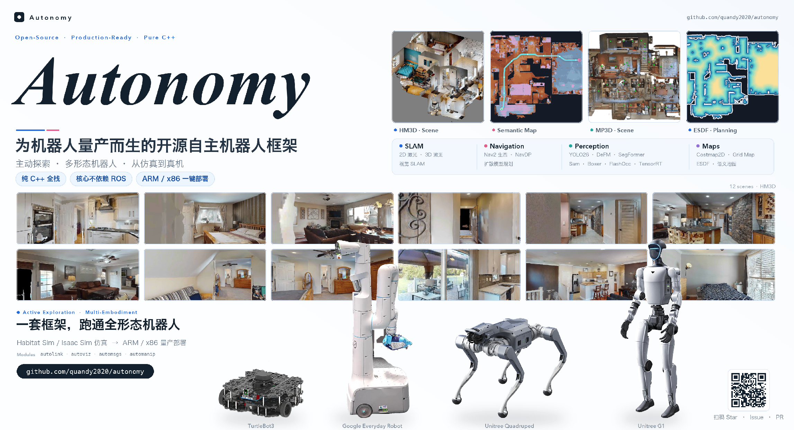
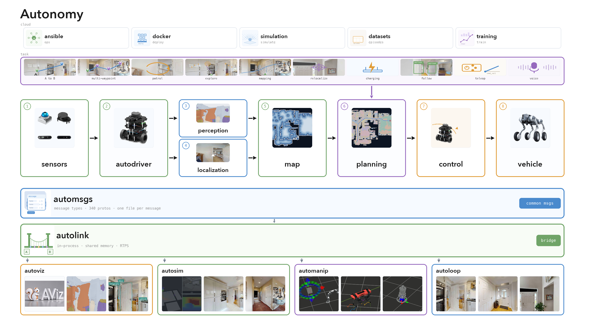
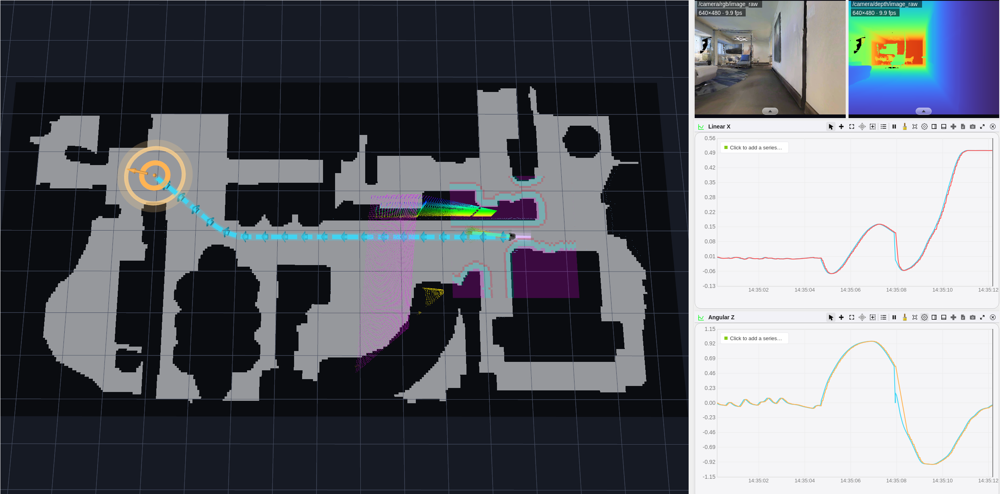
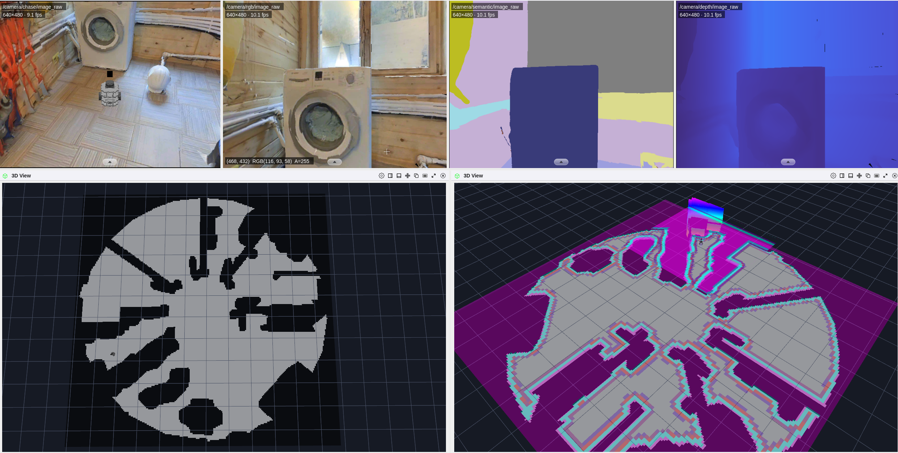
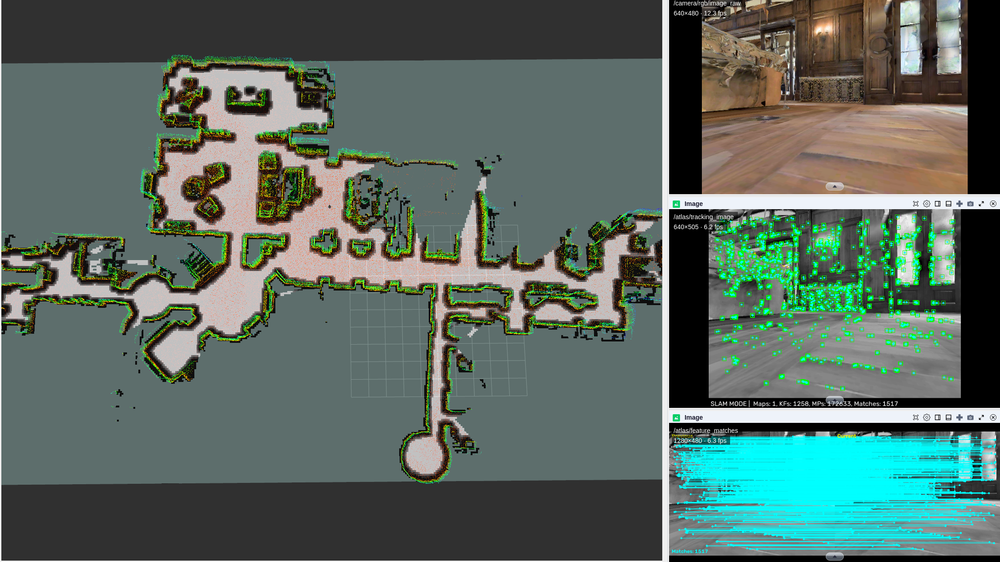
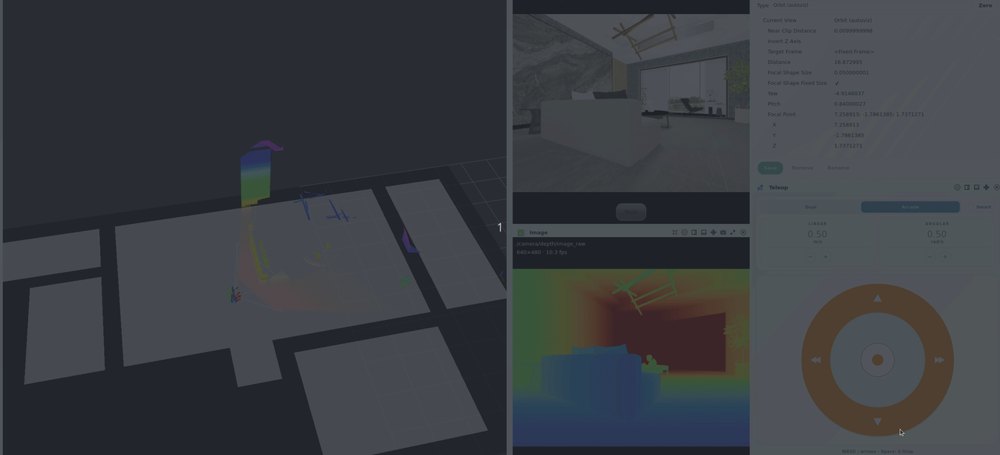

<h1 align="center">Autonomy</h1>

<p align="center">
  <strong>A modular intelligence framework for autonomous mobile robots.</strong>
</p>

<p align="center">
  Modern C++ · Autolink RT · Behavior trees · No ROS runtime required
</p>

<p align="center">
  <a href="version.json"></a>
  <a href="CMakeLists.txt"></a>
  <a href="docs/source/02_Installation/00_guide.md"></a>
  <a href="LICENSE"></a>
  <a href="https://autonomy.readthedocs.io/en/latest/index.html"></a>
</p>

<p align="center">
  <a href="https://autonomy.readthedocs.io/en/latest/index.html">Documentation</a>
  ·
  <a href="#demo">Demo</a>
  ·
  <a href="#quick-start">Quick start</a>
  ·
  <a href="#guides">Guides</a>
</p>

<p align="center">
  
</p>

---

## About

This tree is one robot product, split into packages that share **one message set** and **one IPC runtime**. It is not a ROS 2 workspace.

<p align="center">
  
</p>

Hardware (or a simulator) never talks to planners directly. Drivers publish sensor streams; the core turns those into a map, a path, and `cmd_vel`; the chassis executes. Everything in between uses the same Protobuf types and the same Autolink channels.

| Package | Role |
|---------|------|
| **autodriver** | Hardware I/O: sensors in, `cmd_vel` out. |
| **autolink** | IPC: Node, Channel, Service, Action, Parameter (SHM / RTPS). |
| **automsgs** | Shared Protobuf types for every process. |
| **autonomy** | On-robot core (table below). |
| **automanip** | Arm planning and control. |
| **autosim** | Sim (Habitat / Fake / Isaac); same topics as hardware. |
| **autoviz** | 3D view, teleop, operator UI. |
| **autoloop** | Record, replay, datasets, training. |
| **ansible** | Deploy and ship (with Docker). |

**`autonomy/` is the on-robot brain.** Servers and plugins live here; Autolink only moves bytes.

| Domain | Role |
|--------|------|
| **task** | BT jobs: navigate, recover, dock, follow, voice, teleop. |
| **perception** | Detect, track, occupancy. |
| **prediction** | Agent motion. |
| **localization** | SLAM / odom; TF `map → odom → base_link`. |
| **map** | Occupancy and costmaps. |
| **planning** | Global path. |
| **control** | Path → `cmd_vel`. |
| **bridge** | App / cloud (gRPC). |
| **system** | Monitor, safety, OTA, launch. |
| **audio / voice** | Speech → task. |

Swap **autodriver** for **autosim** and the same core runs in simulation. **autoviz** and **autoloop** attach on Autolink without changing algorithms. Build only the domains you need (`AUTONOMY_BUILD_*` / `BUILD_*`). Linux x86_64 and ARM64 are the primary targets.

---

## Highlights

- **No ROS.** Autolink + automsgs: Node · Channel · Service · Action · Parameter.
- **Swap the ends.** autodriver or AutoSim in; AutoViz / autoloop on the side.
- **SLAM in-tree.** Cartographer, Atlas, Argus (ESIKF).
- **Nav in AutoViz.** Plan, costmap, `cmd_vel` / odom.
- **BT tasks.** Navigate, recover, dock, follow, voice.
- **Ship it.** Docker + Ansible; Linux x86_64 and ARM64.

---

## Demo

<table>
  <tr>
    <td align="center" width="50%" valign="top">
      <a href="https://www.bilibili.com/video/BV1wnWe6cEDX/">
        
      </a>
      <p>
        <a href="https://www.bilibili.com/video/BV1wnWe6cEDX/"><b>▶ Navigation demo</b></a>
      </p>
    </td>
    <td align="center" width="50%" valign="top">
      <a href="https://www.bilibili.com/video/BV11bsA67EcP/?spm_id_from=333.1387.homepage.video_card.click">
        
      </a>
      <p>
        <a href="https://www.bilibili.com/video/BV11bsA67EcP/?spm_id_from=333.1387.homepage.video_card.click"><b>▶ Navigation (sensors + map)</b></a>
      </p>
    </td>
  </tr>
</table>

<p align="center">
  <a href="docs/source/16_Navigator/04_navigate_to_pose.md">Guide</a>
  ·
  <a href="autoviz/README.md">AutoViz</a>
</p>

<table>
  <tr>
    <td align="center" width="50%" valign="top">
      <a href="https://www.bilibili.com/video/BV1qzxX62Ef2/">
        
      </a>
      <p>
        <a href="https://www.bilibili.com/video/BV1qzxX62Ef2/"><b>▶ Atlas-SLAM</b></a>
        ·
        <a href="autonomy/localization/README.md">Guide</a>
      </p>
      <sub>Cartographer · Atlas · Argus (ESIKF)</sub>
    </td>
    <td align="center" width="50%" valign="top">
      <a href="autosim/README.md">
        
      </a>
      <p>
        <a href="autosim/README.md"><b>▶ AutoSim</b></a>
        ·
        <a href="autoviz/README.md">AutoViz</a>
      </p>
      <sub>Habitat · Fake · Isaac Sim + PhysX</sub>
    </td>
  </tr>
</table>

---

## Quick start

Linux x86_64 / ARM64. Layout is a colcon workspace: `autonomy/src/autonomy`. Full install: [docs](https://autonomy.readthedocs.io/en/latest/index.html).

**1. Clone**

```bash
mkdir -p autonomy/src && cd autonomy/src
git clone --recurse-submodules https://github.com/quandy2020/autonomy.git
cd ..
export AUTONOMY_ENV="$PWD"   # …/autonomy  (workspace root)
```

**2. Pull the image**

```bash
docker pull quandy/autonomy.platform.x86_64.nvidia:latest
docker tag quandy/autonomy.platform.x86_64.nvidia:latest \
  autonomy.platform.x86_64.nvidia:latest
```

**3. Start the container**

```bash
python3 src/autonomy/docker/run_autonomy.py -p x86_64 -n yes
docker exec -it SpaceHero bash
cd /workspace/autonomy
```

**4. Build and run**

```bash
colcon build --packages-up-to autonomy
source src/autonomy/scripts/setup_environment.bash
autolink_launch autonomy.launch
```

**5. Download MP3D scenes into `autonomy/src`**

Habitat defaults to `${AUTOSIM_SCENE_ROOT:-/workspace/autonomy/src}/<id>/<id>.glb`. Put Matterport3D rooms next to the repo (not inside `src/autonomy/`):

```text
autonomy/src/
  autonomy/                 # this git tree
  17DRP5sb8fy/17DRP5sb8fy.glb
  17DRP5sb8fy/17DRP5sb8fy_semantic.ply   # optional, for /overall/map
```

Request the dataset from [Matterport3D](https://niessner.github.io/Matterport/), then copy a scene folder onto the host `autonomy/src/` (same path as `/workspace/autonomy/src` in the container).

```bash
# inside SpaceHero
SCENE=17DRP5sb8fy ROBOT=unitree_go2 SENSORS=basic \
  src/autonomy/autosim/scripts/run.sh sim
```

Registered scene ids: `17DRP5sb8fy`, `29hnd4uzFmX`, `2azQ1b91cZZ`, `S9hNv5qa7GM`, `jtcxE69GiFV`, `kEZ7cmS4wCh`, `mJXqzFtmKg4`, `q9vSo1VnCiC`, `vyrNrziPKCB`, `zsNo4HB9uLZ`. Empty studio (no GLB): `SCENE=empty`. Override the root with `AUTOSIM_SCENE_ROOT`.

## Guides

| Package | Guide |
|---------|--------|
| autolink | [README](autolink/README.md) · [IPC](docs/source/03_Communication/00_guide.md) |
| automsgs | [README](automsgs/README.md) |
| autodriver | [README](autodriver/README.md) |
| automanip | [README](automanip/README.md) |
| autosim | [README](autosim/README.md) |
| autoviz | [README](autoviz/README.md) |
| autoloop | [README](autoloop/README.md) |
| ansible | [README](ansible/README.md) |

| Core | Guide |
|------|--------|
| task | [README](autonomy/task/README.md) · [Navigator](docs/source/16_Navigator/00_guide.md) |
| localization | [README](autonomy/localization/README.md) |
| perception | [README](autonomy/perception/README.md) |
| map | [Map](docs/source/07_Map/00_guide.md) |
| planning | [Planning](docs/source/08_Planning/00_guide.md) |
| control | [Control](docs/source/09_Control/00_guide.md) |
| bridge | [README](autonomy/bridge/README.md) |
| system | [README](autonomy/system/README.md) |

[Install](docs/source/02_Installation/00_guide.md) ·
[Run](docs/source/04_Running/00_guide.md) ·
[Architecture](docs/source/01_Instructions/03_system_architecture.md) ·
[Datasets](docs/source/18_Tools/08_datasets.md) ·
[FAQs](docs/source/19_FAQs/00_guide.md) ·
[CMake](cmake/README.md) ·
[Docs](https://autonomy.readthedocs.io/en/latest/index.html)

---

## License

Autonomy is free software under [Apache-2.0](LICENSE).

Inspired by Autoware · Cartographer · Navigation2 · ROS 2 · BehaviorTree.CPP.

<p align="center">
  <em>Autonomy — modular, observable, deployable robot intelligence</em>
</p>
