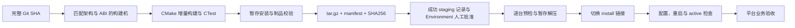

# 运维、构建和发布设计

## 边界与成功标准

`openbot.autonomy_ops` Collection 负责安装、配置、systemd 和逐机发布；CMake 负责增量构建和安装；打包脚本负责将已验证的安装树交付为 tarball；GitHub Actions 负责执行检查、保管构建产物和进入人工批准的发布环境。复用现有工具，不引入额外编排服务或制品注册中心。

开发机允许 build 模式；机器人默认 artifact 模式，不在批量部署时编译或重新安装编译依赖。成功必须包含可追溯的提交与 SHA-256、与目标匹配的架构、所选二进制完整、配置可读和服务 active。机器人业务验收仍由具体平台完成。

## 本次修复

1. `roles/build` 原本不存在，且 `build/` 被 Git 忽略。恢复真实 CMake configure/build/test/install 角色，提供 ccache、并行度和现有缓存复用，并精确放行该源码目录。
2. `vars_files` 的共享变量会遮蔽环境设置。移到 role defaults 后，robots/production 的 artifact 模式、依赖策略和 host_vars 能实际生效；共享 vault 在控制机读取。
3. 制品原本直接覆盖运行目录，旧文件残留，重复 `.bak` 拷贝还可能嵌套。改为控制机归档校验、目标机传输校验、临时解压、完整版本目录与稳定链接，保留 previous 及旧目录。
4. 打包脚本原本把 `tools/` 当仓库根、引用已删除的顶层 config，并强制重新配置 Ninja。修正根目录和组件配置布局，支持复用实际 CMake 构建，生成架构元数据和 SHA-256。
5. 服务名和 bridge 参数与现有源码不一致；更新后只 start 不保证新二进制加载。修正模板、检查 executable、按变更重启；restart 检查 unit 存在并验证 active。删除部署中无条件 `ipcrm`，避免影响活跃通信进程。
6. 配置 push 原本优先读取目标机旧 bundle。现在从控制机组件 conf 推送，由 services 根据变更状态重启；明确保留机器人专有配置文件。
7. CI 原本吞掉 Galaxy 安装错误、使用 mock builtin 模块、遗漏实际打包脚本触发路径，Molecule 也没有覆盖制品角色。改用真实模块校验、明确兼容工具版本、实际 CMake/归档/CLI 测试、环境覆盖测试与制品幂等测试；增加可选人工发布工作流。

## 交付路径

PR 检查使用 GitHub 托管 runner。原生发布构建只由手动 workflow_dispatch 进入受控 builder，不能从未受信任的 PR 自动调度。staging 验证同一 tarball 后，production 应选择同一提交、构建基线并核对制品哈希；如果再次构建，产生的是新制品，必须重新验收。工作流一次选择一个环境；使用 `artifact_run_id` 下载之前成功 staging run 中的制品原件和审计后推广；同时检查源 run 成功结论、提交和摘要，production 不再重编译。

同一目标只允许一个发布进程。workflow 的 concurrency 减少同一环境/架构的发布冲突，跨环境 inventory 不应包含同一台机器。`serial: 1` 与 `any_errors_fatal` 控制故障范围；不把 Ansible forks 当作发布批次。

## 版本、配置和运行数据

- `/opt/autonomy-releases/<sha256>`：完整安装树，发布后不再通过 build 模式写入。
- `/opt/autonomy`：当前版本链接；`/opt/autonomy.previous`：上一版本链接。
- `/etc/autonomy`：可更新的运行配置。完整部署读取制品 bundle，push 读取控制机组件 conf；同名文件会覆盖，不删除机器人专有文件。
- `/var/lib/autonomy`：服务账号 home 和运行数据；日志默认位于其 `.autonomy/log/`，不进入版本替换流程。

首次迁移真实安装目录不是零中断切换，需维护窗口。后续链接替换不覆盖正在运行的文件，服务在配置同步后重启。失败停止后续目标；已切换目标需要按 README 重新部署旧制品恢复。通过历史 Actions 制品做人工批准的回滚；不自动回滚、删除历史版本或重置运行数据，避免把进程 active 误当作机器人业务恢复成功。

制品只描述应用安装树，不承诺携带完整系统第三方动态库。builder 与机器人需使用相同 OS/架构及依赖基线。原生构建记录本机架构，不用于交叉编译；跨平台编译应另行记录工具链和目标架构，不能沿用该 manifest。

## 检查与限制

本地 CI 应验证入口模式和环境优先级、6 套 inventory、最小真实 CMake build/install、打包路径、归档越界/特殊文件/前缀/架构，以及 playbook 语法。隔离容器测试部署真实 artifact role，覆盖首次安装、重复无变更、升级不残留、previous、错误 checksum 和缺少 binary 时保持当前版本。Molecule 在 systemd 容器里额外检查 unit 启动和幂等性。

目前 active 检查不包含健康持续时间、传感器时效、定位状态、导航任务或硬件动作；生产验收应使用目标平台已有指标。release workflow 需要实际 runner、环境审批和 SSH 配置后才能运行，提交 YAML 不代表这些外部条件已就绪。

设计依据：[Ansible 变量优先级](https://docs.ansible.com/projects/ansible/latest/playbook_guide/playbooks_variables.html#understanding-variable-precedence-variable-precedence)、[错误处理与 always 清理](https://docs.ansible.com/projects/ansible/latest/playbook_guide/playbooks_blocks.html)、[unarchive 的校验边界](https://docs.ansible.com/projects/ansible/latest/collections/ansible/builtin/unarchive_module.html)。

## 参考 Autoware 规则后的补充约束

- `galaxy.yml` 定义 Collection 版本与精确外部依赖；`requirements*.txt` 锁定经过验证的控制机工具及传递依赖解析结果。CI 检查两份 collection 依赖声明一致，禁止浮动范围。
- 生产 playbook 不包含实际 tasks/post_tasks；`site.yml` 导入一个应用事务 play，而不是先对整个车队执行基线再开始部署。这样保留每台目标完整执行后才进入下一台的故障边界。profile 只选择场景，任务均在角色中。
- 10 个角色各有 tasks/main.yml、meta 依赖、输入/输出/前提说明、独立 Molecule converge。制品、构建和配置角色显式输出变更状态，services 统一处理启动、重启和验证；不依赖全局 handler 或跨角色 include_role。
- 版本锁仅在显式开关后生效，生产必须打开；精确 SHA/制品哈希与平台约束先校验。APT pins 需要真实平台版本，不自动猜测 CUDA、TensorRT 或系统包版本。当前锁定依赖安装在空 pins 下拒绝执行。
- 完整门禁为本地/CI lint + 语法/契约测试，再进入 22.04/24.04 的 services/build Molecule 矩阵，最后进入 protected environment 的发布。APT 和构建场景用受控小夹具验证角色调用链，不宣称这些夹具验证了完整第三方编译或硬件效果。
- release 工作流保存公开发布审计，输入只允许固定环境、提交和架构。生产 SSH 凭据仅配置在受批准的环境；本机的 runner 标识检查是防误用措施，不能代替凭据隔离。
- 所有 lint 例外均有原因，目前只保留既有 autonomy_* 参数命名兼容，不跳过 package-latest、changed reporting 或真实模块校验。

有意保留 `inventory/` 目录与现有变量 API；动态 CMDB inventory、AWX、全量 ABI/包锁定与业务健康指标，需要实际资产和平台数据后接入。此处不创建空插件，也不把这些条件描述成已经完成。

## 本次宿主机验证

在 Linux x86_64 宿主机、Python 3.12 控制环境执行本地门禁，并使用真实 systemd 隔离容器验证 Ubuntu 22.04 / 24.04 的 services、build 两类场景。每类覆盖 converge、二次执行 `changed=0` 和结果验证；编译场景执行小型 CMake/CTest 夹具，服务场景验证真实进程重启及未选服务保持停止。关闭依赖安装时，bootstrap 不更新 APT 或安装工具。

另外执行真实 artifact/config 角色测试，验证重复安装、升级清理、previous、配置 push，以及坏 checksum / 缺少二进制时保持当前版本；本地 lint、语法、15 项测试、inventory 覆盖与工作流静态检查通过。可选 Docker 测试在默认单测套件跳过，已单独执行通过。

本机使用已有 Ubuntu 构建镜像派生测试镜像，移除无关第三方 APT 源；24.04 镜像恢复发行版 Python 3.12。CI 仍使用声明的 systemd 镜像。以上验证不包含 ARM64、完整第三方重编译、真实机器人或 GitHub 发布环境；正式发布仍需配置 runner、审批和 SSH，并验收平台 ABI 与业务状态。

## 一键本地发布入口

`deploy.sh release <environment>` 先按 `vars/release.yml` 在指定 Docker 容器执行 colcon build，调用现有打包脚本，复制并校验归档后再进入原有 artifact playbook。控制机准备、制品准备、目标部署各自独立；失败不继续发布，目标服务与地址仍由 inventory 管理。此入口用于开发/实验环境，不用于 production 推广；生产继续使用已通过 staging 的同一制品和受审批工作流。

用户目录安装通过 `autonomy_system_install: false` 关闭系统基线和 systemd 管理，并以当前用户安装制品及配置；demo inventory 将其与关闭依赖安装一起固定。系统部署默认行为保持不变。

交叉发布复用同一制品部署入口。`cross-build` 通过共享镜像为单个 Profile 构建，在控制机生成按 SHA-256 命名的归档。`cross-release` 确认主机选择后构建一次，再将同一制品逐台分发。制品记录 Profile、目标 OS 和包架构，目标在接收前校验这些信息。安装每次使用独立暂存目录。需要刷新 sysroot 时，采集与构建使用同一 Profile 锁。生产继续使用现有制品晋级策略。入口见 [交叉编译发布](docs/cross-release.md)。

## 增量构建

`--incremental` 以源码绝对路径、Profile、sysroot 内容、实际镜像 ID、CMake 参数和工具链为缓存键，使用同一 Profile 锁串行访问缓存。交叉打包仍从空安装目录开始。增量构建用提交时间作为 CMake 的时间基准。增量打包固定归档元数据的时间与属主字段，使内容和制品元数据相同的归档保留相同的摘要。

## 增量分发

相同制品仍按归档摘要直接复用。启用增量后，目标对当前受管 release 的普通文件计算 SHA-256。控制机从已校验的完整归档生成差分和复用清单，目标验证清单、复用文件和差分摘要。暂存目录只包含新制品的内容，未变文件在目标上独立复制，旧 release 不参与写入。缺少基线、归档包含稀疏文件或差分缺少尺寸优势时使用完整归档。校验失败时清理暂存并停止。最终 release ID 仍使用原归档摘要。
