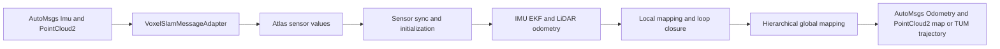

# Atlas

Atlas is a standalone C++17 SLAM library and runner. The Voxel-SLAM pipeline is
ported from the ROS package at `../../ros2/ros-perception/Voxel-SLAM` into the
PCL-free sensor types and CMake layout in this directory. ROS nodes, catkin,
ROS publishers, and ROS runtime are not used.

## Architecture



`atlas_voxel` owns the estimator and mapping algorithms. Its public sensor
types do not include protobuf headers. `atlas_automsgs` contains conversions
between those values and AutoMsgs messages. `VoxelSlamMessageAdapter` is the
application boundary: it accepts `sensor_msgs/Imu` and
`sensor_msgs/PointCloud2`, and can return the latest estimate as
`nav_msgs/Odometry`.

```cpp
atlas::app::VoxelSlamSystem system(config);
system.Start();
atlas::app::VoxelSlamMessageAdapter messages(&system);
messages.AddImu(imu_message);
messages.AddScan(point_cloud_message);

automsgs::msgs::nav_msgs::Odometry odometry;
messages.GetOdometry(&odometry, "map", "base_link");
automsgs::msgs::sensor_msgs::PointCloud2 map;
messages.GetMap(&map, "map");
```

AutoMsgs supplies message schemas and generated Protocol Buffer types. It does
not provide a publisher/subscriber runtime; an application or transport layer
must deliver messages to the adapter methods.

`VoxelSlamSystem::Stop()` drains the global-BA worker and persists the active
session when `voxel.save_path` is set. The session is written under
`<save_path>/<bagname>/` as `alidarState.txt` plus one numbered `.bin` cloud
per keyframe; `edge.txt` stores loop transforms and covariance under
`save_path` and is used with `voxel.previous_map` when loading prior sessions.
Legacy 11-column edge files remain readable and use the historical default
covariance. Call `Stop()` before
exiting if the run should produce a reloadable session. The adapter's `GetMap`
returns a snapshot assembled from the currently optimized keyframes in the
estimator's global coordinates. Its `frame_id` labels those coordinates, so
use the global frame name (normally `map`); the adapter does not transform the
cloud into another frame.

The `voxel` YAML section exposes the local/gravity BA switches, triangle loop
detector, ICP and BTC acceptance thresholds, loop-update cadence, and GBA
window/merge sizes in addition to the voxel and session settings. See
[`config/voxel_slam_default.yaml`](config/voxel_slam_default.yaml) for defaults.

## Component plugins

Trusted dynamic libraries can register component creators by exporting the
`AtlasRegisterComponents` entry point declared with
`ATLAS_COMPONENT_PLUGIN_EXPORT`. Atlas stages registration before applying it;
loaded code remains resident while its factory callbacks or created components
are still in use.

## Build

The default standalone build uses the adjacent `../automsgs` and `../autocmake`
checkouts when an installed AutoMsgs CMake package is not available. Eigen,
glog, Protobuf, and a C++17 toolchain are required; GTSAM is optional. GTest is
required only when `BUILD_TESTING` is enabled (the default).

```bash
cmake -S . -B build
cmake --build build -j
```

To build the estimator library independently of AutoMsgs, Protobuf, applications,
and GTest:

```bash
cmake -S . -B build/core \
  -DATLAS_BUILD_APPLICATIONS=OFF \
  -DATLAS_BUILD_MESSAGE_ADAPTERS=OFF \
  -DBUILD_TESTING=OFF
cmake --build build/core --target atlas_voxel -j
```

| Option | Default | Responsibility |
| --- | --- | --- |
| `ATLAS_BUILD_MESSAGE_ADAPTERS` | `ON` | Build `atlas_automsgs` protocol conversions |
| `ATLAS_BUILD_APPLICATIONS` | `ON` | Build runners and the application system; requires message adapters |
| `BUILD_TESTING` | `ON` | Find GTest and register test targets |

GTSAM is discovered in both configurations. A core-only build exercises the
estimator compilation boundary; it does not validate AutoMsgs conversion or
runner integration.

## Global optimization modules

- `map/voxel/keyframe.hpp` defines the keyframe value independently of the
  sliding octree and its local mapping configuration.
- `map/voxel/hierarchical_bundle_adjustment.hpp` exposes
  `HierarchicalBundleAdjustment` and `GlobalBundleAdjustmentConfiguration`.
- `map/voxel/global_bundle_adjustment_octree.hpp` owns voxel subdivision and
  plane-factor extraction with immutable configuration.
- `common/thread_pool.hpp` supplies a fixed worker pool and an abstract
  scheduling interface. Each global optimization worker retains its optimizer
  and pool across processing cycles. Task dependencies are not implemented yet.

The optimization headers and types replace `hierarchical_ba.hpp`,
`octree_gba.hpp`, `HierarchicalBa`, `GbaConfig`, `OctreeGba`, and
`OctreeGbaConfig`; in-tree callers have been migrated. External callers must
update these includes and names, and use `minimum_eigenvalue` in the global
optimization configuration. The odometry configuration keeps its existing
`min_eigen_value` field.

## Replay

The file replay runner accepts a dataset directory and writes a TUM trajectory:

```bash
./build/app/replay --config config/voxel_slam_default.yaml \
  --dataset /path/to/dataset --output /path/to/output
```

The replay file format and additional profiles are documented under
[`config/`](config/) and [`config/datasets/`](config/datasets/).
