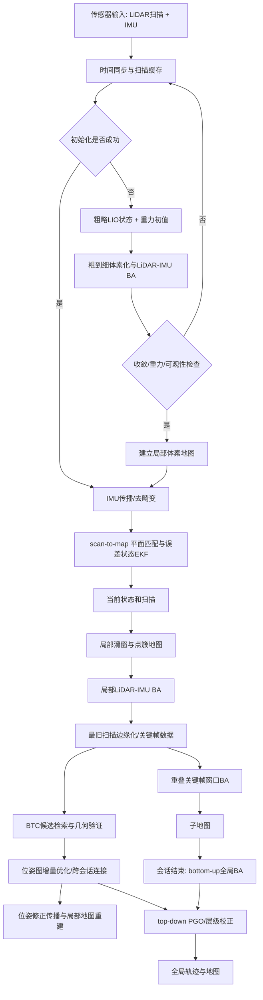

# Voxel-SLAM 源码架构与数据流程

本文对照两份源码说明架构：原始 ROS 2 实现 `/Users/quandy/Workspace/github/ros2/ros-perception/Voxel-SLAM/`，以及当前 Atlas 移植 `/Users/quandy/Workspace/github/autonomy/atlas/`。**原论文描述的是算法设计；下文“原始源码”和“Atlas 当前实现”分别说明代码实际结构，不能把论文设计自动视为两份代码都已完整实现。**

## 1. 两份源码的入口和总体结构

### 原始 ROS 2 Voxel-SLAM

原实现的算法主体主要集中在 `VoxelSLAM/src/voxelslam.cpp`，一个较大的实现文件中包含初始化、前端状态估计、局部 BA、回环、多会话图优化、全局 HBA 和 ROS 发布等职责。相邻算法文件包括 `ekf_imu.hpp`、`preintegration.hpp`、`voxel_map.hpp`、`BTC.h/.cpp`、`loop_refine.hpp`、`feature_point.hpp` 和 `tools.hpp`。ROS 2 节点与 PointCloud2 插件位于 `VoxelSLAMPointCloud2/`；配置、启动文件和 RViz 配置分别位于 `VoxelSLAM/config/`、`launch/`、`rviz_cfg/`。

程序入口位于 `voxelslam.cpp` 的 `main()`。源码中的主算法对象将 ROS 输入队列、算法状态和发布器结合在一起；`thd_odometry_localmapping()` 和 `thd_loop_closure()` 是两个主要长期运行的处理循环。局部重线性化/重切体素还会按配置建立若干短生命周期工作线程。整体因此包含“前端局部处理线程、回环与全局处理线程、局部 BA 内部并行任务”几类并发，而非简单的五个独立线程各负责一个模块。

### Atlas 移植

Atlas 把应用适配、传感器模型、前端、地图、后端、优化器和运行时组件拆成目录模块。Voxel-SLAM 的核心入口在 `atlas/atlas/frontend/trajectory_builder.hpp/.cpp`，当前应用入口通过 `app/slam_system_config.hpp/.cpp` 加载 `config/voxel_slam_default.yaml` 并构造 `VoxelSlamSystem`。目标配置仍使用这一份 YAML，通过模块区块维护参数归属；当前代码字段与目标命名的差异见[配置契约](design/configuration.md)。

当前 `TrajectoryBuilder` 是主要流水线编排类：它持有同步器、IMU EKF、初始化、局部里程计、滑窗 BA 状态、体素地图、BTC 检测器、位姿图和会话数据。它比原始 ROS 文件更清楚地按算法目录拆分实现，但编排状态仍集中在该类中。目录命名空间迁移正在进行：传感器同步/测量类型位于 `atlas::sensor`，体素点簇位于 `atlas::map`，惯性状态/滤波/预积分位于 `atlas::frontend::inertial`；前端主编排器尚待迁入 `atlas::frontend`。后台活动图统一使用 Voxel-SLAM 专用 `LoopPoseGraph`，优化通过 `FactorGraph` 输入模型直接交给唯一增量位姿图求解类（实现使用必选 GTSAM）。

## 2. 目录职责对照

| 职责 | 原始 ROS 2 源码 | Atlas 移植 |
|---|---|---|
| 节点与消息适配 | `VoxelSLAM/src/voxelslam.cpp`、`VoxelSLAMPointCloud2/src/voxelslam_pc2.*` | `atlas/app/replay_main.cpp`、`file_replay_source.*`、`voxel_slam_system.*`、`voxel_slam_message_adapter.*` |
| IMU 状态、滤波和预积分 | `ekf_imu.hpp`、`preintegration.hpp` | `atlas/atlas/frontend/inertial/` |
| 初始化 | `voxelslam.cpp` 中 `Initialization` 类及初始化调用链 | `atlas/atlas/frontend/initialization/` |
| 高频雷达里程计 | `voxelslam.cpp` 中 `lio_state_estimation()` 等 | `atlas/atlas/frontend/odometry/` |
| 滑窗局部 BA | `voxelslam.cpp` 中局部处理与 LiDAR 因子 | `atlas/atlas/frontend/local_mapping/` |
| 自适应体素/八叉树/点簇 | `voxel_map.hpp`、`feature_point.hpp` | `atlas/atlas/map/` |
| BTC 回环 | `BTC.h/.cpp` 和主文件中的候选管理 | `atlas/atlas/backend/loop_closure/triangle/` |
| 位姿图与 PGO | `voxelslam.cpp` 中 GTSAM 图构造和 ISAM2 更新 | `atlas/atlas/backend/pose_graph/`、`atlas/atlas/backend/global_mapping/` |
| 全局 HBA | `voxelslam.cpp` 中 bottom-up / top-down 处理及关联数据 | `atlas/atlas/map/hierarchical_bundle_adjustment.*` 与 `TrajectoryBuilder` 的 GBA 流程 |
| 会话地图保存 | 配置路径、前端拥有状态与兼容会话目录 | `map/serialization/session_writer.*`、`session_reader.*`；PGO 边仍由 `backend/global_mapping/pgo_edges.*` 读写 |
| 配置与运行 | ROS launch、参数 YAML、CMake package | Atlas app 配置、builder、YAML、CMake targets |

## 3. 运行时数据流

### 3.1 输入与同步

原始实现由 ROS 订阅回调收集 IMU 与雷达消息，再由算法循环取出具有时间关系的数据。Atlas 应用层把消息转换成 `sensor::ImuData` 和 `PointCloudXYZI`，交给 `Odometry::AddImu()`、`AddLidar()`；其 `SensorSync` 将时间同步和数据缓存放在算法类中。IMU 数据既供前端传播/去畸变，也供相邻状态预积分因子使用。每个雷达点的相对采样时刻用于运动补偿，因此点云时间字段和 IMU 时间戳的一致性是关键前置条件。

### 3.2 初始化阶段

启动或系统重置后，收集一个短时间窗口的扫描和 IMU。先得出粗略运动状态，再建立初始点云地图并运行 LiDAR-IMU BA。体素平面关联按粗到细方式更新；每一轮使用更新的状态重新投影/去畸变扫描并构造约束。检查优化是否收敛、重力模长是否合理、平面法向约束是否覆盖三个独立方向。通过后设置重力对齐后的世界系和初始局部地图；失败则继续采集数据或重试。

### 3.3 实时前端

对每个新扫描，IMU 样本先传播状态并补偿扫描内运动畸变。降采样点转换至 IMU/世界坐标系，与局部平面地图做 scan-to-map 匹配，使用迭代误差状态 EKF 更新状态。这个结果有两个消费者：对外提供低延迟位姿；作为局部 BA 中新状态的初值。匹配中的平面法向用来评估几何退化；短时退化由 IMU 暂时桥接，连续退化触发会话结束/系统重置策略。

### 3.4 局部滑窗与地图数据

当前扫描和估计状态进入局部窗口。活动窗口内每帧有状态、点云/点簇以及相邻 IMU 预积分数据；固定地图点簇不随活动窗口状态变化，提供世界系几何锚点。局部 BA 联合细化状态和关联平面。窗口最旧帧退出后，其点信息并入固定地图约束，并送入回环/关键帧链路。超出局部范围的体素可清理。Atlas 的 `frontend/local_mapping/LocalMapping` 提供抽象滑窗实现；Voxel-SLAM 原算法路径还包含其专用 `FrameWindow`、体素八叉树与优化缓冲区，实际执行对象需以 `Odometry` 调用链为准。

### 3.5 回环与全局修正

被边缘化的扫描先累积成更稠密的帧，达到位移/角度条件后形成关键帧并提取 BTC 描述子。候选需通过描述子匹配、点到平面几何验证、平面法向退化检测，以及漂移/行程比例检查。验证成功后形成相对位姿因子，进入位姿图。首次连接历史会话时先把新会话对齐到既有世界系；已有连通图上的新回环触发 GTSAM/ISAM2 增量优化或对应后端优化。

优化的关键帧位姿会同步到扫描和子地图。还没进位姿图的延迟帧及活动窗口由末端位姿校正传播。随后重建最近区域的前端体素地图，避免前端继续使用旧坐标系下的地图。会话数据按 session id 分组，历史地图可以加载参与多会话检索和图连接。

### 3.6 全局建图

关键帧在全局线程中以固定大小的重叠窗口做局部关键帧 BA，随后合并为子地图。会话结束或显式请求完成时，对子地图执行 bottom-up HBA，再执行 top-down 位姿/层间校正。全局建图比前端实时估计更重，可异步运行；因此需要关注队列长度、地图快照一致性、停止/收尾行为和资源占用。

## 4. 原始实现的线程与队列关系

原始代码中的 `thd_odometry_localmapping()` 同时承担里程计和局部建图主循环；`thd_loop_closure()` 消费前端边缘化的扫描/关键帧缓冲，检测回环并运行位姿图优化，同时承载 top-down 全局流程。局部 BA 的体素切分、边缘化/重切操作会按 `LocalBA/thread_num` 配置并行，默认源码参数为 5。局部到回环之间通过 `buf_lba2loop` 等队列缓冲，关键帧/子地图数据另行传递。

并发数据边界大致如下：

| 生产方 | 数据 | 消费方 | 同步重点 |
|---|---|---|---|
| ROS 输入回调 | IMU、雷达消息 | 前端主循环 | 时间戳顺序、缓存与停止状态 |
| 前端/局部 BA | 边缘化扫描、状态、点云关联 | 回环线程 | 队列锁、对象生命周期，不能过早释放点云 |
| 回环/PGO | 优化后的关键帧位姿和校正量 | 前端局部地图更新 | 坐标版本一致、延迟状态修正、地图原子替换 |
| 关键帧处理 | 关键帧和子地图数据 | 全局 BA | 不可变快照、会话边界、完成信号 |
| 局部 BA 子任务 | 八叉树/滑窗片段 | BA 汇总阶段 | 工作线程 join 后才能合并结果 |

Atlas 当前 `TrajectoryBuilder` 拥有全局 mapping 生命周期，以及用于活动体素地图重切/边缘化的固定 `common::ThreadPool`；`SlidingVoxelMapOperations` 通过线程池接口提交分区任务，等待所有 future 完成后再合并窗口或清理节点。`HierarchicalBundleAdjustment` 也复用固定线程池执行八叉树分区工作。该实现复用了线程，但尚未形成 Cartographer 式任务依赖图、优先级或可取消任务调度。

HBA 通过 `common::SessionPoseConstraints` 输出会话间关键帧相对位姿，由 backend 转换为内部 `PgoEdges` 并修改 pose graph；地图算法不再直接依赖 backend graph/edge 类型。motion initialization 通过 `MotionInitializationResult` 返回状态、迭代次数、平面可观测性特征值和重力幅值。初始化滑窗地图的建立与失败清理由 `SlidingVoxelMapOperations` 执行，地图重切片仍保持初始化原有串行顺序；BA 优化器构造、因子准备、收敛判据和预积分窗口重建仍由 `MotionInitializer` 编排，因此前端初始化与局部优化状态尚未完全解耦。

## 5. 主要数据对象与所有权

| 对象 | 表达内容 | 生命周期/用途 |
|---|---|---|
| IMU 样本 | 时间戳、角速度、线加速度、协方差/质量 | 同步、状态传播和相邻状态预积分 |
| 扫描点云 | 点坐标、强度、点时间 | 去畸变、匹配、局部 BA 和建图 |
| IMU 状态 | 姿态、位置、速度、陀螺仪/加速度计偏置 | 前端状态、滑窗变量、关键帧状态 |
| 点方差/点簇 | 点统计量及不确定度 | 平面匹配、BA、固定历史地图压缩 |
| 体素键与八叉树叶 | 空间索引、层级平面及窗口点簇 | 局部关联、滑动地图和全局平面构建 |
| ScanPose / Keyframe | 扫描或关键帧位姿、点云引用、描述子 | 回环、位姿图和多会话对齐 |
| PGO 边 | 相对变换、协方差/信息、端点 ID | 里程计链和回环约束 |
| 子地图/历史会话 | 关键帧集合、轨迹、地图数据 | HBA、跨会话检索、恢复和持久化 |

当前会话、历史关键帧、子地图、预积分器、体素树根/子节点和 FrameWindow 缓存均由 `std::unique_ptr` 管理；GTSAM/HBA/地图操作仍使用局部非拥有视图适配既有接口。HBA 请求由 `GlobalMappingRequestBuilder` 在地图锁内转成值快照并共享不可变点云；HBA 局部窗口、submap 和 residual polish 通过 backend `GlobalMappingCommitter` 校验当前版本与关键帧身份，并先验证整批数据再提交位姿。`GlobalMappingState` 持有 HBA 游标、两阶段边集和 submap 缓冲，并封装 HBA 结果提交及版本推进；TopDown 与在线增量 PGO 均通过 `PoseGraphSnapshot` 在锁外求解并检查源版本，再由 `PoseGraphCommitter` 验证多 session 身份后提交。TopDown 位姿提交、pose/map 版本递增和体素地图重建，以及在线 PGO 的滑窗/地图校正，均在地图锁临界区内完成。`TrajectoryBuilder` 仍负责阶段切换与工作循环；跨模块版本推进的其余路径和点云快照语义仍需审计。

## 6. Atlas 移植的边界和代码阅读路径

建议按以下顺序追代码，先确认真实调用关系，再对照论文模块：

1. 应用入口：`atlas/app/replay_main.cpp`、`file_replay_source.cpp`、`voxel_slam_system.cpp`、`voxel_slam_message_adapter.cpp`；应用目标由 `app/CMakeLists.txt` 管理。
2. 流水线入口和配置：`atlas/frontend/trajectory_builder.cpp/.hpp`、`trajectory_builder_options.hpp`。
3. 状态估计：`frontend/inertial/inertial_state_filter.*`、`inertial_preintegrator.*`、`frontend/odometry/`。
4. 初始化和局部 BA：`frontend/initialization/`、`frontend/local_mapping/`。
5. 地图数据结构：`map/sliding_voxel_tree.hpp`、`sliding_voxel_map_operations.*`、`point_cluster.hpp`、`voxel_plane_map.*`、`hierarchical_bundle_adjustment.*`。自适应地图、KD-tree 地图、占据栅格和通用地图 facade 原先只有零字节占位，已删除，不属于当前实现。
6. 回环和 PGO：`backend/loop_closure/triangle/` 生成候选和已验证约束；前端/后端之间的相对位姿值通过 `common/relative_pose_constraint.hpp` 传递；`backend/pose_graph/` 管理领域图、因子图、GTSAM ISAM2 求解和回滚；`backend/global_mapping/` 组装跨会话问题并协调提交。未接入产品的同步图封装已移除。
7. 多会话、完成与恢复：`frontend/trajectory_builder_session.cpp` 中会话快照构造，`map/serialization/session_writer.*` / `session_reader.*` 中兼容格式文件读写，以及 `backend/global_mapping/previous_session_loader.*` 中历史关键帧和 BTC 索引装配；`GlobalMapping` 负责 GBA worker 生命周期和串行唤醒，`GlobalMappingRequestBuilder` 负责局部/submap/residual HBA 请求快照，`GlobalMappingOptimizer` 负责 HBA 计算，`GlobalMappingCommitter` 负责结果版本、身份验证及整批位姿写入。`TrajectoryBuilder::RunGlobalMappingWork()` 仍切换阶段并编排调用；`RunTopDownPgo()` 负责跨 session 优化流程，结果由 `PoseGraphCommitter` 统一校验并提交。

应用的当前调用链为 `replay_main` → `LoadSlamSystemConfig` 和 `FileReplaySource` → `VoxelSlamSystem` → `TrajectoryBuilder` → `TrajectoryBuilder::Process`。AutoMsgs 消息转换由 `VoxelSlamMessageAdapter` 保持在应用边界。`atlas_voxel` 现在要求 GTSAM；`TrajectoryBuilder` 的全局图求解失败后仍有另一条按会话扁平化图数据再尝试的路径，但它同样调用 GTSAM，不是无 GTSAM 的算法回退。

Atlas 的目录边界比原始单文件组织更利于替换传感器适配、优化器或地图实现，但当前 `TrajectoryBuilder` 仍承载多模块协调职责。后续架构演进的重点是把阶段切换与工作循环移至 backend，完成跨模块 map/session 版本推进审计，并明确后台任务收尾协议和地图数据所有权。

## 7. 与算法数学文档的关系

本文侧重源码位置、运行线程、数据对象和调用顺序。算法公式与逐步推导见 [Voxel-SLAM 论文中文翻译与数学解读](../reference/voxel-slam-paper-zh.md) 中“各模块的数学原理”章节。遇到实现与论文描述不一致时，应分别记录“论文方法”和“当前代码行为”，并以对应源码路径和函数调用为证据。

