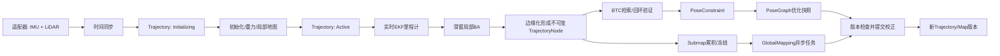

# Voxel-SLAM 架构设计：借鉴 Cartographer 的概念边界

## 1. 目标

本文为 Atlas 中 Voxel-SLAM 的后续重构定义概念模型和目录建议。参考当前仓库内 `autonomy/localization/cartographer/mapping/` 的 `TrajectoryNode`、`PoseGraph`、`Submap`、强类型 ID、轨迹状态、连接关系和后台任务调度方式；只借鉴已经解决的工程问题，不照搬二维/三维栅格地图、概率栅格匹配、proto 持久化或 Cartographer 的全部类层级。

目标是让代码能清楚回答：一条建图轨迹由什么组成；扫描何时成为图节点；节点数据与优化位姿如何分离；子地图何时创建/冻结；回环约束如何连接会话；后台优化如何读取一致快照并提交版本化结果。约束为 C++17、低延迟前端、并行后台、高性能点云处理、核心不依赖 ROS，以及新增类型和成员使用完整清晰的英文名称。

## 2. 工程组织方式：先定边界，再落类与文件

工程按“应用组装 -> SLAM 流水线 -> 领域模块 -> 算法与存储适配”的依赖方向组织。每层只调用下一层公开的窄接口；数据向上通过明确结果返回，后台结果通过带版本的消息提交。ROS、MCAP、文件序列化、GTSAM 等外部依赖都留在边界适配层，领域模型不依赖它们。

目录与模块设计采用自顶而下、自下而上的闭环：自顶而下从单/多会话建图流程推导责任和接口；自下而上对照 Voxel-SLAM 原实现及 Atlas 当前调用、状态所有权、线程和性能约束验证并修订。原始算法到目标目录的逐项映射、两种方向的检查问题及汇合规则见[项目目录树设计](design/project-tree.md#自顶而下与自下而上的设计闭环)。任何没有源码/算法依据的抽象暂不引入，任何原始算法能力都必须有迁移落点。

构建/发布单元继续沿用 Atlas 现有 CMake 工程和组件目标，不为了架构图额外创造独立 package。核心库负责算法和数据模型；应用层提供离线回放、消息适配和命令行入口；配置和文档独立；测试按模块现有组织。标准下限为 C++17。

### 分层关系

```text
应用与适配层 (app)
    ↓ 创建并连接
系统门面与流水线 (MappingService / TrajectoryBuilder)
    ↓ 调用稳定接口
领域模块 (Initialization / Frontend / LocalMapping / LoopClosure / GlobalMapping)
    ↓ 读写显式领域数据
Trajectory + Node + Submap + Constraint + VoxelMap
    ↓ 通过适配器调用
算法和基础设施 (EKF / BALM2 / BTC / HBA / GTSAM / ThreadPool / Serializer)
```

**依赖规则：** app 可以依赖所有面向调用者的接口；协调器依赖领域接口，不直接构造 GTSAM 因子；节点和轨迹模型不得包含 ROS message、GTSAM 类型或文件路径；Voxel-SLAM 位姿图输入使用 Atlas 因子图数据模型，GTSAM 仅由 `backend/pose_graph/pose_graph_solver.*` 封装；模块之间不互相读取对方的私有容器。优化器兼容设计见[因子图优化](design/optimization.md)。

## 3. 目标目录树

目录树必须适配 Voxel-SLAM 实际移植，而非泛化 SLAM 模板：明确保留初始化、IMU EKF/预积分、实时 LIO、局部 LiDAR-IMU BA、自适应体素地图、BTC、增量 PGO、多会话和 HBA 的迁移落点；ROS/AutoMsgs 只处在输入输出边界。Cartographer 借鉴限于领域命名、`internal/` 实现边界、前后端异步快照等工程经验。

完整目标树、原始文件到 Atlas 的迁移映射、模块依赖和当前目录收敛项见[面向 Voxel-SLAM 移植的项目目录树](design/project-tree.md)。该树沿用 Atlas 当前工程根、CMake targets 和现有模块；文件移动按算法链增量执行，不代表所有目标文件已经落地。

不创建空 `examples/`。示例首先按任务写在 README/docs，并复用现有 app、转换工具和 config；当有独立可运行 demo 可执行程序时再按仓库 CMake 约定组织，且每个示例都要能给出具体命令、输入、配置和输出。

## 4. 模块划分与职责

| 模块 | 拥有的状态 | 接收 | 输出 | 明确不负责 |
|---|---|---|---|---|
| `MappingService` | 生命周期入口与配置快照 | sensor 数据/完成请求 | 状态、轨迹、地图快照 | BA、回环搜索和图优化细节 |
| `TrajectoryBuilder` | 当前活动 trajectory、顺序和版本提交点 | 有序传感器包、模块结果 | 下游任务与对外事件 | 几何运算、GTSAM 因子构造 |
| `frontend` | IMU 状态、当前扫描和局部窗口 | 有序传感器包、只读局部地图 | 低延迟状态、局部优化节点 | 跨会话图管理和持久化 |
| `backend` | 已提交节点、约束、子地图和异步优化任务 | 不可变关键帧/子地图快照 | 回环约束、全局 pose updates | 直接阻塞实时前端 |
| `Initialization` | 初始化窗口和成功判定过程 | LiDAR、IMU、粗略状态 | 初始状态、重力、局部地图 | 管理历史会话和持久化 |
| `Odometry` / frontend | EKF 状态、当前局部匹配上下文 | 同步扫描、IMU、地图只读视图 | 低延迟状态、退化质量 | 管理全局子地图和 GBA worker |
| `LocalMapping` | 有界滑窗与固定点簇引用 | 前端状态、扫描、预积分 | 更新状态、边缘化 node | 直接触发会话存盘 |
| `LoopClosure` | BTC 索引和待验证候选 | 不可变 node data | 已验证 `PoseConstraint` | 直接修改前端体素地图 |
| `PoseGraph` | node/submap 位姿、约束、trajectory 连通关系 | 已验证约束 | 版本化优化结果 | 持有完整原始点云 |
| `GlobalMapping` | 有界任务队列、子地图快照和 worker 生命周期 | 完成/稳定子地图快照 | 优化结果、新 map version | 在求解期间锁住前端地图 |
| `TrajectoryStore` / `MapStore` | ID 索引、元数据、快照版本 | 节点/子地图提交 | 只读查询和快照 | 执行传感器估计 |
| `Runtime executor` | worker、任务队列与停止状态 | 有界任务 | 完成/失败结果 | 理解 SLAM 几何语义 |

先以模块接口和所有权拆分，不要求每一行算法都从 `Odometry` 迁走。`TrajectoryBuilder` 不能成为新的万能类：它只调度状态转换和数据交接；节点/地图块存储和优化任务分别有明确 owner。若两个类只是转发方法且没有独立状态、并发边界或替换价值，应合并而不是保留 facade。

## 5. 数据流与生命周期



生命周期规则：一条 `Trajectory` 初始化失败时不得发布为 active；持续退化时结束或标记旧轨迹，再启动新 trajectory；局部滑窗只持有有限帧；边缘化后产生的 `TrajectoryNodeData` 不可变；Submap 达到窗口/重叠策略后冻结其观测内容；loop/GBA 任务只读快照并标注源版本；结果提交前确认 trajectory 和版本仍匹配；完成时先停止接收新任务，再排空/取消后台任务，然后保存最后一致快照。

## 6. 文件和命名规范

### 文件布局

- 一个头文件声明一个主要类型或一组紧密相关的值类型；实现放同名 `.cpp`。模板、纯值类型和极短 inline 逻辑留在头文件。
- 新文件名用小写 `snake_case`，以领域名词或职责结尾：`trajectory_node.hpp`、`pose_constraint.hpp`、`pipeline_coordinator.cpp`、`global_mapping_worker.cpp`。
- 不使用 `misc`、`manager`、`helper`、`utils` 作为新模块名；确实是管理器时用具体对象命名，如 `TrajectoryStore`、`LoopClosureIndex`。
- 文件夹直接表达模块职责，避免重复叠词。例如 `backend/pose_graph/pose_graph_optimizer.hpp` 可以接受；`backend/backend_core/graph_engine/graph_manager.hpp` 层级过深。
- 对外接口放在拥有该领域概念的目录内，避免单独建只有一个头文件的 `interfaces/`。

### C++ 标识符

- 类型、枚举、函数和方法使用 `UpperCamelCase`；变量和成员使用 `snake_case`；常量使用 `kUpperCamelCase`，遵循 Google C++ 风格。
- 不用自造或非必要缩写：新代码写 `trajectory_sequence_number`、`keyframe_identifier`、`global_mapping_request`，不写 `traj_seq`、`kf_id`、`gba_req`。标准领域词 IMU、LiDAR、BA、PGO 可保留。
- 类型名明确区分 `TrajectoryId`、`NodeId`、`SubmapId`。避免裸 `int id`、布尔参数 `AddNode(..., true)`；使用具名 options 或 enum。
- 方法表达动作和结果：`CreateTrajectory`、`FinishTrajectory`、`AddNodeToSubmap`、`ApplyOptimizationResult`；避免 `DoProcess`、`UpdateData`。
- 公开状态迁移返回明确成功/错误信息，C++17 用 enum + result struct，不依赖 `std::expected`。

### 模块文件清单

详细文件名按领域拆分，避免把实现清单和顶层架构原则混在一份长文档中。各子文档中的路径均为**目标设计名**，不表示源码已存在；路径根目录与拆分原则见 [文件命名总览](design/README.md)。

- [应用与流水线编排](design/application-and-pipeline.md)
- [Trajectory、Node 与 Submap 模型](design/trajectory-and-map.md)
- [初始化、里程计与局部建图](design/frontend-and-local-mapping.md)
- [回环、位姿图与全局建图](design/backend-and-global-mapping.md)
- [运行时、持久化与测试](design/runtime-and-storage.md)

### 新建与合并规则

新建文件前先找同目录现有职责。只有满足以下至少一项才拆独立文件：拥有长期状态；需要独立替换/模拟；是清楚的算法边界；并发或资源生命周期需要隔离。纯数据模型可按一个领域概念集中，不为每个 struct 建一对空文件。Cartographer 风格使用领域名词作为短文件名，`_interface` 表示契约，`_2d`/`_3d` 表示确有必要的算法变体，`internal/` 放实现细节。

对现有文件的改名采用两步：先冻结目标名称和类职责清单，再做机械移动/改 include，最后单独验证构建。名称迁移不能顺手改变算法阈值、数据关联或序列化兼容性。

## 7. C++17 与性能预算

- ABI 和语言标准保持 C++17；不使用 concepts、`std::span`、`std::expected` 等 C++20 API。需要 view 时使用项目已有 Eigen/容器引用模式或轻量只读 view 类型。
- 大型点云、体素快照和节点观测跨线程通过 `std::shared_ptr<const T>` 共享；位姿、ID、小型固定矩阵按值传递；避免裸 owning pointer。
- 前端每帧处理路径不等待全局 BA，不做全局容器复制；滑窗容量固定上限并复用缓冲区。
- 全局任务不持有活动地图锁做优化。先创建快照，后台求解，结果回到短临界区校验版本并提交。
- 线程池任务有容量、优先级/过载策略和停止语义；不在每扫描内创建销毁线程。若 Atlas 现有 `common::ThreadPool` 满足需要，复用而不引入新的 runtime 框架。
- `MapVersion` 与 `TrajectoryId` 随异步请求返回；过期结果不能覆盖更新地图。点云共享对象一旦发布即 const，地图变更发布新快照。

## 8. 设计借鉴原则

### 借鉴

- **Trajectory 作为会话/建图单元**：管理一段连续采集的节点和子地图，具有唯一 ID、生命周期和与其他轨迹的连接关系。它解决当前用 `cur_session_id_`、`mp`、`relc_counts_` 等多个整数/数组平行表达会话状态的问题。
- **Node 作为不可变观测数据与可变图位姿的组合**：点云、时间、IMU 区间、BTC 描述子等观测数据稳定后应只读共享；全局优化位姿独立存放并可按版本更新。借鉴 Cartographer `TrajectoryNode::Data` 的 `shared_ptr<const Data>` 生命周期思想。
- **Submap 表达一组局部观测和其优化坐标**：将关键帧/扫描集合聚成有重叠关系的局部地图块，优化其位姿，建立 node-to-submap 关联。不要把当前 `Keyframe` 同时作为关键帧、子地图、GBA 聚合块和原始点云 owner。
- **Constraint 是显式的一等数据**：里程计边、回环边、跨轨迹初始对齐、node-submap 匹配具有来源、测量、协方差、验证状态和端点 ID，进入 pose graph 前有明确验证。
- **后台计算消费快照，主线程提交结果**：任务持有不可变输入快照，结果携带地图版本和修正量；仅在受控提交边界更新活动图/局部地图。

### 不照搬

- 不引入 Cartographer 的 `MapBuilder` / `TrajectoryBuilder` 全部继承体系；Voxel-SLAM 的前端和 GBA 流程已具备专门的算法接口。
- 不把每个原始 LiDAR 点都升级为全局 pose graph node。图节点应对应稳定关键帧或子地图锚点，原始扫描保留在局部优化/子地图数据中。
- 不使用单一万能 `Node` 名称。新 API 使用 `TrajectoryNode`、`SubmapNode` 或清晰的 `NodeId` 语义，避免和 ROS node、线程节点混淆。
- 不复制 Cartographer 的 protobuf 作为运行时核心对象；运行时以轻量 C++17 值类型和共享只读数据为主，序列化只发生在 persistence 边界。
- 不为论文的每个模块新建转发 facade。只有拥有状态、执行明确状态变更或隔离资源生命周期的模块才单独成类。

## 9. Cartographer 概念到 Voxel-SLAM 数据模型的映射

### 3.1 ID 与版本

使用不相混淆的强类型 ID，而非在公开接口中传裸 `int`：

```cpp
struct TrajectoryId {
  std::uint32_t value = 0;
};

struct NodeId {
  TrajectoryId trajectory_id;
  std::uint64_t sequence_number = 0;
};

struct SubmapId {
  TrajectoryId trajectory_id;
  std::uint64_t sequence_number = 0;
};

struct MapVersion {
  std::uint64_t value = 0;
};
```

ID 类型应提供比较、哈希和有效性检查；禁止隐式互转。跨会话 node/submap 的身份由 `TrajectoryId + sequence_number` 唯一确定。版本号用于拒绝过期 GBA 结果和诊断地图校正竞争。

### 3.2 Trajectory

`Trajectory` 是一段采集会话及其可优化状态，不是线程，也不是一条只含位姿的向量。

```cpp
enum class TrajectoryState {
  kInitializing,
  kActive,
  kDegraded,
  kFinished,
  kFrozen,
};

struct Trajectory {
  TrajectoryId id;
  TrajectoryState state = TrajectoryState::kInitializing;
  std::vector<NodeId> node_identifiers;
  std::vector<SubmapId> submap_ids;
  MapVersion map_version;
};
```

这里的 `vector` 只作模型示意。大规模轨迹实现要使用追加友好的存储/索引，避免在实时线程中复制整条向量。轨迹元数据由 session/trajectory store 管理，点云不直接嵌入 `Trajectory`。

状态转换建议为：`kInitializing -> kActive -> kFinished`；持续退化可从 `kActive -> kDegraded`，随后重新初始化新轨迹；完成会话后可按策略冻结为 `kFrozen`。Frozen 表示其位姿不再被常规优化移动，和“数据只读”不是一回事。

### 3.3 TrajectoryNode / NodeData

```cpp
struct TrajectoryNodeData {
  double timestamp_seconds = 0.0;
  InertialState local_state;
  std::shared_ptr<const sensor::PointCloudXYZI> point_cloud;
  std::shared_ptr<const std::vector<TriangleDescriptor>> loop_descriptors;
  std::vector<sensor::ImuData> imu_measurements_from_previous_node;
};

struct TrajectoryNode {
  NodeId id;
  std::shared_ptr<const TrajectoryNodeData> constant_data;
  transform::Rigid3d global_pose = transform::Rigid3d::Identity();
  MapVersion pose_version;
};
```

`constant_data` 构造并发布后不可变，可被可视化、回环和存盘任务并发读取；全局位姿由 pose graph 管理，不要求重写点云。避免对共享可变 `Keyframe*` 同时做回环位姿更新、全局 BA 和地图拼接。实时前端的当前扫描仍可使用独立 mutable buffer，只有边缘化/关键帧提交时才转成不可变 node data。

### 3.4 Submap

```cpp
enum class SubmapState {
  kAccumulating,
  kFinished,
  kOptimizing,
};

struct Submap {
  SubmapId id;
  SubmapState state = SubmapState::kAccumulating;
  std::vector<NodeId> node_identifiers;
  std::shared_ptr<const MapSnapshot> voxel_map;
  transform::Rigid3d local_pose = transform::Rigid3d::Identity();
  MapVersion map_version;
};
```

Voxel-SLAM 论文的数据金字塔是“扫描 -> 关键帧 -> 子地图”。因此 `Submap` 应表示关键帧/扫描聚合产生的局部几何实体，而非单纯再命名现有 `Keyframe`。构建完成后固定其点数据快照；优化可更新子地图全局位姿，或生成新的地图快照版本。重叠窗口使相邻子地图共享部分关键帧，关联关系要显式记录，不能仅靠数组索引推断。

### 3.5 Constraint / PoseGraph

```cpp
enum class ConstraintKind {
  kOdometry,
  kLocalScanToSubmap,
  kLoopClosure,
  kInterTrajectoryAlignment,
};

struct PoseConstraint {
  NodeId from_node;
  NodeId to_node;
  transform::Rigid3d measured_relative_pose;
  Eigen::Matrix<double, 6, 6> covariance;
  ConstraintKind kind = ConstraintKind::kOdometry;
  bool verified = false;
};
```

图优化器只消费通过有效性检查的约束和初值，并返回 Atlas 定义的优化结果，其中包括目标 `MapVersion`、优化后的 pose 更新、残差统计和失败状态。不要让 GTSAM 的 `Values`/`NonlinearFactorGraph` 暴露到前端、数据模型或优化公共接口；当前仅实现唯一的增量位姿图求解路径；不保留多优化器能力协商或静默回退。

跨轨迹连接需要单独保存轨迹间变换及其时间/来源，不要把首次对齐当成普通同轨迹 loop edge 丢失语义。维护 trajectory connectivity graph 便于发现连通地图簇、冻结或独立导出会话。

## 10. 线程和高性能约束

### 前端与后台任务

参考 Cartographer 的异步 constraint search / optimization 思路，但不照搬其 scheduler。Atlas 可以保留单一高优先级前端执行上下文，并使用有界任务池做并行匹配、局部体素工作或后台全局 BA。全局任务输入是只读快照：

```cpp
struct GlobalMappingRequest {
  TrajectoryId trajectory_id;
  MapVersion source_version;
  std::shared_ptr<const GlobalMapSnapshot> snapshot;
};

struct GlobalMappingResult {
  TrajectoryId trajectory_id;
  MapVersion source_version;
  std::vector<PoseUpdate> pose_updates;
  bool success = false;
};
```

提交结果时比较轨迹 ID 和版本：版本过期则丢弃或在新快照上重算，不能把旧优化写回新地图。停止流程应先拒收新任务，再 drain 或显式 cancel 队列，等待 worker 完成，最后持久化最后一个一致版本。

### 资源预算

- 前端队列应有容量上限和过载策略；过载时优先保留最新可处理数据，并显式记录丢弃/延迟，而不是无限堆积。
- 点云只读快照尽量通过 `shared_ptr<const T>` 传递，避免大对象深拷贝；小型状态和 ID 按值传递。
- voxel worker 根据体素块/窗口块分片，避免多个线程写同一容器；先局部归约，再单线程或分区提交。
- 不在热路径反复分配每点临时对象；复用 scratch buffers、预分配滑窗容量、按块处理点云。
- 任何锁都要有明确 owner 和锁顺序；不要让优化器在持有全局地图锁时做长耗时求解。
- C++17 标准库没有 `std::expected`，错误结果可用明确的 status enum + result struct 表达，避免异常控制正常迭代。

## 11. 从现有 Atlas 渐进迁移

1. **定义强类型 ID 和节点数据快照**：保留现有 int 字段，通过边界转换逐步迁移；先让新增数据流使用强类型，不做一次性全仓替换。
2. **把 keyframe 语义拆清楚**：`Keyframe` 先拆为关键帧身份/状态和 `shared_ptr<const KeyframeData>`；HBA 聚合块另建 `Submap`，停止复用同一 `Keyframe` 结构表达不同粒度。
3. **建立 TrajectoryStore 与连接图**：将当前 session counters、keyframe ranges、previous session vectors 收敛到轨迹元数据和连通关系。先提供兼容查询，迁移调用方后移除并行状态。
4. **抽取 PoseConstraint 与优化结果**：将 PGO edge 中的 from/to、相对测量、协方差、来源和验证状态集中为类型；唯一求解实现只做 Atlas 因子与第三方因子的映射和求解。
5. **抽离 TrajectoryBuilder**：`TrajectoryBuilder` 直接作为前端编排入口；当前只有一个实现，因此不保留无替换需求的 `TrajectoryBuilderInterface`。
6. **把 GBA worker 移到 GlobalMapping**：外部只调用 submit/finalize，输入快照和返回版本显式；取消 `Odometry` 对全局 worker 内部缓冲的直接拥有。
7. **最终清理重复 graph/global facade**：只保留实际承载活动 PGO 状态的 `LoopPoseGraph` 和唯一的增量位姿图优化类；`BackendRunner` 与同步 `PoseGraph` 无产品调用，已删除。继续明确 `GlobalMapping` 与 `TrajectoryBuilder` 的任务和缓冲所有权。

每一步保持可编译、保持公开配置可兼容，并能独立回滚。避免同一阶段同时改变状态估计算法、点云过滤阈值或回环门限，以便把性能变化归因到架构改动。

## 12. 现阶段结论

Atlas 已拥有许多合适的算法目录和组件，但 `TrajectoryBuilder` 仍承担过多编排与生命周期状态；现有 `Keyframe` 同时带位姿、点云共享指针、会话编号和遍历距离，容易把关键帧、会话成员和子地图聚合物混成一个概念。Cartographer 的价值不在于增加类数量，而在于稳定的 ID、Trajectory 生命周期、Node 不可变观测、Submap 成员关系、显式 constraints、连通状态及异步任务边界。

建议先实施 ID/immutable node snapshot/trajectory lifecycle，再抽 coordinator 与 global mapping worker。`Node`/`Submap` 分离、跨轨迹连通图和 versioned commit 是目标模型；细节应以当前 Atlas 调用链和性能测量为准，避免为了模仿 Cartographer 而改变 Voxel-SLAM 原有数据关联和 HBA 分层。

## 参考源码

- Atlas Cartographer：`autonomy/localization/cartographer/mapping/trajectory_node.hpp`、`pose_graph.hpp`、`internal/pose_graph_storage.hpp`、`mapping/submaps.hpp`、`common/thread_pool.hpp`。
- Atlas Voxel-SLAM：`atlas/atlas/frontend/trajectory_builder.hpp`、`atlas/atlas/map/keyframe.hpp`、`atlas/atlas/backend/pose_graph/loop_pose_graph.hpp`、`atlas/atlas/backend/global_mapping/global_mapping.hpp`。
- 原始 Voxel-SLAM：`/Users/quandy/Workspace/github/ros2/ros-perception/Voxel-SLAM/VoxelSLAM/src/voxelslam.cpp`。
