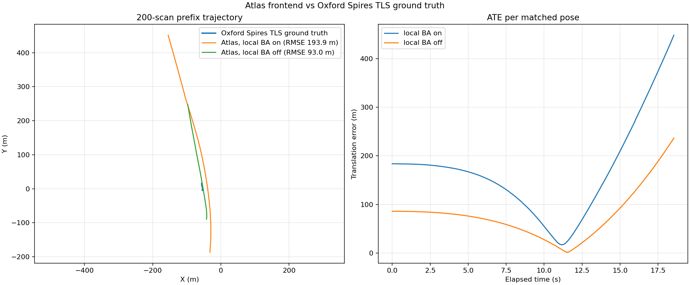

# Oxford Spires 200 帧前缀轨迹评测

> **状态：重构前临时诊断，不是正式验收。** 用户要求先完成代码重构，再进行数据集评测。下列结果仅用于记录此前定位问题时的观察；最终评测必须在重构收尾后重新运行，并以正式结果替换或另建报告。

## 评测范围

- 数据集序列：`2024-03-14-blenheim-palace-05`。
- 输入：前 200 帧原始 LiDAR 扫描及对应原始 IMU，非 ROS 格式。
- 算法范围：Atlas 前端；回环检测和全局映射/全局优化关闭。
- 参数：遵循原 Voxel-SLAM `hesai.yaml` 的 Hesai 传感器参数（盲区 0.7 m、点过滤步长 1、IMU 协方差参数 0.01/1、点云噪声 0.01/0.01、降采样 0.1 m、体素 1 m、局部窗口 10、IMU 因子系数 0.000025）；LiDAR→IMU 外参取 Oxford Spires 发布的本序列传感器标定。
- 回放状态：motion initialization 成功；默认配置和局部 BA 关闭对照均输出 187 个位姿，全部匹配到真值。最大时间戳差 0.021920 s。
- 真值定义：Oxford Spires `gt-tum.txt` 中的 `base` 坐标系位姿。估计的 IMU 位姿使用发布的 LiDAR/IMU 标定和 `base`-LiDAR 外参转换到 `base` 坐标系。
- 对齐：估计位置轨迹分别执行刚体 SE(3) Umeyama 对齐，不估计尺度；每个估计时间戳匹配最近真值，最大允许时间差 0.05 s。ATE 定义为对齐后的三维平移误差 RMSE。

## ATE / RMSE

| 前端设置 | 匹配数 | 平移 ATE RMSE | 均值 | 中位数 | P95 | 最大值 | 估计路径长度 | 峰值速度 |
|---|---:|---:|---:|---:|---:|---:|---:|---:|
| 默认（局部 BA 开启） | 187/187 | **193.930409 m** | 168.097488 m | 167.377370 m | 381.485007 m | 447.857776 m | 656.162525 m | 74.448 m/s |
| 诊断消融（局部 BA 关闭） | 187/187 | **92.954168 m** | 77.981697 m | 75.386283 m | 193.672840 m | 236.556119 m | 343.657580 m | 49.265 m/s |
| 真值 | — | — | — | — | — | — | 20.643877 m | — |

按原始 Hesai 参数运行仍严重发散。关闭局部 BA 后 ATE 有所降低，但结果仍不可用；因此局部 BA 会加剧误差，却不是唯一根因。默认配置末段峰值速度 74.45 m/s，与该段真实手持采集速度不符。

## 轨迹与真实采集数据对比

逐帧数据见 [轨迹比较 CSV](oxford-spires-200-prefix-trajectory-comparison.csv)、[默认配置的对齐估计轨迹](oxford-spires-200-prefix-estimated-base-aligned.tum)、[关闭局部 BA 的对齐估计轨迹](oxford-spires-200-prefix-estimated-base-without-local-ba-aligned.tum)、[匹配真值轨迹](oxford-spires-200-prefix-ground-truth-matched.tum) 和 [原始估计 IMU 轨迹](oxford-spires-200-prefix-estimated-imu-raw.tum)。

Oxford Spires 是真实采集的背包/手持多传感器数据；此处与离线 TLS 地图配准轨迹比较，不是正在运行的真机在线对比。官方说明真值为 base 位姿并由 LiDAR/TLS 配准得到：[数据集主页](https://dynamic.robots.ox.ac.uk/datasets/oxford-spires/)、[Ground Truth 说明](https://github.com/ori-drs/oxford_spires_dataset/wiki/Ground-Truth)。

## 暂存观察（不得作为最终指标）

1. 这些仅是约 20 秒、200 帧前缀的重构过程诊断，不代表正式 Oxford Spires 基准结果。
2. 参数消融显示局部 BA 会加剧误差，但关闭局部 BA 后仍发散；正式评测前应先完成重构及代码级验证。
3. 后续正式评测使用该序列官方 IMU/LiDAR 标定、数据集 Hesai 传感器参数和重构后的默认配置；保留参数快照、命令、回放日志和轨迹文件以便复现。
4. 完成前端及 backend 重构后，再分阶段评估完整序列、回环/全局优化、ATE/RMSE、吞吐和内存。
