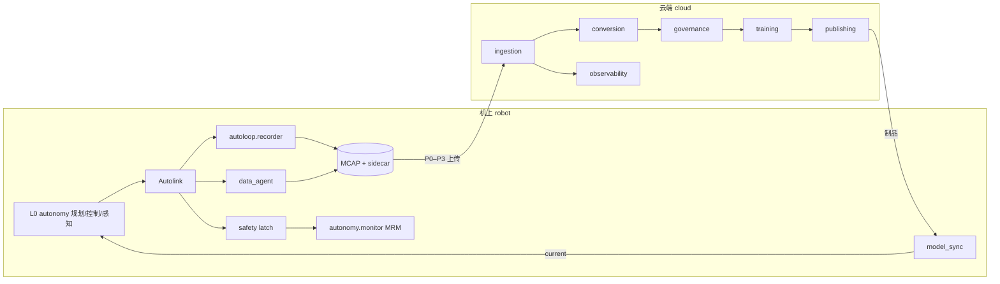
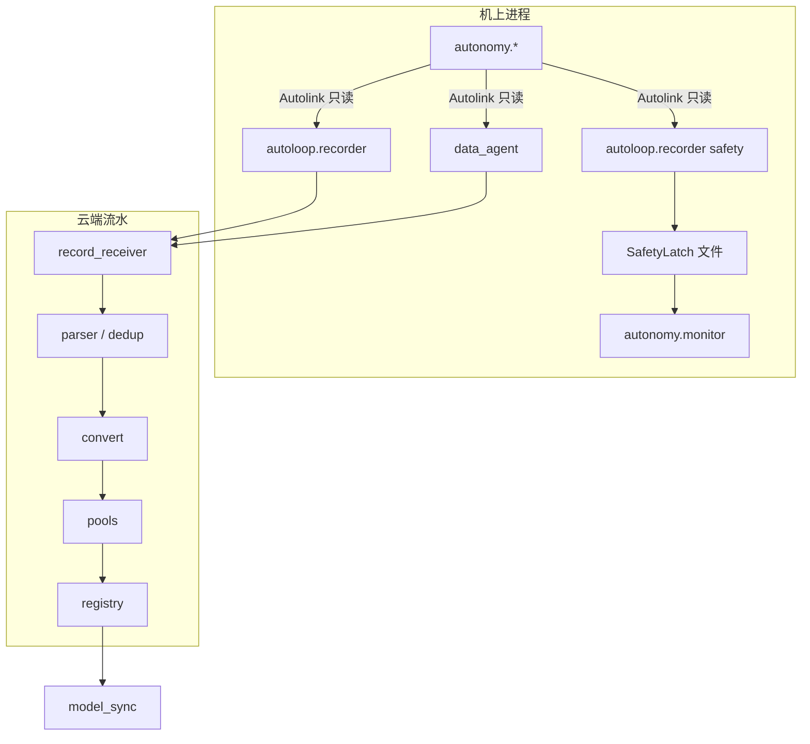

# 03 架构

Autoloop 把一次业务失败变成可归档对象。机上三条独立路径：`autoloop.recorder`（L1 采集 + flush 时 L2–L6）、`data_agent`（上传 / 遥测）、`autoloop.recorder safety` / `safety_guard`（L4 闩锁）。云端只消费证据。Bridge 不参与采集。

## 飞轮

一次最小闭环：**触发落盘 → 准入归档 → 转换 / 治理 → 训练或回归 → 发布 → 机上切换 → 下一 episode 四元组带上新 `policy_version`**。

## 职责切分

| 域 | 做什么 | 不做什么 |
|----|--------|----------|
| `autonomy` L0 | 规划、控制、感知、任务 | 不被 Autoloop 改源码、不插 `/cmd_vel` 转发 |
| `autoloop.recorder` | 机上证据 overlay（L1–L6 采集与 sidecar） | 不发 `/cmd_vel`、不调度训练 |
| `data_agent` | ring / 触发 / MCAP / 上传队列 / 遥测 | 不替代 recorder 的事件图；不发布控制 |
| `model_sync` | 拉模型、校验四元组、切 `current` | 不在任务 RUNNING 中途热切 |
| `autoloop.cloud` | 入库、转换、治理、训练入口、发布、诊断 | 不远程刹停机器人 |
| autoviz / dashboards | 只读 MCAP + sidecar + 指标 | 不写控制通道 |

`drivers` / `localization` / `navigation` / `perception` 在 Autoloop 树内是 **loop-runtime 接口**，供仿真回放与机上代理对接；家居导航本体仍在 `autonomy/`。

## 进程拓扑

采集进程与控制进程隔离。上传失败只积压，不阻塞订阅回调。

## 分层与源文件

| 层 | Autoloop 落点 | 判定 |
|----|---------------|------|
| L0 本体 | 不修改 | 控制图不变 |
| L1 捕获 | `robot/recorder` + `robot/data_agent` | MCAP 可 `RecoverMcap` |
| L2 时间因果 | recorder `event_graph`；云 `trace_index` | 窗内共现，非物理因果 |
| L3 归因 | `bt_attribution` / 任务 feedback / 定位质量 | 节点名可检索 |
| L4 安全 | `safety_monitor` / `safety_guard` + SHA-256 链 | 只闩不控 |
| L5 度量 | recorder `metrics`；`telemetry_gate` | MPS/MPD、接管率 |
| L6 回放 | recorder `replay` / `player`；`cloud/simulation` | 四元组一致才算正式 |

`RunEvidencePipeline` 无 Autolink 依赖，可单测。云端 Python 训练在 `cloud/training/`，不链入采集 binary。实现成熟度与缺口见 [15 TODO](15_todo.md)。

## 与相邻域

| 域 | 关系 |
|----|------|
| `SafetyLatch` | 急停与 L4 Fallback 的进程间文件闩；Bridge E-Stop 共用。 |
| `autonomy.monitor` MRM | 读闩后执行停机；Autoloop 不实现制动。 |
| `BtStatusLogger` | 发布 `/behavior_tree/log`；recorder 只订阅。 |
| gRPC Bridge | 健康 / 急停 / 改参；采集不经 Bridge。 |
| autoviz Record | 播放 `.mcap` / `.record`。 |
| autoviz Evidence | 读 `.sidecar.json`；写 `.observations.jsonl`。 |
| EventBundler | P0 可写危险指针 manifest，不调用 bundler API。 |

## 构建入口

| 系统 | 目标 |
|------|------|
| CMake preset `default` | `autoloop/common` + `robot` + `cloud` |
| `AUTOLOOP_BUILD_RECORDER` | `autoloop.recorder`、`autoloop_robot_recorder_test` |
| 转换 CLI | `autoloop-convert`（`convert` / `check`） |
| include | `AUTOLOOP_SRC_ROOT` → `autoloop/` |

关闭 recorder 开关后不编 `autoloop.recorder`；launch 中的 recorder 模块应同步去掉。

## 配置面

| 文件 | 用途 |
|------|------|
| `robot/config/data_agent/recorder.pb.txt` | `RecorderOptions`，单一来源 |
| `robot/config/data_agent/{conservative,aggressive,minimal}.yaml` | ring 窗口 / 优先级下限 |
| `robot/config/model_sync/sync_policy.yaml` | 回灌策略 |
| `robot/config/maps/map_version.yaml` | `env_version` 地图侧 |
| `robot/config/calibration/calibration_version.yaml` | `env_version` 标定侧 |
| `cloud/conversion/presets/*.yaml` | LeRobot preset |
| `cloud/observability/alerts/*.yaml` | `error_density` / `data_loss` / `safety_event` |

## 故障隔离

| 状态 | 去向 |
|------|------|
| 四元组缺字段 | diagnostics，禁止训练 |
| 哈希不匹配 | 拒收，告警 `data_loss` |
| 上传中断 | 断点续传，P0 优先 |
| 安全链断裂 | 失败池 + `safety_event`；该 robot 不得晋升 |
| 门禁未过 | registry 不更新 `current` |
| 订阅失败 | recorder 仍 `WaitForShutdown`，不反向影响发布者 |
| MCAP 打开失败 | 打日志，丢弃本次 flush |
| HIL 遇闩锁 | 进程非零退出，避免往总线上灌回放 |
| 混版 | `telemetry_gate` 标记，不得当新模型正例 |
