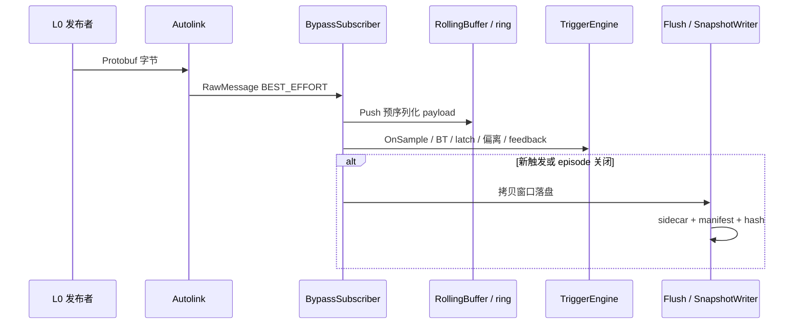
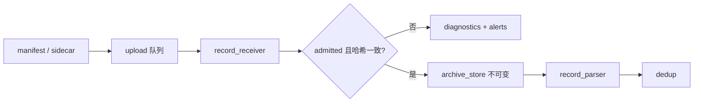
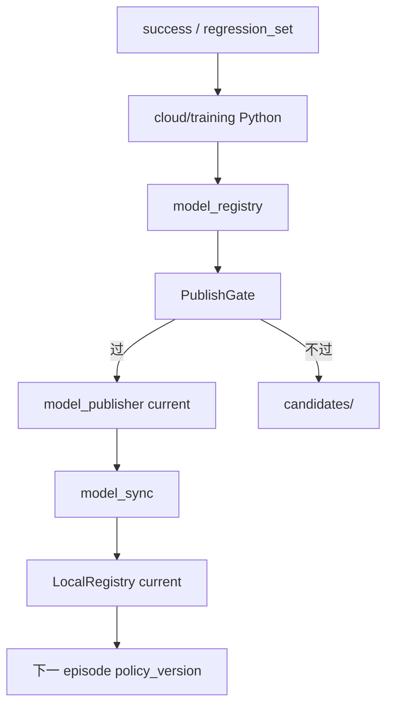
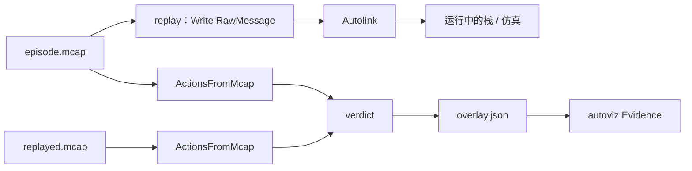

# 04 数据流

闭环是状态机，不是单向 ETL。每步写入可检索身份，下一步只消费 `admitted=true` 的对象。在线路径处理 `Sample{channel, payload, DualClock}`；证据图、门禁与治理在 episode 关闭之后计算。

## 主路径

```text
1 旁路订阅 → 2 ring 窗口 → 3 触发 → 4 MCAP+sidecar
    → 5 P0–P3 上传 → 6 云端校验归档 → 7 解析/去重
    → 8 转换 LeRobot → 9 治理分流 → 10 训练或回归
    → 11 PublishGate → 12 registry → 13 model_sync
    → 14 下一 episode 的 policy_version = 新版本
```

## 在线采集



recorder 热路径细节见 [19 / recorder 04](recorder/04_dataflow.md)。触发规则见 [12](12_triggers.md)。`data_agent::OnSample`：入 ring → `triggers_.Observe` → `SnapshotWriter::Write`（拷贝，非 `TakeAll`）→ `uploader_.Enqueue`。

## Episode 落盘

recorder（`$output_dir`，默认 `~/.autonomy/records` 或 `AUTOLOOP_RECORD_ROOT`）：

```text
$output_dir/
  episodes/            # 四元组齐全
  diagnostics/
  metrics/episodes.jsonl
  gate/latest.json
  safety/chain.bin
```

同 stem：`<id>.mcap` / `.sidecar.pb` / `.sidecar.json` / `.manifest.json` / `.overlay.json` / `.observations.jsonl`。

data_agent：

```text
$record_root/ep-<utc_ns>-<kind>/
  snapshot.mcap
  sidecar.pb           # autoloop.common.EpisodeSidecar
  sidecar.json
  events.jsonl         # 可选
```

`content_sha256` 对 mcap 文件。P0 急停 / 任务失败追加哈希链。

## 上传与入库



`record_receiver::Ingest`：读 `sidecar.pb` → `admitted && IsAdmitted(version)` → `Sha256File(mcap)==content_sha256` → `archive_store.Put`。失败写 `observability/alerts`。`record_parser` 按最小 MCAP 方言抽通道；`dedup` 按内容哈希 + 场景聚类。未 admitted 的 diagnostics 默认不进训练，可上传供人看。

## 转换与治理

```text
episodes admitted
  → autoloop-convert convert <in> <out>
  → meta 含 episode_id + VersionTuple
  → auto_label → human_review
      ├─ success_pool
      ├─ failure_pool
      └─ diagnostics
```

转换时钟用单调轴。缺四元组的 meta 不得进 `lerobot_builder`。人审队列键 `episode_id`。

## 学习、门禁、回灌



训练不在采集热路径调度。回归失败 → 该 `git_sha` 不得晋升，episode 进 `failure_pool`。回灌后接管率升：告警 `takeover_rate`，允许把 `current` 指回上一 `policy_version` 并打 `model_rollback`。

## SIL / HIL / 裁决



`cloud/simulation/replay` 按 `mono_ns` 差值推进；`scenarios` 把 `env_version` 绑到场景资产；`regression_runner` 固定 seed 跑 `regression_set`。采集 flush 的 overlay 为 `pending_replay`，正式 L6 用 `autoloop.recorder verdict`。

## 追查路径

```text
仪表告警 / 日志 ERROR
    → trace_id | episode_id
    → trace_index + metadata_store
    → sidecar（admitted? missing_fields? 四元组?）
    → MCAP 时间轴 + 事件图
    → failure_pool 或 diagnostics
    → replay 同 seed（可选）
```

| 能查到 | 不能（需 SIL/HIL） |
|--------|-------------------|
| 失败窗内 odom / plan / cmd / BT / 定位质量 / 接管 | 未订阅通道的物理真值 |
| 时间共现：定位下降 → path 偏离 → 任务 FAILED | 传感器硬件损坏的物理因果 |
| 四元组证明地图 / 模型版本 | 未打 `env_version` 的现场布局变化 |
| 安全闩是否在失败前已置位 | 采集进程去刹停机器人 |

L2 文档与 UI 不得把「相关」写成「导致」，除非 SIL 对照复现成功。

diagnostics 三类：

1. **未准入**：缺四元组。先补版本源再谈训练。
2. **破损**：哈希失败、MCAP 截断。可 `RecoverMcap` / 重传。
3. **已准入仍失败**：进 `failure_pool`，挂根因卡片，供回归集。

家居现场：走偏 → 任务失败 toast + episode 链接；定位丢失 → `loc_degrade` + `env_version`；人接手 → P1 高亮；急停 → 闩保持、安全链新条目。每次业务失败至少有一条可打开的 episode；只有日志没有 MCAP → `data_loss`，不算闭环完成。

## 可视化数据流

所有面板以 `episode_id` 为游标，seek 到同一单调轴。

| 层 | 数据 | 联动 |
|----|------|------|
| 分诊（autoviz Evidence） | `sidecar.json` + MCAP | cursor → 全面板；观察须 `evidence_node_id` |
| 机队仪表 | `fleet_health` / `takeover_rate` / `conversion_quality` | 告警 payload 含 `trace_id` |
| 治理卡片 | pool + 四元组 + 人审 | 点卡片打开分诊，不另开无身份视频桶 |

`--full-dump` 长 MCAP 在时间轴上抽样渲染（默认 10 Hz overlay），原始字节仍按帧可 seek。清单与 UI 用 JSON；机器链路用 `sidecar.pb`。

## 反路径

| 事件 | 路径 |
|------|------|
| 缺四元组 | diagnostics + 可视化仍可打开 MCAP |
| 训练指标回退 | 不发布；regression_set 加该 episode |
| 回灌后接管率升 | 告警 `takeover_rate`；回滚 `current` |
| 安全链失败 | 失败池；禁止该 robot 模型晋升 |
| 混版 | telemetry 标记；不当新模型正例 |
| 上传积压 | P0 抢占；采集不阻塞 |
