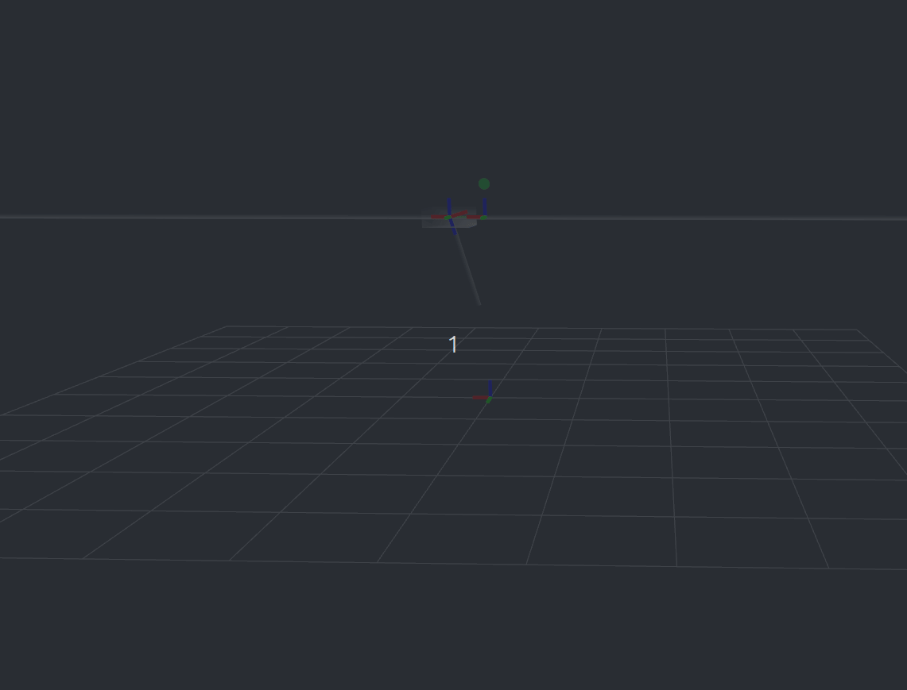
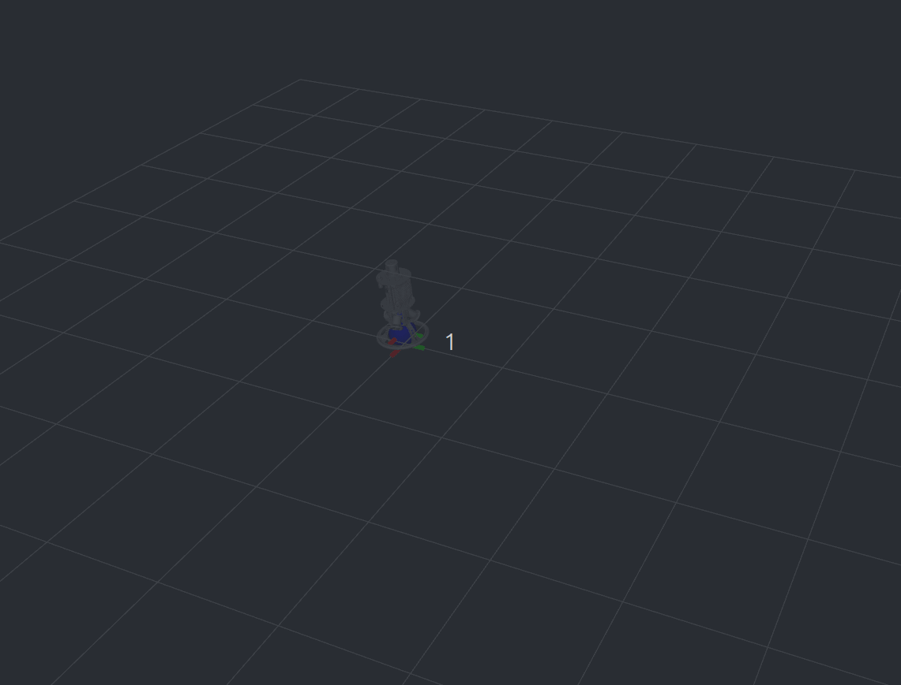
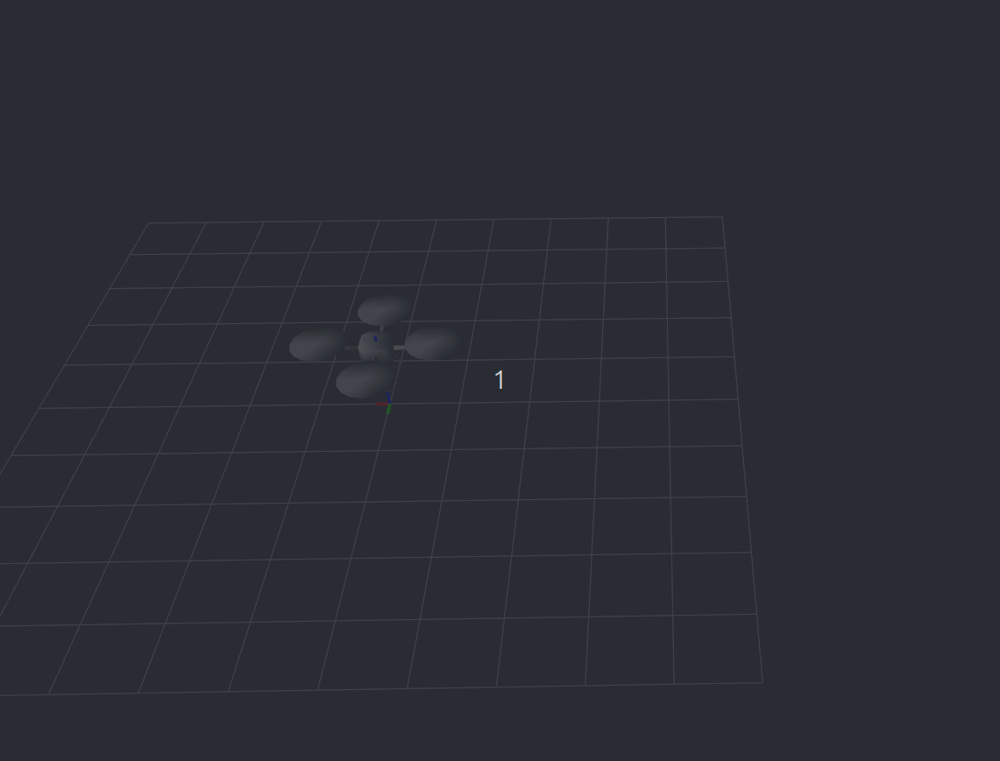
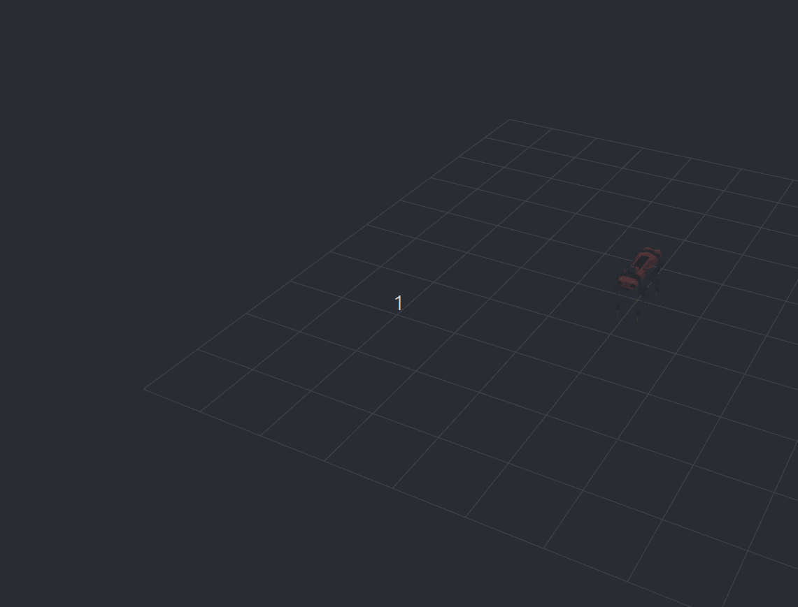
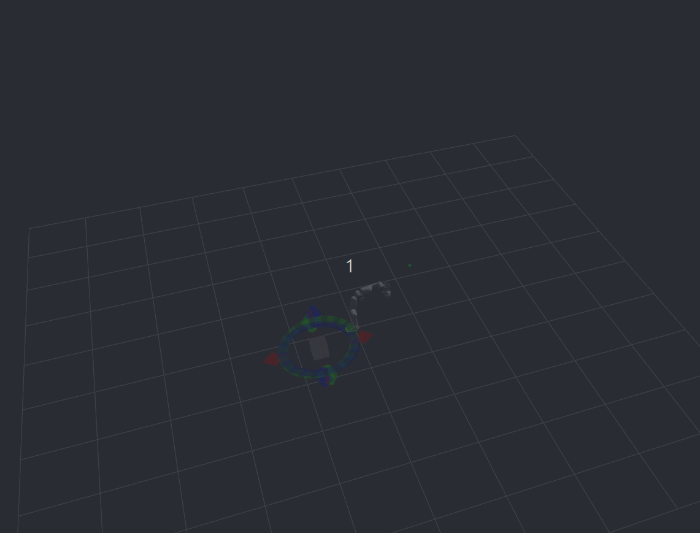

# Automanip

机械臂规划 / 执行栈（MoveIt 同构）+ OCP 子库 [`bolza/`](bolza/)（`libbolza`）。原 `autonomy/manipulation` 已收口至此。

示例通过 Autolink 把 URDF、关节、轨迹与目标发给 [autoviz](../autoviz/)，在 3D 视图中闭环演示 MPC。

## 一览

| 域 | 路径 | 做什么 |
|---|---|---|
| 规划栈 | `automanip/{model,planner,pipeline,motion,dispatch,…}` | MoveIt 同构；主进程 `automanip` |
| OCP 子库 | [`bolza/`](bolza/)（`libbolza` + [使用指南](bolza/docs/README.md)） | DDP / SQP / IPM / SLP / MPC |
| OCP 示例 | [`examples/`](examples/) | cartpole / ballbot / quadrotor / … |
| 启动 | `launch/` | 进程 |

## 示例用例

在仓库根目录编译并安装依赖后，先开 autoviz（固定坐标系 `map`，RobotModel 的 Description Topic 为 `/robot_description`），再跑对应 `*_demo`。话题与交互细节见 [examples/README.md](examples/README.md)。

| Cartpole | Ballbot |
|:---:|:---:|
|  |  |
| 小车倒立摆 · `cartpole_demo` | 球上平衡 · `ballbot_demo` |

| Quadrotor | Legged robot |
|:---:|:---:|
|  |  |
| 四旋翼跟踪 · `quadrotor_demo` | ANYmal C 步态 · `legged_robot_demo` |

| Mobile manipulator |
|:---:|
|  |
| 移动机械臂（Franka / PR2 / Ridgeback+UR5 / Kinova / Mabi）· `mobile_manipulator_demo` |

另有无动图的双积分器示例：`double_integrator_demo`（示意图见 [`bolza/docs/images/double_integrator.png`](bolza/docs/images/double_integrator.png)）。

### 快速跑起来

```bash
cmake --build build/autonomy -j"$(nproc)" --target \
  cartpole_demo ballbot_demo quadrotor_demo \
  legged_robot_demo mobile_manipulator_demo

export PATH=$PWD/build/autonomy/bin:$PATH
export LD_LIBRARY_PATH=$PWD/build/autonomy/lib:$LD_LIBRARY_PATH

# 另开终端：autoviz
cartpole_demo                 # 一直跑；也可 cartpole_demo 400
ballbot_demo 400              # 默认 DDP；或 ballbot_demo 0 slp
legged_robot_demo 400 sqp
mobile_manipulator_demo       # 默认 Franka；Interact 拖标记后右键 Send target pose
mobile_manipulator_demo pr2
```

也可用 launch（一直跑，DDP）：

```bash
autolink launch start src/autonomy/automanip/examples/launch/cartpole.launch
autolink launch start src/autonomy/automanip/examples/launch/mobile_manipulator.launch
```

## 进程

| 二进制 | 说明 |
|---|---|
| `automanip` | ManipulationServer（`/automanip/move`） |
| `automanip.manipulation` | 同上（兼容别名入口） |
| `automanip.manipulation.setup` | Setup CLI lite |
| `*_demo` | bolza OCP 示例（见 [`examples/`](examples/)） |

规划配置：`share/automanip/conf/manipulation.pb.txt`（或 `--conf`）。

## 规划栈运行

```bash
cmake --build build/autonomy -j"$(nproc)" --target automanip_main bolza

export AUTOMANIP_PATH=$PWD/src/autonomy/automanip
export LD_LIBRARY_PATH=$PWD/build/autonomy/lib:$LD_LIBRARY_PATH
export PATH=$PWD/build/autonomy/bin:$PATH
automanip -n
automanip
```

## 文档

| 文档 | 内容 |
|---|---|
| [examples/README.md](examples/README.md) | 编译 / 运行参数、autoviz 话题与改目标方式 |
| [bolza/README.md](bolza/README.md) | `libbolza` 最小用法 |
| [bolza/docs/README.md](bolza/docs/README.md) | OCP 模块、求解器、机器人教程 |

## 许可证

Apache-2.0。`bolza/` 源码保留上游 BSD 头（见 `bolza/solver_license.txt`）。
