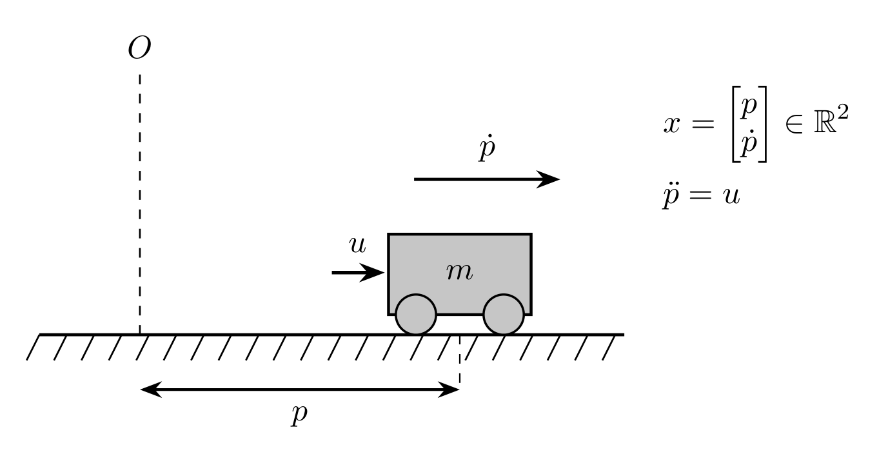
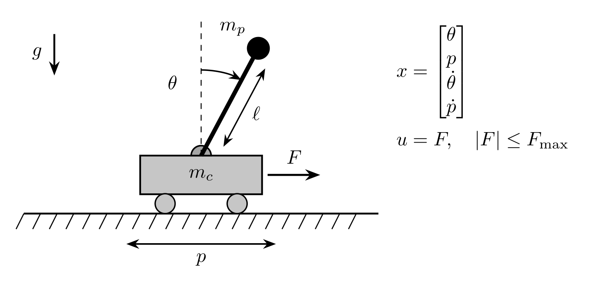
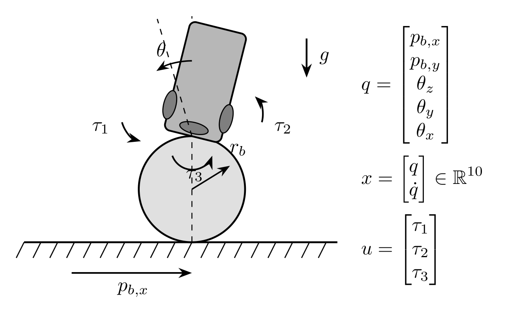
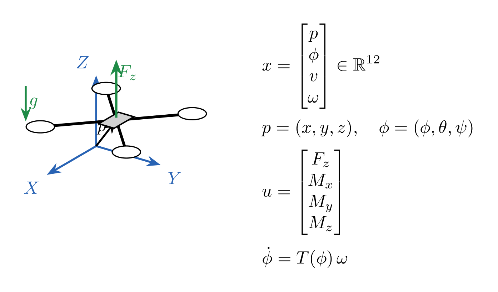
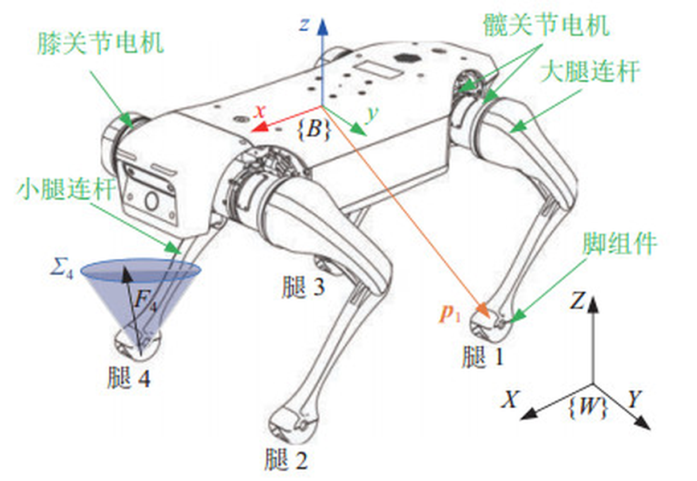

# 4　机器人示例

对齐 [OCS2 Robotic Examples](https://leggedrobotics.github.io/ocs2/robotic_examples.html)。

| 层次 | 路径 | 职责 |
|:---|:---|:---|
| 库 | `automanip/bolza/`（`libbolza`） | `Problem` → `Solve` → $\mathbf{u}(t)$；**不依赖** autonomy / autolink |
| 教程 | `examples/tutorial/` | 纯库可执行文件（只链 `bolza`） |
| 机器人示例 | `examples/<robot>/<robot>.{hpp,cpp}` | 预装 $\mathbf{f},Q,R$（`task.info`） |
| Demo | `demo_loop` | Autolink 可视化（非求解 API） |

---

## 4.1　教程：`Problem` / `Solve`

```text
Problem  →  Solver::Options  →  Solve(...)  →  Summary
```

头文件：`<bolza/solver.hpp>`（含 `Problem`）  
实现：`bolza/problem.{hpp,cpp}` · `bolza/solver.hpp` · `bolza/solve.cpp`  
源码：[`examples/tutorial/solve_double_integrator.cpp`](../../examples/tutorial/solve_double_integrator.cpp)  
CMake：`target_link_libraries(… PRIVATE bolza)` · 目标 `bolza_tutorial_di`

### 问题

一维双积分器，跟踪 $\mathbf{x}^\star=[1,0]^{\!\top}$：

$$
\mathbf{x}=\begin{bmatrix}p\\\dot{p}\end{bmatrix},\quad
\dot{\mathbf{x}}=A\mathbf{x}+Bu,\quad
A=\begin{bmatrix}0&1\\0&0\end{bmatrix},\
B=\begin{bmatrix}0\\1\end{bmatrix}.
$$

$$
\min\ \phi+\int l\,dt,\quad
l=\tfrac12\tilde{\mathbf{x}}^{\!\top}Q\tilde{\mathbf{x}}+\tfrac12 R u^{2},\quad
\phi=\tfrac12\tilde{\mathbf{x}}^{\!\top}Q_f\tilde{\mathbf{x}},\quad
\tilde{\mathbf{x}}=\mathbf{x}-\mathbf{x}^\star.
$$

### 流程

| # | 做什么 | API |
|:---|:---|:---|
| 1 | 动力学 $A,B$ | `SetLinearDynamics` |
| 2 | 二次代价 $Q,R,Q_f$ | `AddQuadraticCost` / `AddQuadraticFinalCost` |
| 3 | 参考 $\mathbf{x}^\star$ 与初值 $\mathbf{x}_0$ | `SetTarget` / `SetInitialState` |
| 4 | 开环 $[t_0,t_f]$ | `options.tf` · `Solve`（`mpc_steps=0`） |
| 5 | 滚动 MPC（可选） | `options.mpc_steps>0` · 再 `Solve` |

`mpc_steps == 0`（默认）：内部 `SLQ::Run`。  
`mpc_steps > 0`：内部 `GaussNewtonDDPMPC` + MRT。

### 代码（与教程源码一致）

```cpp
#include <bolza/solver.hpp>
#include <bolza/core/types.hpp>

using bolza::matrix_t;
using bolza::vector_t;

bolza::Problem problem;

const matrix_t A = (matrix_t(2, 2) << 0, 1, 0, 0).finished();
const matrix_t B = (matrix_t(2, 1) << 0, 1).finished();
problem.SetLinearDynamics(A, B);

const matrix_t Q = matrix_t::Identity(2, 2);
const matrix_t R = matrix_t::Constant(1, 1, 0.1);
problem.AddQuadraticCost(Q, R);
problem.AddQuadraticFinalCost(10.0 * Q);

problem.SetTarget((vector_t(2) << 1.0, 0.0).finished());  // u★=0
problem.SetInitialState(vector_t::Zero(2));

bolza::Solver::Options options;
options.tf = 3.0;
options.max_num_iterations = 20;
options.display = true;

bolza::Solver::Summary summary;
bolza::Solve(options, &problem, &summary);
// summary.ok · summary.u0 · summary.x_final · summary.state_trajectory

options.mpc_steps = 50;           // >0 → 滚动 MPC
options.time_horizon = 2.0;
options.mrt_frequency_hz = 100.0;
bolza::Solve(options, &problem, &summary);
```

### 构建与运行

```bash
# 1) 仅库（推荐）
cmake -S automanip/bolza -B build/bolza
cmake --build build/bolza -j"$(nproc)" --target bolza

# 2) 教程可执行文件在 automanip/examples（上层工程，只链 bolza，非库依赖）
cmake --build <umbrella-build> -j"$(nproc)" --target bolza_tutorial_di
bolza_tutorial_di
```

### Options / Summary 要点

| 字段 | 含义 |
|:---|:---|
| `options.t0` / `tf` | 开环时域 |
| `options.max_num_iterations` | DDP 迭代上限 |
| `options.display` | 短摘要 |
| `options.mpc_steps` | `0` 开环；`>0` 滚动步数 |
| `options.time_horizon` | MPC 预测时域（秒） |
| `options.mrt_frequency_hz` | MRT 频率 |
| `summary.u0` / `x_final` | 首控制 / 末状态 |
| `summary.*_trajectory` | 时间 / 状态 / 输入轨迹 |

### 扩展

| 改什么 | 怎么做 |
|:---|:---|
| 非线性 $\mathbf{f}$ | `problem.SetDynamics(std::make_unique<…>)` |
| 自定义代价 | `AddCost` / `AddFinalCost` |
| 机器人预装 OCP | `examples/<robot>/<robot>.{hpp,cpp}`（底层仍是 `OptimalControlProblem`） |
| 约束 / SQP·IPM | 暂走底层 API（§4.4+）；facade 后续可扩 |
| 可视化 | `RunDemo`（`demo_loop`）；解题不需要 |

官方 `*_demo` = `{robot}.cpp` + MPC + Autolink；本教程只演示 `libbolza` 解题入口。

---

## 4.2　示例一览

| 系统 | $(n_x,n_u)$ | 约束 | Demo | 求解器 |
|:---|:---|:---|:---|:---|
| Double Integrator | $(2,1)$ | — | `double_integrator_demo` | DDP |
| Cartpole | $(4,1)$ | $\|F\|\le F_{\max}$ | `cartpole_demo` | DDP |
| Ballbot | $(10,3)$ | — | `ballbot_demo` | `ddp` / `slp` |
| Quadrotor | $(12,4)$ | — | `quadrotor_demo` | DDP |
| Legged Robot | $(24,24)$ | 模式相关 | `legged_robot_demo` | `ddp` / `sqp` / `ipm` |

```bash
cmake --build <umbrella-build> -j"$(nproc)" --target \
  double_integrator_demo cartpole_demo ballbot_demo \
  quadrotor_demo legged_robot_demo
# 参数1：MRT 步数（0=持续）；参数2：求解器名（ballbot/legged）
double_integrator_demo 400
```

配图 [`images/`](images/) · [ATTRIBUTION](images/ATTRIBUTION.md) · 形式 [03_getting_started.md](03_getting_started.md)。

---

## 4.3　Double Integrator

> 建模细节；上手请先跑 §4.1 与 `bolza_tutorial_di`。

### 问题

跟踪一维位置 $p^\star$，速度趋零。$\mathbf{x}=(p,\dot{p})$，$u=\ddot{p}$。线性、无路径约束。

### 建模



*位置 $p$、速度 $\dot{p}$、输入 $u$；$\ddot{p}=u$。*

$$
\mathbf{x}=\begin{bmatrix}p\\\dot{p}\end{bmatrix},\quad
\dot{\mathbf{x}}=A\mathbf{x}+Bu,\quad
A=\begin{bmatrix}0&1\\0&0\end{bmatrix},\
B=\begin{bmatrix}0\\1\end{bmatrix}.
$$

$$
\min_u\ \tfrac12\tilde{\mathbf{x}}(t_f)^{\!\top}Q_f\tilde{\mathbf{x}}(t_f)
+\int_{t_0}^{t_f}\bigl(\tfrac12\tilde{\mathbf{x}}^{\!\top}Q\tilde{\mathbf{x}}+\tfrac12 R\,u^{2}\bigr)\,dt
\quad\text{s.t.}\quad
\mathbf{x}(t_0)=\mathbf{x}_0,\ \dot{\mathbf{x}}=A\mathbf{x}+Bu.
$$

$\tilde{\mathbf{x}}=\mathbf{x}-\mathbf{x}^\star$。教程硬编码 $Q=I$、$R=0.1$、$Q_f=10Q$；demo 从 `task.info` 读。

### 公式 ↔ 代码

| 公式 | §4.1 facade | demo Interface |
|:---|:---|:---|
| $A,B$ | `SetLinearDynamics` | `LinearSystemDynamics` |
| $Q,R,Q_f$ | `AddQuadraticCost` / `AddQuadraticFinalCost` | `QuadraticStateInputCost` / `QuadraticStateCost` |
| $\mathbf{x}^\star$ | `SetTarget` | `TargetTrajectories`（`Pose.x` → $p^\star$） |
| $\mathbf{x}_0$ | `SetInitialState` | `SystemObservation` |
| 求解 | `bolza::Solve` | `GaussNewtonDDPMPC` + MRT |

### Demo

| | |
|:---|:---|
| 源码 | `examples/double_integrator/double_integrator.{hpp,cpp}` |
| 逻辑 | `Interface` 装 OCP → `GaussNewtonDDPMPC` → `on_target` 写 $p^\star$ → `RunDemo` |
| 运行 | `double_integrator_demo 400` |

---

## 4.4　Cartpole

### 问题

小车–倒立摆起摆并镇定；跟踪小车位置；$|F|\le F_{\max}$。CppAD 非线性动力学 + 增广拉格朗日输入界。

### 建模



*$\mathbf{x}=[\theta,p,\dot{\theta},\dot{p}]^{\!\top}$，$u=F$。*

$$
\mathbf{I}(\theta)=\begin{bmatrix}I_{\mathrm{p}}&m_p\ell\cos\theta\\ m_p\ell\cos\theta&m_c+m_p\end{bmatrix},\quad
\mathbf{r}=\begin{bmatrix}m_p\ell g\sin\theta\\ F+m_p\ell\dot{\theta}^{2}\sin\theta\end{bmatrix},
\quad
\begin{bmatrix}\ddot{\theta}\\\ddot{p}\end{bmatrix}=\mathbf{I}^{-1}\mathbf{r}.
$$

$$
l=\tfrac12(\mathbf{x}-\mathbf{x}^\star)^{\!\top}Q(\mathbf{x}-\mathbf{x}^\star)+\tfrac12 R F^{2},\quad
|F|\le F_{\max}\ \Leftrightarrow\ e+DF\ge\mathbf{0}\ (e=[F_{\max};F_{\max}],\ D=[1;-1]).
$$

| 参数 | 默认 | |
|:---|:---|:---|
| $m_c,m_p,L,g,F_{\max}$ | $1,1,1,9.8,6$ | $\ell=L/2$；$I_{\mathrm{p}}=\tfrac1{12}m_p L^{2}+m_p\ell^{2}$ |

### 公式 ↔ 代码

| 公式 | 代码 |
|:---|:---|
| $\theta,p,\dot{\theta},\dot{p}$ | `state(0..3)`（θ 在前） |
| $F$ | `input(0)` |
| $\mathbf{f}(\mathbf{x},F)$ | `CartPoleSytemDynamics::SystemFlowMap` |
| $\|F\|\le F_{\max}$ | `LinearStateInputConstraint` + `SlacknessSquaredHingePenalty` |
| $p^\star$ | `x_star(1)=Pose.x` |

### Demo

| | |
|:---|:---|
| 源码 | `examples/cartpole/cartpole.{hpp,cpp}` |
| 动力学 | `dynamics/cart_pole_system_dynamics.hpp` |
| 运行 | `cartpole_demo 400` |

---

## 4.5　Ballbot

### 问题

球上三轮平衡；跟踪地面 $(p_{b,x},p_{b,y})$ 与偏航 $\theta_z$。非最小相位：先反向倾再加速。

### 建模



$$
\mathbf{q}=\begin{bmatrix}p_{b,x}&p_{b,y}&\theta_z&\theta_y&\theta_x\end{bmatrix}^{\!\top},\quad
\mathbf{x}=\begin{bmatrix}\mathbf{q}\\\dot{\mathbf{q}}\end{bmatrix},\quad
\mathbf{u}=(\tau_1,\tau_2,\tau_3).
$$

$$
M(\mathbf{q})\ddot{\mathbf{q}}+C\dot{\mathbf{q}}+\mathbf{g}=B\mathbf{u}
\ \Rightarrow\
\dot{\mathbf{x}}=\begin{bmatrix}\dot{\mathbf{q}}\\ M^{-1}(B\mathbf{u}-C\dot{\mathbf{q}}-\mathbf{g})\end{bmatrix}.
$$

参考：$\theta_z^\star\leftarrow\theta_z+\mathrm{atan2}(\sin(\psi_{\mathrm{cmd}}-\theta_z),\cos(\cdots))$；俯仰/滚转参考取当前值。两点轨迹 $\{t,t_{\mathrm{arr}}\}$。

### 公式 ↔ 代码

| 公式 | 代码 |
|:---|:---|
| $p_{b,x},p_{b,y},\theta_z,\theta_y,\theta_x$ | `state(0..4)` |
| $\dot{\mathbf{q}}$ | `state(5..9)` |
| $\tau_i$ | `input(0..2)` |
| $\mathbf{f}$ | `BallbotSystemDynamics::SystemFlowMap` |
| $\theta_z^\star$ 连续化 | `CommandToGoal`（`ballbot.cpp`） |

### Demo

| | |
|:---|:---|
| 源码 | `examples/ballbot/ballbot.{hpp,cpp}` |
| 求解器 | `ddp`（默认）/ `slp` → `GaussNewtonDDPMPC` / `SlpMpc` |
| 运行 | `ballbot_demo 400` · `ballbot_demo 0 slp` |

---

## 4.6　Quadrotor

### 问题

跟踪 $(\mathbf{p},\psi)$；滚转/俯仰由推力方向调节。$\mathbf{u}=(F_z,M_x,M_y,M_z)$。

### 建模



$$
\mathbf{x}=\begin{bmatrix}\mathbf{p}\\\boldsymbol{\phi}\\\mathbf{v}\\\boldsymbol{\omega}\end{bmatrix},\quad
\dot{\boldsymbol{\phi}}=T(\boldsymbol{\phi})\,\boldsymbol{\omega},\quad
\begin{aligned}
\ddot{x}&=\tfrac{F_z}{m}\sin\theta,\\
\ddot{y}&=-\tfrac{F_z}{m}\cos\theta\sin\phi,\\
\ddot{z}&=\tfrac{F_z}{m}\cos\theta\cos\phi-g.
\end{aligned}
$$

$\boldsymbol{\phi}=(\phi,\theta,\psi)$ 为 XYZ 欧拉；$T(\cdot)$：`GetMappingFromLocalAngularVelocityToEulerAnglesXyzDerivative`。悬停初值 $F_z\approx mg$。

### 公式 ↔ 代码

| 公式 | 代码 |
|:---|:---|
| $\mathbf{p},\boldsymbol{\phi},\mathbf{v},\boldsymbol{\omega}$ | `state(0..2)`, `(3..5)`, `(6..8)`, `(9..11)` |
| $F_z,\mathbf{M}$ | `input(0..3)` |
| $\mathbf{f}$ | `QuadrotorSystemDynamics::ComputeFlowMap` |
| $\mathbf{x}^\star$：位置+偏航 | `CommandToGoal`（滚转/俯仰保持当前） |

### Demo

| | |
|:---|:---|
| 源码 | `examples/quadrotor/quadrotor.{hpp,cpp}` |
| 运行 | `quadrotor_demo 400` |

---

## 4.7　Legged Robot（ANYmal）

### 问题

切换系统：给定步态，跟踪躯干 $(x,y,\psi)$，分配支撑力。FCD / SRBD；求解器 DDP / SQP / IPM。

### 建模



*机体系 $\{B\}$、世界系 $\{W\}$、足端 $\mathbf{p}_1$、接触力 $\mathbf{F}_4$、摩擦锥 $\Sigma_4$。*

| 图中 | 公式 / 实现 |
|:---|:---|
| $\{B\}$ | 基座姿态 ⊂ $\mathbf{q}_b$ |
| $\{W\}$ | $\mathbf{p}_i,\mathbf{f}_i$ 表达系 |
| $\mathbf{F}_4,\Sigma_4$ | $\mathbf{f}_i$、`FrictionConeConstraint` |

$$
\mathbf{x}=\begin{bmatrix}\mathbf{h}/m\\\mathbf{q}_b\\\boldsymbol{\theta}\end{bmatrix}\in\mathbb{R}^{24},\quad
\mathbf{u}=\begin{bmatrix}\mathbf{f}_1\\\vdots\\\mathbf{f}_4\\\dot{\boldsymbol{\theta}}\end{bmatrix}\in\mathbb{R}^{24}.
$$

$$
\dot{\mathbf{h}}_{\mathrm{lin}}=m\mathbf{g}+\sum_i\mathbf{f}_i,\quad
\dot{\mathbf{h}}_{\mathrm{ang}}=\sum_i(\mathbf{p}_i-\mathbf{c})\times\mathbf{f}_i.
$$

| 集合 | 约束 |
|:---|:---|
| $i\in\mathcal{W}$ | $\mathbf{f}_i=\mathbf{0}$；抬腿 $z_i(t)=z_i^\star(t)$ |
| $i\in\mathcal{S}$ | 摩擦锥 $\mu(F_z+F_{\mathrm{grip}})-\sqrt{F_x^{2}+F_y^{2}+\varepsilon}\ge 0$；足速为零 |

模式 $\{\sigma_k,t_k\}$：`SwitchedModelReferenceManager` + `reference.info`。

### 公式 ↔ 代码

| 公式 | 代码 |
|:---|:---|
| $\mathbf{h}/m$ | `state.head(6)` |
| $\mathbf{q}_b$ | `state.segment<6>(6)`（跟踪 $x,y,\psi$） |
| $\boldsymbol{\theta}$ | `state.tail(12)` |
| $\mathbf{f}_i$ | `GetContactForces(input,i,info)` |
| $\dot{\boldsymbol{\theta}}$ | `input` 尾部 |
| $\mathbf{f}_i=\mathbf{0}$ / $\Sigma_i$ | `ZeroForceConstraint` / `FrictionConeConstraint` |
| $\sigma$ | `observation.mode`；初值 `ModeNumber::STANCE` |

### Demo

| | |
|:---|:---|
| 源码 | `examples/legged_robot/{demo,legged_robot_interface}.cpp` |
| 逻辑 | Interface 挂模式约束 → `ddp`/`sqp`/`ipm` → `on_target` 改 $\mathbf{q}_b$ |
| 运行 | `legged_robot_demo 400` · `… 400 sqp` · `… 400 ipm` |

---

## 4.8　与 OCS2 对照

| | OCS2 | Bolza |
|:---|:---|:---|
| 入门 API | 各 `ocs2_<robot>` 样板 | `bolza::Problem` / `bolza::Solve`（§4.1） |
| 模型 | `ocs2_<robot>` | `examples/<robot>/` + `libbolza` |
| 通信 | ROS | demo + Autolink（**库本身无中间件**） |
| 构建 | catkin | 库：独立 CMake；demo：`automanip/examples` |

求解器：[07_solvers.md](07_solvers.md)；配置：[06_configuration.md](06_configuration.md)。
