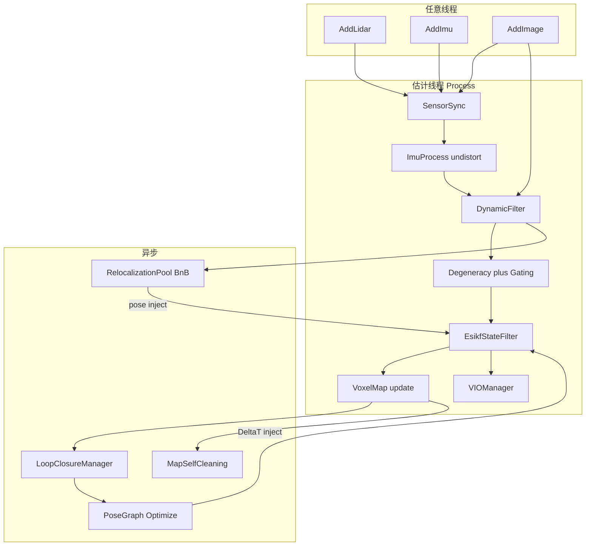

# 架构

## 1. 目录职责

```text
argus/
├── apps/                       # offline_* / verify_* / livo_esikf_node
│   └── datasets/               # KITTI / Spires / NCD（不进 libargus）
├── argus/                      # 库源码（头/源同树）
│   ├── common/                 # 日志、YAML、时间、相机、SE3、ThreadSafeQueue
│   ├── sensor/                 # IMU / Image / PointCloud
│   ├── frontend/               # Preprocess、IMU、SensorSync、DynamicFilter
│   ├── backend/                # ESIKF + PoseGraph
│   ├── fusion/                 # ConfidenceGating / 各向异性 / IntensityAssist
│   ├── perception/             # Degeneracy / SensorHealth
│   ├── map/                    # 一类型一文件：Voxel* / LioFrameBuffers / Occupancy* / Visual*
│   ├── mapping/                # MapBuilder（会话落盘 + 先验导出）
│   ├── odometry/               # LivoOdometry + VIOManager / Frame
│   └── relocalization/         # 重定位 + 回环
│       ├── bbs/ / scan_context/       # BnB 引擎、SC++ 地点识别
│       └── loop_closure/               # 回环（命名空间 loop_closure）
├── config/                     # livo_esikf.yaml + calibration/ + robustness/
├── scripts/                    # 下载 / 评测 / Open3D
├── docs/                       # 本文档体系
└── test/                       # test_*.cpp
```

CMake：`GLOB` → 单库 `libargus`（`Argus::odometry` 等为别名）。可选 `ARGUS_USE_ONNXRUNTIME`。

可维护性：优先一类型一文件；函数体控制在约 80 行内，复杂流程拆成短 helper。

命名（见名知意、言简意赅）：
- 类型 / 方法：PascalCase（`VoxelMapManager`、`ProcessLio`）
- 成员 / 局部：snake_case；类私有成员后缀 `_`（`state_propagated_`）
- 布尔：`enable_*` / `is_*` / `has_*`，避免含糊的 `*_en` / `flg`
- 禁止：拼写错误缩写（`pyrimid`→`pyramid`）、全大写类型别名（用 `VoxelLocation` 而非 `VoxelLocation`）
- 领域词保留标准写法：`ESIKF`、`NCC`、`LiDAR`；热路径符号与论文一致时可短（`Rcw`、`Pcw`）

## 2. 模块依赖

```text
apps / odometry
    → frontend → sensor → common
    → fusion → perception + map + backend
    → relocalization/loop_closure → map + pose_graph        (async)
    → relocalization                                (isolated BnB pool)
```

硬边界：

- ESIKF **不**包含动态物体逻辑；只消费门控后的残差与权重。
- 回环 / PoseGraph / 自清洁 **异步**；写地图须锁或单写者。
- Relocalization 线程池 **仅** `RelocalizationManager` 持有。
- LIO / VIO 热路径禁止 `std::cout` / 每帧 `printf`（VIO 调试仅 `enable_plot`）；`OccupancyGridBuilder` 单线程写图（`Set*Unlocked`）。
- **缓冲真源**：`LivoOdometry::lio_frame_`（`LioFrameBuffers`）经 `VoxelMapManager::BindFrameBuffers` 注入；ESIKF / 建图一律 `manager.frame()`。standalone 测试可不 Bind，用 manager 内部 `owned_frame_`。

## 3. 数据流



文字版：

```text
IMU ─────────────────────────────► ESIKF predict（ImuProcess）
                                      │
LiDAR → Preprocess → DynamicFilter → 点面残差 ──┐
                                      │           │
Camera → VIOManager → 光度残差 ─────────────────┤
                                      │           │
                                      ▼           ▼
                              Degeneracy → ConfidenceGating
                                      │           │
                                      └─────► ESIKF update
                                                  │
                    ┌─────────────────────────────┼─────────────────────────┐
                    ▼                             ▼                         ▼
              Map + Confidence            LoopClosure (async)           Output
              + Session / Cleaning        + PoseGraph (async)
```

## 4. 双后端

| 后端 | 职责 | 线程 |
|------|------|------|
| **EsikfStateFilter** | 实时 predict + 迭代点面更新 | **唯一**估计线程 |
| **PoseGraph** | 关键帧边、回环因子、跨会话联合优化 | 异步 worker |

解耦：ESIKF 推送关键帧快照；PoseGraph 回传 `LoopCorrection(ΔT)`，估计线程 **原子注入**（不打断当前滤波周期中途写协方差中间量）。

重定位结果同理：池线程只写结果队列；估计线程 `TryInjectRelocalization` 整包替换位姿。

## 5. 编排器

`LivoOdometry` 持有前端、体素图、可选 VIO / 回环 / 建图 / 重定位 / 自清洁，对外契约：

```text
任意线程:  AddLidar / AddImu / AddImage
估计线程:  while (Process(&out)) { use out.state; check out.status; }
可选:      SaveBuiltMap / LoadBuiltMap / RequestRelocalization
```

详情见 [03_sequence.md](03_sequence.md)、[10_usage.md](10_usage.md)。
