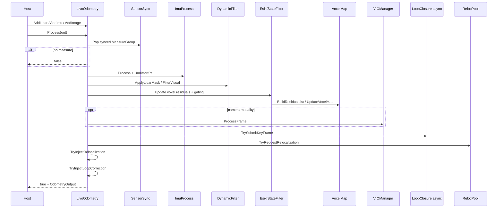
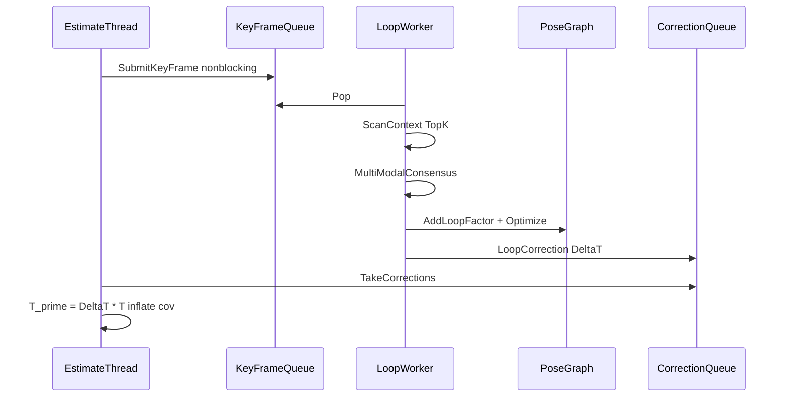
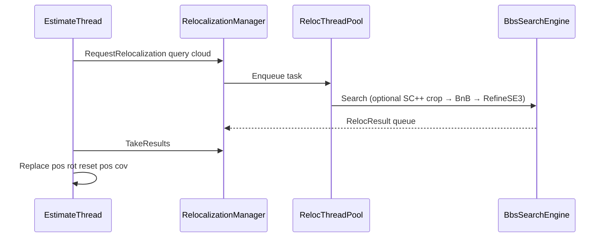

# 线程模型与时序

## 1. 线程组

```text
[实时 / 估计线程]
  Process() 串行：sync → undistort → filter → ESIKF → VIO → map → 提交异步任务 → 注入结果

[异步 worker]
  LoopClosureManager：Scan Context + PoseGraph::Optimize
  MapSelfCleaning：低频 Prune

[重定位专用池 RelocalizationThreadPool]
  仅 BnB / 3D-BBS；有界队列；默认满时丢弃最旧
```

## 2. 硬约束

| # | 规则 |
|---|------|
| 1 | ESIKF **单线程串行**；禁止并行写状态或并行迭代更新 |
| 2 | 动态过滤可并行，残差须按时间戳排序后串行喂入 ESIKF |
| 3 | 回环 / PoseGraph / 自清洁 **禁止**在估计线程内跑全局优化 |
| 4 | 重定位池 **不**进入实时链路；结果仅经 Manager 回调注入 |
| 5 | `threading.backend_threads` **必须为 1**；`loop_closure.async` **必须为 true** |

## 3. 单帧 Process（LIO / LIVO）



`Process` 分支：

- 有 LiDAR 包 → `ProcessLio`（体素 ESIKF；LIVO 时再跑 VIO）。
- 仅图像（ONLY_VIO 同步路径）→ `ProcessVio`（生产配置加载时拒绝无 LiDAR 模态）。

软失败：`out.soft_skip==true` 表示包已消费但未更新地图（空点云 / 全动态剔除 / VIO 未就绪等）。

## 4. 回环注入



- `Optimize` / `Detect` **仅** worker。
- 估计线程只做 `SubmitKeyFrame` / `TakeCorrections`。
- `enable_pose_inject`（默认 true）控制是否写回 ESIKF。

## 5. 重定位注入



触发（`relocalization.trigger`）：

| 值 | 行为 |
|----|------|
| `tracking_lost` | 连续丢失 ≥ `min_lost_streak` 且冷却期满 |
| `manual` | 仅外部 `RequestRelocalization` |
| `cross_session_load` | 加载先验后首帧有效点云请求一次 |

`IsTrackingLost`：空点云 / LiDAR 健康超时 / 门控 `lidar_valid==false` / 退化 `is_degenerated==true`。

## 6. 地图锁

| 路径 | 锁 |
|------|-----|
| `UpdateVoxelMap` / `BuildVoxelMap` / `EraseVoxels` | `unique_lock` on `map_mutex_` |
| `BuildResidualListOMP` / `UpdateConfidence` | `shared_lock` |
| 异步 `Prune` | shared 收集 → unique `EraseVoxels` |

禁止在 ESIKF 迭代内 `Prune`。

## 7. 验收要点

- 估计线程内无 `PoseGraph::Optimize` / BnB `Search`
- 重定位队列满：`OnFull::kDropOldest`（可改 `kReject`）
- 压力下 ESIKF 延迟不随回环频率线性上升（需场景压测）
