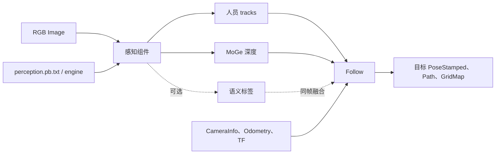
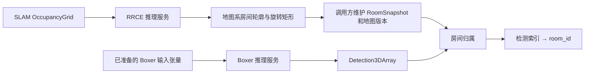

# 架构与数据流

## 代码分层

| 目录 | 职责 |
|---|---|
| `inference/` | 复用 common/network 的会话、图像预处理及命名张量检查 |
| `models/` | C++ 图加载和模型适配。模型系列和实际权重由配置指定 |
| `tasks/` | 解码检测、深度、掩码、轮廓、三维框等任务结果 |
| `engine/` | 配置绑定、逐帧编排、AutoLink 发布和对象张量推理服务 |
| `behaviors/` | 跟随及人员关联。Follow 将跟踪、深度、标定和里程计转换成局部任务输出 |
| `proto/`、`conf/`、`dag/`、`launch/` | 协议、部署参数、进程装配及启动入口 |

`engine/pipeline.hpp` 定义进程内流水线接口。默认 `TaskPipeline`
读取 `model_id`，复用同 ID 的推理会话。Detect 与 Track 在会话、尺寸和
输出名一致时复用同帧检测结果。任意多头任务共享一次前向推理仍未实现。

## 实时图像感知与跟随

感知组件和 Follow 由各自 launch 启动，通过 AutoMsgs 话题通信。
语义图使用独立订阅，要求与深度的时间戳、光学坐标系、图像几何一致。
语义不可用时，Follow 使用深度网格。

## 地图语义链路

当前 RRCE 和 Boxer 结果通过服务响应返回。调用方负责地图更新触发、
房间 ID 生命周期、Boxer 输入准备和图像位姿对齐。房间归属用原始轮廓，
旋转矩形用于显示或粗匹配。当前服务没有自动订阅 SLAM 地图，也没有发布
`SceneGraphDelta`。

## 与探索的边界

最终集成中，距离传感器驱动 FAR 的可见图。语义服务独立运行，为房间和物体
提供可重建的标注。TARE 消费几何可达性与可选房间标注，将前沿按房间聚合并排序，
再由 FAR 到达候选目标。标注缺失时继续使用几何前沿。按照这个依赖方向，
FAR 无需链接 RRCE 或 Boxer，也无需等待语义结果。

房间级 TARE、可见图语义叠加、动态行人接线和跨帧融合属于后续集成。
已有探索入口不代表已启用这些语义功能。
