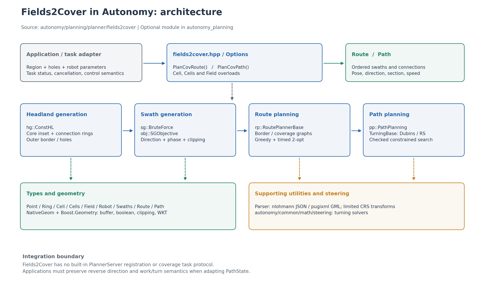

# Fields2Cover 覆盖规划文档

Fields2Cover 将带孔洞的作业区域转换为作业条带、访问路线和受转弯半径约束的路径，适用于割草、清扫、喷洒等区域覆盖任务。本文档对应本仓库的 C++ 移植实现，入口是 [fields2cover.hpp](../planner/fields2cover/fields2cover.hpp)，命名空间为 `autonomy::planning::planner::fields2cover`。

## 阅读顺序

1. [架构与源码导航](fields2cover_architecture.md)：模块职责、扩展接口、规划服务的集成边界。
2. [数据模型与数据流](fields2cover_dataflow.md)：从区域、机器人参数到 `Swaths`、`Route`、`Path`，以及坐标和方向约定。
3. [构建与使用](fields2cover_usage.md)：启用可选模块、运行完整 C++ 示例、分阶段规划、导入和导出。
4. [参数与算法选择](fields2cover_parameters.md)：默认值、地头计算、条带目标和转弯算法。
5. [验证、故障定位与结果](fields2cover_testing.md)：回归命令、100 + 500 场景验证、成功与失败 PNG、已知限制。



架构图的 [SVG](images/fields2cover-architecture.svg) 和[生成脚本](examples/render_diagrams.py)一并保留。

## 三个核心概念

- **Swath（作业条带）**：一段作业中心线、作业宽度及方向；中心线被田地和孔洞裁剪。
- **Route（访问路线）**：按顺序访问的条带组，以及条带之间的连接折线。它保存真实田地边界，供后续连接路径校验。
- **Path（执行路径）**：包含位置、车体航向、段长、前进/后退方向、作业/转弯类型和速度的状态序列。控制器适配应保留这些信息。

`PlanCovRoute()` 返回路线；`PlanCovPath()` 完成路线和转弯规划。需要比较多个转弯算法时，先生成一次 `Route`，再调用 `pp::PathPlanning::PlanPath()`。

## 当前集成状态

Fields2Cover 编译进 `autonomy_planning`，由 `AUTONOMY_BUILD_FIELDS2COVER=ON` 启用；该开关默认 `OFF`。它是覆盖算法库，目前没有 Fields2Cover 专属 Autolink 节点、任务协议或内置 `GlobalPlanner` 注册。修改导航配置中的 `planner_id` 并不能直接启动区域覆盖；集成方案见[架构文档](fields2cover_architecture.md)。

示例使用平面米制坐标。真实田地应包含外边界和障碍孔洞；地头内缩会收缩外边界并扩大孔洞。覆盖率通常针对去除地头后的核心作业区，路径连接则可以使用原始田地中的地头区域。

## 快速运行

在 `SpaceHero` 容器内执行：

```bash
cd /workspace/autonomy
source /opt/ros/humble/setup.bash
colcon build --packages-up-to autonomy --cmake-args \
  -DAUTONOMY_BUILD_PLANNING=ON \
  -DAUTONOMY_BUILD_FIELDS2COVER=ON \
  -DAUTONOMY_BUILD_FIELDS2COVER_TESTS=ON

cmake -S src/autonomy/autonomy/planning/docs/examples \
  -B artifacts/fields2cover-docs-example \
  -DAUTONOMY_SOURCE_ROOT=/workspace/autonomy/src/autonomy \
  -DAUTONOMY_BUILD_ROOT=/workspace/autonomy/build/autonomy
cmake --build artifacts/fields2cover-docs-example -j2
artifacts/fields2cover-docs-example/coverage_demo \
  artifacts/fields2cover-docs-example/output
```

`colcon` 是本工作区使用的构建入口；覆盖规划调用本身不需要 ROS 节点。示例目录中附有 `COLCON_IGNORE`，示例输出目录由 CMake 创建同名标记，避免被误识别为工作区包。

示例输出 Dubins、Reeds–Shepp 路径、核心边界、条带和统计文本。绘图命令及依赖见[使用文档](fields2cover_usage.md)。

## 验证范围

2026 年 11 月 18 日的固定输入验证：原 100 场景修复后 100/100 通过，独立新增 500 场景 500/500 通过。输入、过程退出码、独立几何检查和修前失败 PNG 均有保留，见[测试说明](fields2cover_testing.md)。这些结果验证中心线几何、覆盖率和采样曲率；完整车体扫掠与实车动态执行需要应用层另外验证。

本目录中的示例和图是文档配套材料；库源码位于 `../planner/fields2cover/`。示例使用 `.cc` 扩展名，避免进入 planning 当前对 `*.cpp` 的递归源文件收集。
