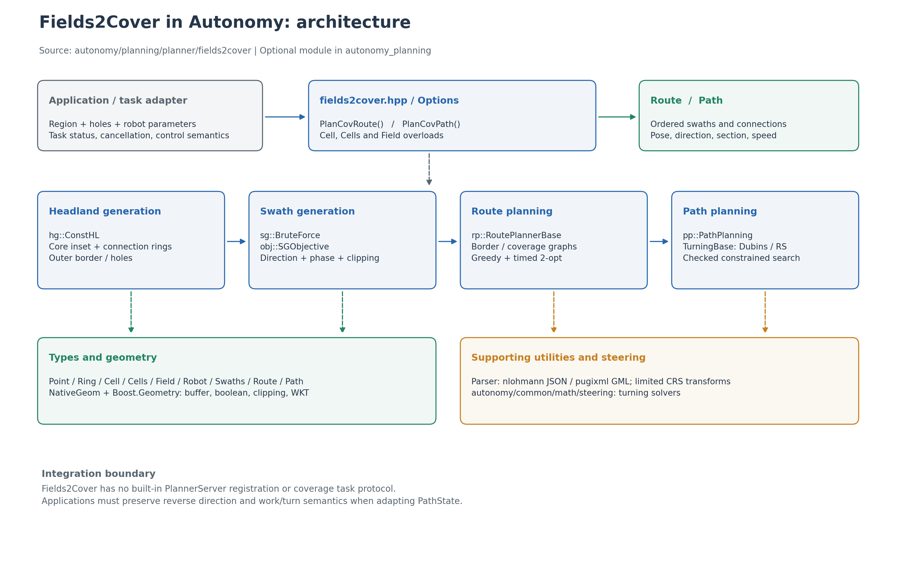

# Fields2Cover 架构与源码导航

[返回目录](README.md) · [数据流](fields2cover_dataflow.md) · [使用方式](fields2cover_usage.md)

## 模块位置与依赖

覆盖算法源码位于 `autonomy/planning/planner/fields2cover/`，通过 [planning/CMakeLists.txt](../CMakeLists.txt) 编译到共享库 `autonomy_planning`。已有 CMake 工程内可连接 `autonomy::planning` 目标。该模块由 `AUTONOMY_BUILD_FIELDS2COVER` 单独控制，与 Vista 探索规划分开启用。

当前几何后端是仓库内的 `NativeGeom` 与 Boost.Geometry；转弯求解调用 [common/math/steering](../../common/math/steering)。JSON 解析使用 `nlohmann/json`，GML 解析使用 vendored pugixml；CMake 为该库启用 `PUGIXML_HEADER_ONLY`。本实现没有链接 GDAL 或 OR-Tools，不能按上游完整 Fields2Cover 的依赖和优化器能力推断行为。

## 职责分层

### 入口与策略组装

[fields2cover.hpp](../planner/fields2cover/fields2cover.hpp) 定义 `Options`、算法枚举及 `Cell` / `Cells` / `Field` 的入口重载；[fields2cover.cpp](../planner/fields2cover/fields2cover.cpp) 负责选择地头、条带目标和转弯规划器。

- `PlanCovRoute()`：核心区内缩 → 条带生成 → 访问路线 → `route.SetField(cells)`。
- `PlanCovPath()`：先生成路线，再交给 `pp::PathPlanning::PlanPath()`。
- `Field` 重载：复制田地，按 `local_crs` 决定是否投影到 UTM，以及是否把结果转回原 CRS。

入口函数不提供覆盖质量验收、任务取消或运行时障碍更新。应用应检查空结果、异常和质量指标，规划任务超时应由调用方管理。

### 几何与机器人模型

[types.hpp](../planner/fields2cover/types.hpp) 提供 `F2C*` 别名，[types/](../planner/fields2cover/types) 维护几何、机器人、路线和路径。

- `Cell` 是有外环和内环的多边形，`Cells` 保留多个多边形组件。
- `NativeGeom` 实现布尔运算、缓冲、距离、WKT 和有限 CRS 转换；Boost.Geometry 完成几何运算。
- `Robot` 保存车宽、作业宽度、最大曲率、曲率变化率和速度等参数。
- `Route` 保存条带组、连接折线及 `optional<Cells>` 真实田地；`Clone()` 保留田地。
- `PathState` 保存离散运动段，`dir` 表达倒车，`len` 保持非负。

几何包装类的默认复制共享内部 `shared_ptr`；需要独立修改时使用 `Clone()`。`Route::SetField()` 会克隆传入田地，以保留边界信息。详见[数据模型](fields2cover_dataflow.md)。

### 地头与分解

[hg::ConstHL](../planner/fields2cover/headland_generator/constant_headland.cpp) 对田地做负缓冲，返回核心区及不同深度的内缩环。顶层入口支持 `HGAlg::NONE` 和 `HGAlg::CONST`。

`CorridorHL`、`RequiredHL` 和 [decomposition/](../planner/fields2cover/decomposition) 下的分解器作为独立类存在；顶层 `DecompAlg` 当前仅有 `NONE`，`GetDecompPtr()` 分派仍被注释，不能通过 `Options` 启用梯形或往复式分解。需要这些策略时应直接调用相应类，独立核对输出后再送入后续阶段。

### 条带生成与目标函数

[sg::BruteForce](../planner/fields2cover/swath_generator/brute_force.cpp) 搜索方向，[SwathGeneratorBase](../planner/fields2cover/swath_generator/swath_generator_base.cpp) 在局部坐标中旋转田地、生成固定间距线、裁剪并恢复坐标。

`obj::SGObjective` 决定方向评分：条带数、边界近似条带数、条带长度、覆盖率或重叠。默认 `NSwathModified` 使用快速边界评分。生成器对每个方向尝试 5 个固定起始相位；当初选方向实际覆盖率不足 98% 时，`GenerateBestSwaths()` 会额外尝试精确边方向、垂直方向和其他角度，以实际覆盖率选择更好的条带。98% 是内部搜索触发值，不是成功保证。

[obj::FieldCoverage](../planner/fields2cover/objectives/sg_obj/field_coverage.cpp) 在局部坐标中逐条缓冲并合并作业带，再与核心区求交。重叠区域只计一次，孔洞不计入作业区面积。

### 访问路线

[rp::RoutePlannerBase](../planner/fields2cover/route_planning/route_planner_base.cpp) 建立两个图：

- `shortest_graph`：连接条带端点与对应田地边界，沿外环、孔洞环建立通行连接。
- `coverage_graph`：表达条带访问方向和条带间移动成本。

`ComputeBestRoute()` 当前是贪心最近节点构造加限时的 2-opt 改进。`show_log` 和 `use_guided_local_search` 在该实现中未参与求解；`search_for_optimum` 也不等于全局最优保证。顶层 `Options::rp_alg` 当前只有 `SHORTEST_ROUTE`，入口直接实例化 `RoutePlannerBase`。

`BoustrophedonOrder`、`SnakeOrder`、`SpiralOrder`、`CustomOrder` 是独立条带排序类，可在分阶段使用中显式调用，尚未由顶层 `RPAlg` 分派。

### 转弯与约束连接

[pp::PathPlanning](../planner/fields2cover/path_planning/path_planning.cpp) 在条带之间生成连接，使用 `TurningBase` 选定的 Dubins、DubinsCC、Reeds–Shepp 或 Reeds–SheppHC 算法。

连接先尝试直接转弯或沿路线上折线圆滑转弯，再检查实际田地、孔洞、段连续性和采样曲率。无效候选进入 [constrained_connection.hpp](../planner/fields2cover/path_planning/constrained_connection.hpp) 的姿态搜索：二维距离图引导避障，恒曲率运动原语推进，末段用所选转弯算法连接精确目标姿态。只有普通 Reeds–Shepp 搜索允许后退。

连续曲率算法的直接候选仍会校验，但约束搜索没有连续曲率替代方案；需要替代时抛出明确异常。搜索预算、异常和约束区别见[参数说明](fields2cover_parameters.md)。

## 与规划服务和控制器的关系

[PlannerServer](../planner_server.cpp) 当前内置注册 `NavfnPlanner`、`DijkstraPlanner`、`ThetaStarPlanner` 和 `VistaPlanner`，没有注册 Fields2Cover。现有 [planning_options.proto](../proto/planning_options.proto) 没有作业区域、多边形孔洞、作业宽度等 Fields2Cover 任务配置。

可采用以下应用层集成流程；这是建议的适配工作，不是已经存在的覆盖服务：

1. 接收区域任务，固定坐标系和边界版本，构建 `Cells` 与 `Robot`。
2. 调用 `PlanCovRoute()` 和 `PathPlanning`，把异常和空结果变成任务失败状态。
3. 独立验收覆盖率、边界、障碍、全车体扫掠及执行器能力。
4. 把 `PathState` 转换成应用轨迹，保存位置、航向、前进/后退、速度及作业开关。
5. 作业区段启用工具，连接和转弯段按任务要求关闭工具；倒车接缝应显式减速、停止和换向。
6. 障碍变化或任务取消时，由服务层中止执行并重新规划。

仅转换成一组无方向的导航 pose 会丢失作业语义与倒车信息。通用路径平滑器也可能改变覆盖率、半径和障碍距离，任何后处理之后都应重新验收。

## 扩展与维护入口

- 新增条带目标：实现 `obj::SGObjective`，核对最小化/最大化符号，需要顶层使用时同步修改枚举及 `GetSGObjPtr()`。
- 自定义条带角度步长：实例化 `sg::BruteForce` 并设置 `SetStepAngle()`；`Options` 不暴露该参数。
- 自定义路线：继承 `rp::RoutePlannerBase` 或显式调用排序器，并为结果设置真实田地。
- 新增转弯算法：实现 `pp::TurningBase`，明确连续曲率能力，补充终点、方向、障碍与半径回归。
- 修改几何后端：先运行 [fields2cover_test.cpp](../planner/fields2cover/fields2cover_test.cpp) 中的内缩、孔洞、共边、重叠和真实失败场景回归，再复测固定输入集。

源码移植许可保留在 [LICENSE](../planner/fields2cover/LICENSE)。公开接口头文件中的说明与本实现有差异时，以实现和回归结果为准。
