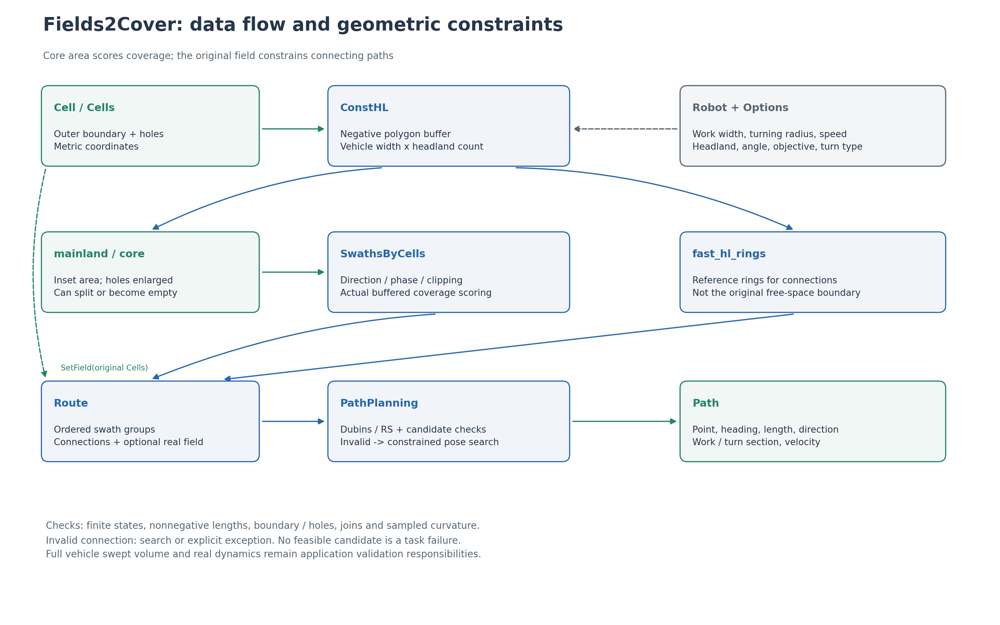
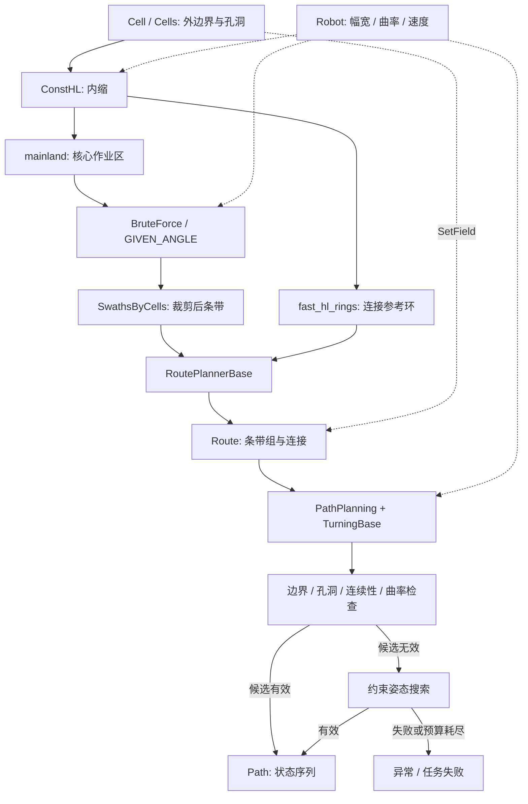

# Fields2Cover 数据模型与数据流

[返回目录](README.md) · [架构](fields2cover_architecture.md) · [参数](fields2cover_parameters.md)

## 数据流总览



[SVG 版本](images/fields2cover-dataflow.svg)。绿色实线表示规划数据流，虚线表示机器人参数或真实田地约束。核心区用于作业覆盖，原始田地用于转弯通行边界，两者需要同时保存。



## 输入模型

### Point → LinearRing → Cell → Cells

`F2CPoint` 保存 `x/y/z`，本覆盖算法主要在 XY 平面工作。所有距离、机器人宽度、条带间距和转弯半径应使用同一长度单位，示例统一为米；角度统一为弧度，零角沿 +X，正角逆时针。

`F2CLinearRing` 保存闭合边界。`Cell` 的第 0 个环是外边界，第 1 个及之后的环是孔洞；障碍应作为孔洞添加，而非独立可作业的 `Cell`。`Cells` 是多个多边形组件，常用于内缩或裁剪产生分离区域。

输入应有非零面积、有限坐标和有效多边形拓扑，孔洞在外环内。重复点、零长边和自交需要在输入阶段处理。`Cells` 能保存不连通组件，但这不保证组件之间存在受约束的通行连接。

### Robot

`Robot(width, cov_width)` 中 `width` 是车体名义宽度，`cov_width` 是工具作业宽度。条带间距来自 `GetCovWidth()`；顶层恒定地头宽度来自 `GetWidth() * hg_swaths`。最小转弯半径、最大曲率和速度影响连接几何及路径状态。

宽度参数本身并不等于全车体碰撞模型。当前自由空间检查验证路径中心线，没有自动把原始田地按完整车体包络缩小。

## 每阶段的输入与输出

### 1. 地头

输入：原始 `Cells`、车宽、地头条数。

输出：`mainland` 核心作业区，以及用于连接的 `fast_hl_rings`。负缓冲收缩外环、扩大孔洞，结果可能为空或拆成多个组件。

顶层恒定地头计算：

```text
d_headland = robot.GetWidth() * opt.hg_swaths
mainland = cells.buffer(-d_headland)
hl_swaths[i] = cells.buffer(-robot.GetWidth() * (i + 0.5))
fast_hl_rings = hl_swaths[floor(0.5 * opt.hg_swaths)]
```

`HGAlg::CONST` 要求正的地头条数；不要用 `hg_swaths=0` 代替 `HGAlg::NONE`。应用应在送入条带生成前检查内缩结果非空。

### 2. 条带

输入：核心区、作业宽度、给定角或方向目标。

输出：`SwathsByCells`。每个 `Swath` 保存中心 `LineString`、幅宽、ID、作业类型和方向；一条长线穿过孔洞或凹边界时会裁成多个有效条带。对应核心组件的条带保持分组。

生成器先平移到参考点附近，再旋转到条带水平的局部坐标中进行裁剪、覆盖评分和相位选择，最后旋转并平移回输入坐标。

### 3. 覆盖评分

对核心区域 `C`，每条中心线 `S_i` 和幅宽 `w_i`：

```text
coverage = area(C ∩ union(buffer(S_i, w_i / 2))) / area(C)
```

代码分母增加 `1e-7`，返回比例而非百分数。打印百分数应乘 100。缓冲工具覆盖并集与核心区求交，所以重叠只算一次、孔洞不计入分母；该指标不代表工具在原始地头区域完成了作业。

### 4. 路线

输入：条带组和连接参考环。

输出：`Route` 中的 `vector<Swaths>` 与 `vector<MultiPoint>`。`connection[i]` 表示进入第 `i` 个条带组的连接；首连接可以为空。连接数量比条带组多 1 时，最后一项表示离开最后组的尾连接。

顶层 `PlanCovRoute()` 自动调用 `route.SetField(cells)`。分阶段调用 `rp.GenRoute()` 时，调用方需要手动设置原始田地。`SetField()` 会保存克隆，`Route::Clone()` 及路线 CRS 变换会保留或同步更新田地。

路线的连接折线用于访问顺序和转弯参考，尚不是最终受半径约束的执行轨迹。

### 5. 执行路径

输入：路线、机器人和 `TurningBase`。

输出：`Path` 的状态序列。每个 `PathState` 描述从 `point` 开始的一个小段：

- `point`：段起点坐标。
- `angle`：车体航向，弧度。
- `len`：非负段长度；终点标记允许为 0。
- `dir`：`FORWARD=1`、`BACKWARD=-1`。倒车时车体朝向与移动方向相差 π。
- `type`：`SWATH=1`、`TURN=2`、`HL_SWATH=3`。
- `velocity`：速度参数；不能只看它的正负来判断倒车。

```text
AtEnd.x = point.x + cos(angle) * len * dir
AtEnd.y = point.y + sin(angle) * len * dir
```

`Path::DiscretizeSwath(step)` 对作业和地头直行段细分，保留转弯段。调用其他插值或平滑方法可能改变几何，需要重新校验。`Path::ToLineString()` 的点序列不携带速度、类型和方向，应保留原状态用于控制和工具开关。

`SaveToFile()` / `SerializePath()` 的每行格式为：

```text
x y z angle velocity len dir type
```

加载应使用新建的 `Path`；`LoadFile()` 会追加状态。序列化接口不会附加 CRS、任务 ID 或工具状态，应用应另外保存元数据。

## 坐标流：Cells 与 Field 的区别

`Cell` / `Cells` 重载直接在传入平面坐标中规划，输出仍在该坐标系。它们不会根据数值猜测米或经纬度。

`Field(cells, id)` 会把第一条外环的起点存为 `ref_point`，内部几何变为：

```text
field.GetField() = cells - field.GetRefPoint()
field.GetCellsAbsPosition() = field.GetField() + field.GetRefPoint()
```

因此 `PlanCovPath(robot, field, options, true)` 返回的是这个内部局部坐标结果。要回到原始米制坐标，可执行 `path.MoveTo(field.GetRefPoint())`。手工规划 `Route` 时也应在同一坐标框架中保存真实田地。

`local_crs=false` 的 `Field` 重载先转 UTM，再规划，最后转回原 CRS。转回经纬度的点坐标和重新计算的段长不再是米，重算角度也不宜直接作为车辆控制航向；建议在投影后的米制坐标中完成执行轨迹适配。

本地 `CoordTransform` 只显式识别 `EPSG:4326`、`EPSG:4258` 和 `UTM:…` 字符串，未识别 CRS 会落入恒等分支。它没有完整 EPSG 数据库、垂向转换或大地基准精密变换。应用应明确投影，不要把任意 EPSG 代码的设置视为转换已完成。

## 失败如何沿数据流传播

内缩为空、无条带和不连通区域可能产生空结果或后续错误，需要调用方主动检查。无效连接不能以直角折线代替成功：普通 Dubins/RS 的约束搜索失败会抛异常；连续曲率规划缺少可行替代时也会抛异常。

`PathPlanning::PlanPath(robot, swaths, turn)` 直接连接条带，不接收真实田地，不能承担孔洞避障的验收责任。包含障碍的应用优先使用保存了真实田地的 `Route` 重载，最后再做独立质量检查。
