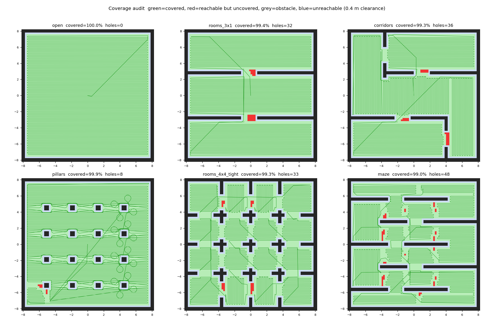
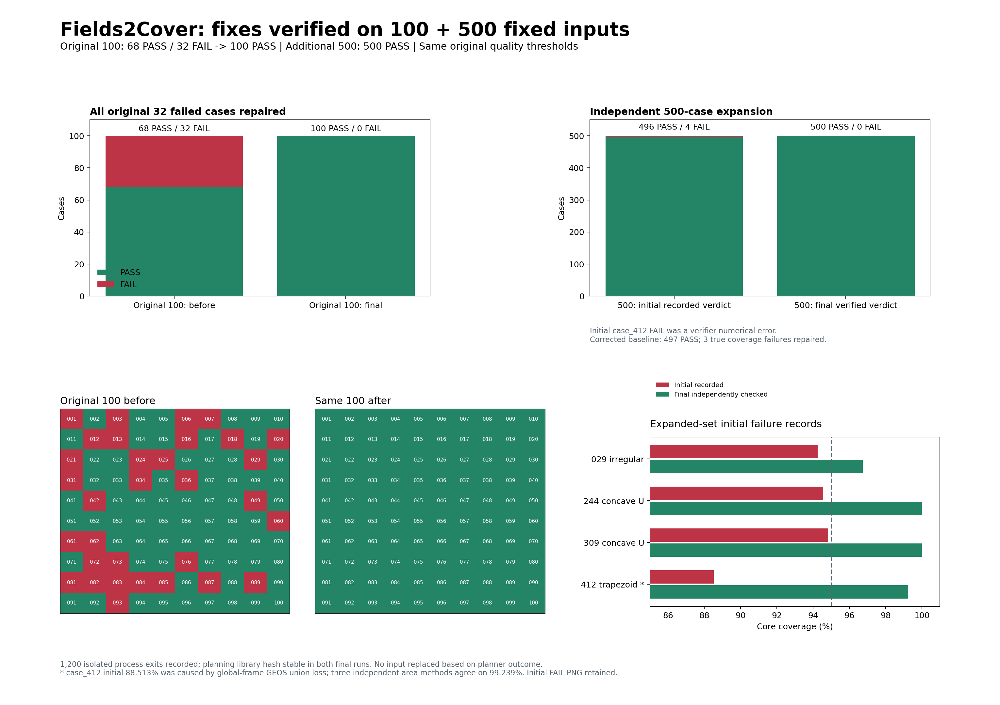
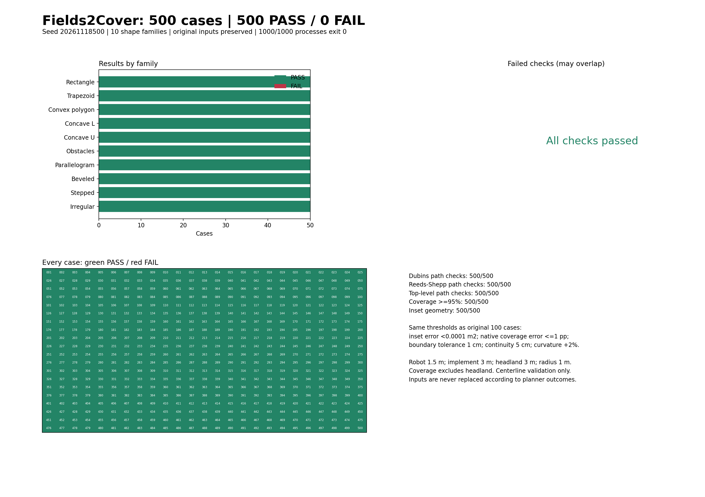
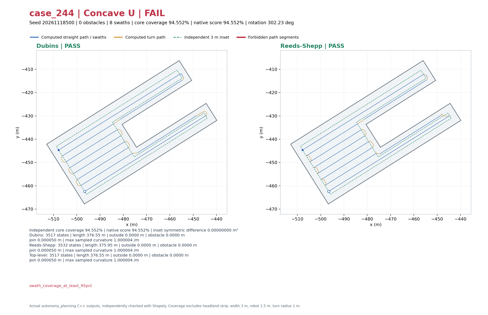
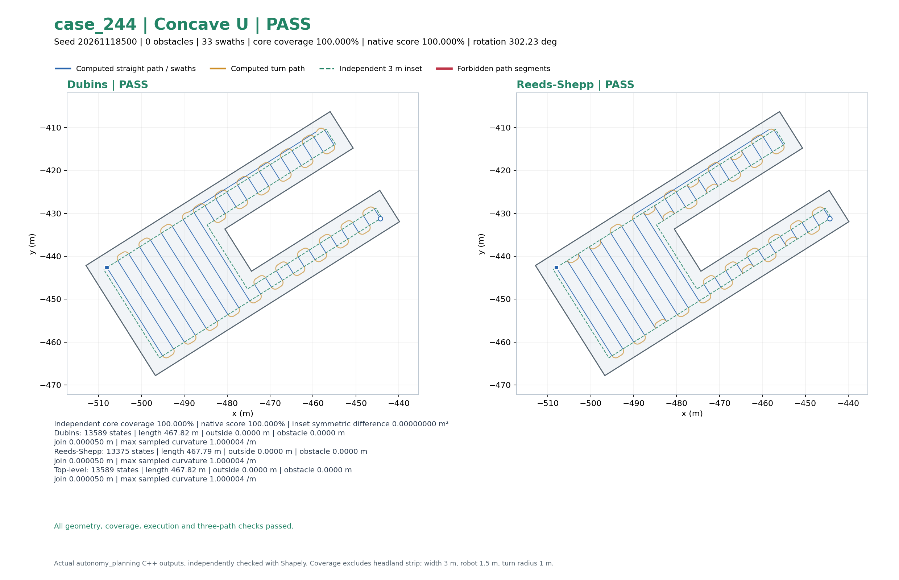

# Fields2Cover 验证、故障定位与结果

[返回目录](README.md) · [使用方式](fields2cover_usage.md) · [参数](fields2cover_parameters.md)

## 持久回归与示例验证

专项回归源码为 [fields2cover_test.cpp](../planner/fields2cover/fields2cover_test.cpp)，由 CMake 注册为 `planning.fields2cover_test`。启用方式和执行命令：

```bash
cd /workspace/autonomy
source /opt/ros/humble/setup.bash
colcon build --packages-up-to autonomy --cmake-args \
  -DAUTONOMY_BUILD_PLANNING=ON \
  -DAUTONOMY_BUILD_FIELDS2COVER=ON \
  -DAUTONOMY_BUILD_FIELDS2COVER_TESTS=ON
ctest --test-dir build/autonomy \
  -R '^planning\.fields2cover_test$' --output-on-failure
```

该测试包含 28 项检查：内缩距离及精度、孔洞扩张、线裁剪、距离、布尔运算、多组件、WKT、转弯连接、原 100 与新增 500 的失败输入，以及旋转共边、重叠与非法幅宽回归。CTest 显示 1 项专项测试，测试程序内部输出 `28/28 checks passed`；这两个计数层次不同。

[文档示例](examples/coverage_demo.cc) 独立编译并检查顶层 API、分阶段 API、Dubins/RS、GeoJSON 输入和路径输出。命令在[使用文档](fields2cover_usage.md)，输出 PNG 是实际 C++ 规划结果的绘图。

本次文档配套实测（2026-11-18）：示例 CMake 配置和编译通过，内置 WKT 与 GeoJSON 两种输入运行通过，路径 PNG 生成通过；专项 CTest 为 1/1 通过。这里没有重新运行整个仓库 CTest，也没有重新生成已经归档的 600 场景输入。

## 2026-11-24 地图级压测回归（task.coverage_stress_test）

地图级用例不再依赖地图文件或仿真节点：测试在内存里构造 82×82、0.2 m/格的占用栅格，直接调用 `CoverageServer::Compute()`。参数与 `conf/autosim_coverage.json` 对齐（`robot_width 0.35`、`robot_radius 0.4`、`operation_width 0.8`、`headland_width 0.3`、`headland_passes 1`、路径间距 0.15 m）。CMake 在 `AUTONOMY_BUILD_COVERAGE_TESTS=ON` 时注册 `task.coverage_stress_test`，超时 900 s。程序支持用第一个参数只跑一个用例（例如 `task.coverage_stress_test pillars`），设 `COVERAGE_STRESS_DUMP=<目录>` 会导出地图与路径，设 `COVERAGE_STRESS_TRACE=1` 会打印每个用例的转向统计。

每个用例断言三件事：请求被接受、`core_coverage` 不低于该地图阈值、发布路径没有任何位姿落在占用栅格上。

| 用例 | 布局 | 覆盖率 | 阈值 | 房间 | 位姿 | 障碍内位姿 | 耗时 |
| --- | --- | --- | --- | --- | --- | --- | --- |
| open | 空房间 | 100% | 0.99 | 1 | 41150 | 0 | 0.07 s |
| open_two_rings | 空房间，墙边 2 圈 | 100% | 0.99 | 1 | 39734 | 0 | 0.06 s |
| rooms_4x4_tight | 16 间 3.6 m 房间 + 2 m 门洞 | 99.55% | 0.98 | 16 | 55024 | 0 | 0.16 s |
| rooms_3x1 | 3 间宽房间 | 100% | 0.99 | 3 | 34168 | 0 | 0.05 s |
| l_shape | L 形 | 99.99% | 0.99 | 2 | 44789 | 0 | 0.11 s |
| corridors | 交错走廊 | 99.98% | 0.99 | 3 | 42829 | 0 | 0.11 s |
| pillars | 4×4 立柱 | 99.72% | 0.985 | 2 | 50160 | 0 | 3.03 s |
| clutter | 40 个随机 0.8 m 障碍 | 99.69% | 0.985 | 6 | 39231 | 0 | 2.76 s |
| narrow_door | 0.4 m 窄门 | 100% | 0.99 | 2 | 38107 | 0 | 0.05 s |
| maze | 5 条错位隔墙 | 99.93% | 0.985 | 13 | 46962 | 0 | 0.16 s |

整套 10 个用例耗时 6.6 s（CTest 计时）；当前 `ctest --test-dir build/autonomy -R '^task\.coverage'` 为 3/3 通过、合计 7.3 s。



上图把结果重新栅格化复核：绿色是清扫宽度（0.8 m，±0.4 m）覆盖到的可达格，红色是可达但没被覆盖的格，蓝色是被 0.4 m 机器人半径判为不可达的格。独立复核的覆盖率是 99.0%–100%，剩余红块集中在门洞侧壁和墙角，属于 0.4 m 转弯半径下的几何残留。逐段采样连续位姿之间的连线，穿墙段为 0。

### 参数一致性决定覆盖率数值

同一套用例改用 `Configuration` 默认值（田间机器人 `robot_width 1.5`）运行时，墙边内缩是 `max(0.25, 0.5 × 1.5) = 0.75 m`，3.6 m 房间的有效作业面只剩 2.1 m，覆盖率掉到 82%–65%。这不是规划漏洞，而是参数不匹配。用例现在显式构造与 `autosim_coverage.json` 一致的配置，阈值随之收紧到 0.98 以上。

### 墙边圈数由请求控制

`CoverageRequest` 新增可选字段 `headland_passes = 30`。服务端优先用它，其次用配置里的 `headland_passes`，圈数决定墙边带的宽度（圈数 × `operation_width`），核心区域从墙边带内侧开始扫。面板 `Navigation → Coverage` 的 “Wall loops” 数字框（0–5，默认 1）就写这个字段，填 0 时改由 Headland 宽度决定墙边带宽度，`open_two_rings` 用例覆盖了 2 圈的情形：覆盖率仍为 100%，路径不进入占用格。

### 性能：连接检查里的原生几何调用

压测最初跑不完，`gdb` 采样显示热点在 `FreeSpace::Contains()`：`SegmentClear()` 按 2 cm 采样，每个采样点都要遍历原生环坐标并调用 `GetX()/GetY()`。改成构造时把环坐标缓存成 `double`、每个环预存包围盒之后，`pillars` 从 100 s 以上降到 3 s，`planning.fields2cover_test` 仍然通过。

### 轨迹日志

`coverage: routed link ...` 这类轨迹默认不再输出；需要排查时设置 `AUTONOMY_COVERAGE_TRACE=1`，同时还会打印 `plan:`（房间、作业区、内缩）和 `band:`（墙边带面积）两行，用来核对内缩是否符合预期。

### 已知显示问题：立柱与外墙之间的绕行环

`pillars` 地图上，走过立柱的那一行必须绕开立柱，绕行结果是一个贴边的小环，视觉上像多出来一个圈。这是“同一行被立柱切断后仍然连续清扫”的必然代价，覆盖率不受影响（99.72%→复核 99.9%）。尝试过把同一批行片按列重排（每个立柱列扫完再换下一列），绕行环从 109 处降到 5 处、路径短 14%，但导出的路径在平滑阶段丢失了远端一片区域，复核覆盖率掉到 70%，因此没有采用，保留按行顺序。


## 2026-11-18 固定场景结果

以下是已归档结果，绑定到当时的输入和规划库；后续源码变化应重新执行验证。

- 原始随机 100：种子 `20261118`；修前 68 PASS / 32 FAIL；修后 **100 PASS / 0 FAIL**；最低核心覆盖率 **98.003%**。
- 独立新增 500：种子 `20261118500`；修后 **500 PASS / 0 FAIL**；最低核心覆盖率 **96.547%**。
- 两批总计 1,200 个隔离进程全部退出 0，无超时；两批规划库 SHA-256 相同且运行期间保持不变。
- 库 SHA-256：`9d96a5c2550854938a9837a46f25b03146b7e41c41713f62ec44ecea7949f04a`。
- 参数：机器人宽 1.5 m、作业宽 3 m、核心内缩 3 m、最小转弯半径 1 m。

新增 500 的 10 类形状各 50 个：矩形、梯形、凸多边形、凹 L、凹 U、障碍田地、平行四边形、倒角、阶梯、不规则田地。尺寸、旋转和平移范围扩大，障碍田地最多含 5 个孔洞。输入在运行前生成并核对 SHA-256，没有根据规划结果替换案例。





本目录保留[结果摘要及证据哈希](validation-results-20261118.json)。完整逐例输入、过程元数据、分析结果和 PNG 位于工作区 `artifacts`，不是库源码的运行依赖。

## 独立判定标准

每个场景检查条带、Dubins、Reeds–Shepp 和顶层默认 Dubins 路径。两个隔离 C++ 进程分别输出规划和原生覆盖评分，Python 使用独立 Shapely 几何进行复核。

- 输入有效、面积符合输入，内缩核心对称差 `<1e-4 m²`。
- 核心作业覆盖率 `≥95%`，条带非空，访问路线保留全部条带。
- 作业带在局部坐标合并，并与 `1e-9 m` 精度网格合并交叉核对，面积差 `<1e-4 m²`。
- 独立与原生覆盖比例差 `≤1` 个百分点。
- 条带和路径不穿孔洞，越界或障碍中的长度 `<1e-4 m`；边界使用 1 cm 容差。
- 路径坐标和段长有限、段长非负；连接误差 `<5 cm`；同方向相邻状态的采样曲率 `≤1.02/r`。
- 每个规划/评分进程正常退出；超时、异常和缺失输出均按失败记录。

覆盖率是核心作业区的覆盖率，排除地头。该验证不包含完整车体包络、工具扫掠、动态障碍、底盘加减速及实车跟踪；也没有把 CC/HC 纳入 600 场景批测。

## 新增 500 的失败修复与数值误判

初测记录为 496 PASS / 4 FAIL。`case_029`、`case_244`、`case_309` 实际覆盖不足，已修复条带方向与相位选择；`case_412` 的失败来自独立校验器全局坐标 GEOS 合并丢失面积。局部坐标合并、`1e-9 m` 精度合并、逐条面积及原生评分均支持约 99.239% 的覆盖率。校验器已修正并新增数值一致性检查，质量阈值保持不变。

case_244 的同一输入修复前后：





case_412 的[数值证据](../../../../../artifacts/fields2cover-random-fix/validation-numerics-case412.json)及原始 FAIL 图仍保留，避免将验证器误判当作规划器修复。

此次库修复包括多边形内缩精度、局部坐标覆盖合并、条带相位与方向补偿、`Route` 保存真实田地，以及受边界和曲率约束的连接搜索。持久回归包含上述真实失败输入。

## 结果文件与 PNG 索引

以下相对链接指向本工作区的历史产物；跨机器迁移文档时可同时复制对应 `artifacts`。本页嵌入的 PNG 和摘要已经放在文档目录内，可以单独查看。

- [总索引及全部失败修前/修后链接](../../../../../artifacts/fields2cover-random-fix/PNG-index.md)。
- [原 100 初测成功与失败 PNG](../../../../../artifacts/fields2cover-random-100/PNG-index.md)。
- [原 100 最终 PNG](../../../../../artifacts/fields2cover-random-fix/final-100/PNG-index.md)。
- [新增 500 最终 PNG](../../../../../artifacts/fields2cover-random-500-final/PNG-index.md)。
- [500 初测失败图及对应修后图](../../../../../artifacts/fields2cover-random-500-final/initial-failures/PNG-index.md)。
- [500 PNG 下载包](../../../../../artifacts/fields2cover-random-500-final-PNG.zip)：511 张最终图，加 4 张初测失败图和 2 张比较/测试图，共 517 张。
- [修复与失败证据包](../../../../../artifacts/fields2cover-random-fix-results.zip)：原 32 个失败与新增 4 个初测失败的前后图、比较、补丁和日志，共 77 张 PNG。

场景目录的 `scenarios.json` 和 `inputs/` 保存固定输入及哈希；`metadata.json` 保存库/程序哈希、退出码、超时与耗时；`raw/` 是原始 C++ 输出；`analysis/` 是逐例独立判定；`report.json` / `results.csv` 是汇总；`PNG-manifest.json` 保存图像尺寸及 SHA-256。

## 在新目录复测 500 个固定输入

下面命令复用已归档输入和测试程序源码，把新输出放到新目录，不改写历史结果。脚本中的编译路径绑定本容器工作区，其他环境需要对应调整。

```bash
cd /workspace/autonomy
f2c_baseline=/workspace/autonomy/artifacts/fields2cover-random-500-final
f2c_recheck=/workspace/autonomy/artifacts/fields2cover-recheck-500-$(date +%Y%m%d-%H%M%S)
mkdir -p "$f2c_recheck"
touch "$f2c_recheck/COLCON_IGNORE"
cp "$f2c_baseline/scenarios.json" "$f2c_baseline/run-batch.py" \
   "$f2c_baseline/validate-random.cpp" "$f2c_baseline/render-results.py" "$f2c_recheck/"
cp -a "$f2c_baseline/inputs" "$f2c_recheck/"

python3 "$f2c_recheck/run-batch.py" > "$f2c_recheck/run.log" 2>&1
export PYTHONPATH=/workspace/autonomy/artifacts/fields2cover-random-fix/python-deps
python3 artifacts/fields2cover-random-fix/analyze-parallel.py "$f2c_recheck"
python3 artifacts/fields2cover-random-fix/render-batch.py "$f2c_recheck"
```

仅退出 0 还不能说明所有几何检查通过；需要查看 `metrics.json` / `report.json`。`run-batch.py` 完成批次并记录各进程结果，分析阶段才形成逐例 PASS/FAIL。每个测试进程当前有 45 s 超时，批次使用 4 个并行 worker；校验和绘图分别使用 8 与 4 个 worker。

## 故障定位顺序

1. **编译或符号缺失**：核对两个 Fields2Cover CMake 开关及 `AUTONOMY_BUILD_PLANNING`；独立示例还需要 Eigen3、`autonomy_common` 与规划库。不要仅根据头文件存在认定共享库含覆盖实现。
2. **空核心或无条带**：检查单位、孔洞、输入拓扑及地头内缩；核心被内缩完全消除时应明确失败。不要用 `CONST + hg_swaths=0`。
3. **覆盖不足**：画核心和实际工具覆盖；核对条带角度、幅宽、相位和断裂组件。评分统一使用同一核心区，在局部坐标交叉检查近共线合并。
4. **连接穿障或曲率过大**：检查 `Route` 是否保存真实田地，避免使用无田地的直接条带重载；观察失败连接的起止姿态、最小半径及地头空间。
5. **约束搜索耗尽**：保留输入及起止姿态，检查可通行组件是否连通；CC/HC 没有连续曲率搜索替代。搜索失败应按失败输出，而不是输出方角路径。
6. **控制阶段倒车错误**：核对 `PathDirection` 的保留、车辆是否支持倒车和换向停顿。路径生成成功不等于当前导航控制器可执行该任务。

## 完整 CTest 的历史边界

先前归档的完整 CTest 是 **35/36**，唯一失败为 `control.policy_native_spline_tracker_test`，错误为：

```text
MPPIController admitted native gate: nonfinite or forbidden reverse feedback command
```

这是 2026-11-18 当次完整测试的历史快照，属于控制器模块；[归档完整日志](../../../../../artifacts/fields2cover-random-fix/ctest-final.log)和[单独失败复测](../../../../../artifacts/fields2cover-random-fix/ctest-mppi-recheck-failed.log)已保留。文档专项复测只运行 Fields2Cover；不把这份历史计数当作当前整个仓库的最新状态。需要全仓结果时运行 `ctest --test-dir build/autonomy --output-on-failure` 并另存日期和日志。
