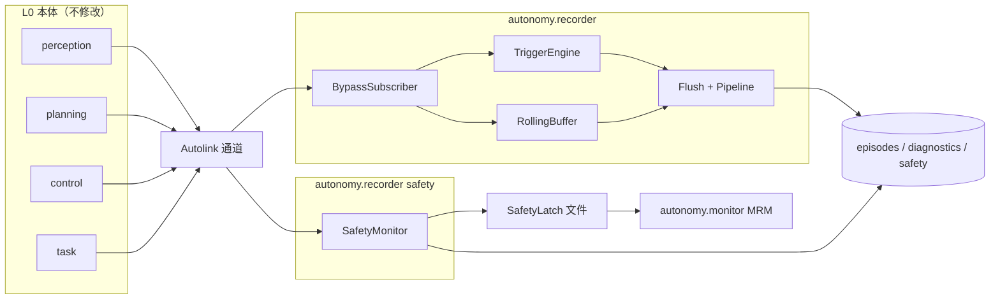

# 03 架构

机上三条独立进程：`autonomy.recorder`（L1 采集 + flush 时跑 L2–L6）、`autonomy.recorder safety`（L4 闩锁）、`autonomy.monitor`（既有 MRM）。autoviz 与 CLI 离线消费产物。Bridge 不参与采集。

## 进程拓扑

控制输出仍由 control 直接写 `/cmd_vel`。safety 与 recorder 均为读者。

## 分层与源文件

| 层 | 源文件 | 运行位置 |
|----|--------|----------|
| L1 订阅 | `subscriber.cpp` | recorder 进程 |
| L1 缓冲 / 触发 / episode | `rolling_buffer` `trigger` `episode` `clock` | recorder 进程 |
| L1 解析（只读） | `signals.cpp` | recorder / safety |
| L1 容器 | `mcap_writer.cpp` | recorder / player |
| L2 | `event_graph` `root_cause` | flush / `pipeline` |
| L3 | `bt_attribution.cpp` | flush / `pipeline` |
| L4 | `hash_chain` `safety_monitor` | recorder flush；safety 进程 |
| L5 | `metrics.cpp` | flush / `pipeline` / `gate` |
| L6 | `replay.cpp` `player.cpp` | `replay --profile` / `verdict` |
| 边 | `value_tier` `upload` `convert` `sidecar` `observation` | CLI / flush |

`Recorder` 编排 L1 与 flush。`RunEvidencePipeline` 无 Autolink 依赖，可单测。

## 与相邻域

| 域 | 关系 |
|----|------|
| `system/safety/SafetyLatch` | 急停与 L4 Fallback 的进程间文件闩；Bridge E-Stop 共用。 |
| `system/monitor` MRM | 读闩后执行停机；recorder 不实现制动。 |
| `BtStatusLogger` | 发布 `/behavior_tree/log`；recorder 只订阅。 |
| EventBundler 日志树 | P0 写 `$AUTONOMY_LOG_ROOT/events/recorder_<id>/manifest.json`，不调用 bundler。 |
| gRPC Bridge | 健康 / 急停 / 改参；采集不经 Bridge。 |
| autoviz Record | 播放 `.mcap` / `.record`。 |
| autoviz Evidence | 读 `.sidecar.json`；写 `.observations.jsonl`；cursor seek 到 Record 时间轴。 |

## 构建入口

| 系统 | 目标 |
|------|------|
| CMake | `option(AUTONOMY_BUILD_RECORDER ON)` → `autonomy.recorder`、`system.recorder_test` |
| Bazel | `//autonomy/system:autonomy.recorder`、`:recorder_test` |

关闭开关后 `autonomy_system` 过滤 `recorder/` 源，launch 中的模块若仍存在会启动失败，部署时应同步去掉 `autonomy.launch` 的 recorder 模块。

## 配置面

单一来源：`recorder_options.proto` + `conf/recorder.pb.txt`。`LoadRecorderOptions` 填默认通道与限幅。字段语义见 [05 使用](05_usage.md)。

订阅 QoS：BEST_EFFORT + KEEP_LAST。`depth`/`queue` 为 0 时启发式为高频 32/64、大载荷 2/8（`--full-dump` 为 64/16），避免 depth=1 丢掉滚动窗口。测试全量：`recorder_full.launch` / `--full-dump`。

采集热路径：通道 flags 在 Attach 时算好；schema/`GetMsgType` 只查一次；flush 用 `TakeAll` 移动 payload；MCAP 消息体直接 `write` 进文件，不经中间 `std::string`。`cmd_vel` 动作与 session BT 转移有上限，避免全量会话撑爆内存。

## 故障隔离

- 订阅失败：recorder 仍 `WaitForShutdown`，不反向影响发布者。
- MCAP 打开失败：打日志，丢弃本次 flush。
- 哈希链损坏：`verify-chain` / `Load` 失败；safety 从空链重新开始需运维介入，不自动截断历史。
- HIL：闩锁已置则进程以非零退出，避免在急停态往总线上灌回放。
