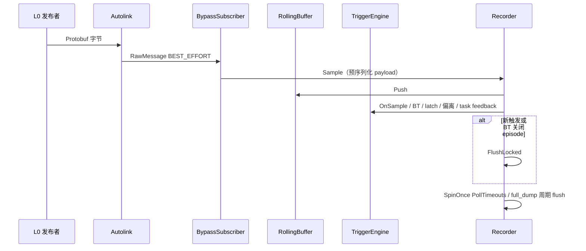
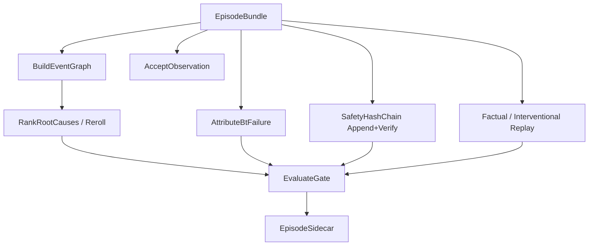
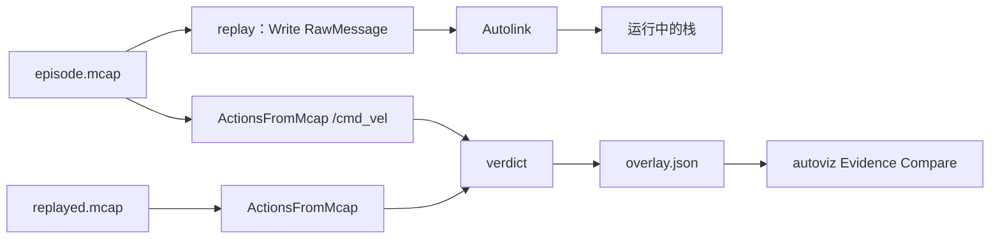

# 04 数据流

在线路径只处理 `Sample{channel, payload, DualClock}`。业务 Protobuf 的完整反序列化仅发生在触发所需的 odom / path / twist / cost、任务 feedback，以及 BT log。证据图与门禁在 episode 关闭时对内存 bundle 计算，再写成 sidecar。

## 在线采集



`HandleSample` 额外分支：

- `odom_channel` / `plan_channel` → `PathTracker` → 超差则 `TRIGGER_PATH_DEVIATE`
- `cost_channel` → `OnCost`
- `cmd_vel_channel` → `TwistToAction` 追加 `ActionEvent`
- `teleop_goal_channel` → `OnTakeover`
- `/autonomy/task/*/goal`、`/goal_pose` → 打开 episode
- `/autonomy/task/*/feedback` → FAILED/CANCELED（及 tracking TARGET_LOST）为 `TRIGGER_TASK_FAILURE`；localization `quality` 低于 `localization_quality_floor` 同样触发
- `bt_log_channel` → 解析 `BehaviorTreeLog`，维护 `EpisodeTracker`；关闭则 flush

## Episode 落盘

关闭 episode 时目录由 `admitted` 选择：

```text
$output_dir/
  episodes/   # 四元组齐全
  diagnostics/
  metrics/episodes.jsonl
  gate/latest.json
  safety/chain.bin
```

每个 episode 一组同 stem 文件：

| 文件 | 内容 |
|------|------|
| `<id>.mcap` | 默认：触发窗口内 RawMessage；`--full-dump`：会话全程增量 |
| `<id>.sidecar.pb` | `EpisodeSidecar` |
| `<id>.sidecar.json` | 图节点/边、触发、观察、门禁、时钟 |
| `<id>.manifest.json` | `admitted`、`priority`、`upload`、`policy` |
| `<id>.overlay.json` | `ReplayReport`（flush 时为占位自洽） |
| `<id>.observations.jsonl` | 人工观察（可选，flush 前读入） |

P0 急停 / 任务失败触发会在 flush 中追加哈希链项，并 `chain_.Save(safety/chain.bin)`。

## 证据 pipeline



`PublishGate.passed` 需同时满足：回放 `valid`、安全链可验证、re-roll 通过或无卡片、`delta_success_set` 不低于 `-regression_delta_limit`、归因覆盖 ≥ `attribution_coverage_floor`。覆盖与 MPS/MPD 在机队 jsonl（最多 256）+ 当前 episode 上计算。`gate/latest.json` 是该快照的边侧镜像。

离线重跑：`autonomy.recorder pipeline -i <id>.sidecar.pb`（从 pb 恢复 bundle 中的 header / triggers / observations / actions / safety，再计算）。

## SIL / HIL / 裁决



`ActionsFromMcap` 扫描 topic 名含 `cmd_vel` 的消息；`ParseTwist` 先识别 `TwistStamped`（本栈 `/cmd_vel`），否则回退 `Twist`。`SkipReplayTopic`：`mid_stack` 跳过 `cmd_vel*`；`sensor_in` 再跳过 plan / BT / task / perception。采集 flush 的 overlay 为 `pending_replay`，不是自比通过。

## 观察与分诊

autoviz 打开 `<id>.sidecar.json` 后：

1. 读取同 stem 的 `.overlay.json`、`.observations.jsonl`
2. Timeline / Causal / BT 共用 monotonic cursor
3. cursor 按 episode `[start,end]` 线性映射到 Record 面板 `rangeStartSec–rangeEndSec` 并 `seekTo`
4. Observe 页追加 jsonl 行（须绑定节点）

拖入 `*.sidecar.json` 会 `showPanelByObjectName(EvidenceDock)` 并加载。

## 上传与转换

```text
episodes/*.manifest.json
  → upload=true 且 admitted
  → 拷贝 mcap / sidecar.pb / sidecar.json / manifest / overlay / observations.jsonl
convert：mcap → <out>/meta/info.json + data/chunk-000/episode_000000.jsonl
```

`convert` 不写 parquet；帧率由 `--fps` 控制。未 admitted 的 diagnostics 默认不上传。
