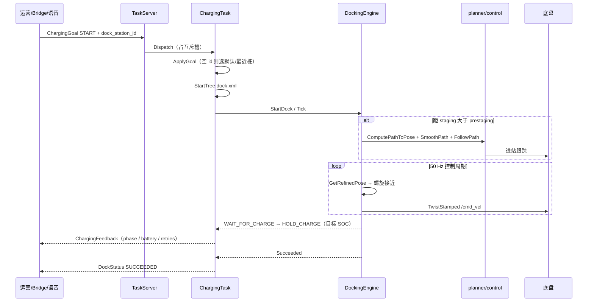
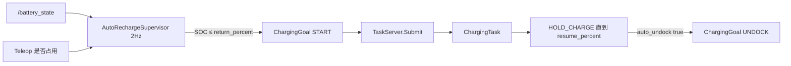
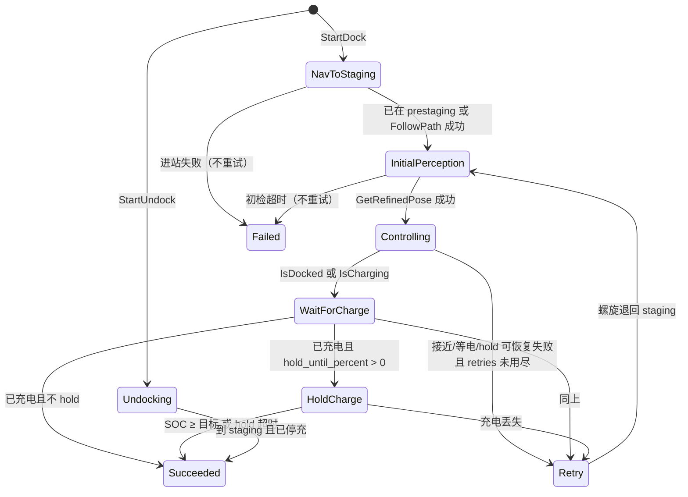

# 充电 / 自动回充

`autonomy/task/charging` 是 Task 域的对接与自动回充：无 ROS，消息为 automsgs proto。流程对齐 OpenNav Docking（进站 → 初检 → 螺旋接近 → 等电流 → 保持充电），由 `DockingEngine` 按 task 周期 tick，不阻塞 ROS action。

| 项 | 说明 |
|---|---|
| 任务类型 | `ROBOT_TASK_DOCK` |
| 目标通道 | `/autonomy/task/charging/goal`（`ChargingGoal`） |
| 反馈通道 | `/autonomy/task/charging/feedback`（`ChargingFeedback`） |
| 配置 | `task/conf/charging.pb.txt`（安装后 `share/autonomy/task/conf/`） |
| 对接树 | `task/conf/behavior_tree/charging/dock.xml`（`DockRobot`） |
| 脱桩树 | `task/conf/behavior_tree/charging/undock.xml`（`UndockRobot`） |
| BT 周期 | 10 ms（`BtDefaults` charging profile） |

---

## 1. 架构

四层。树只编排一次 `DockRobot` / `UndockRobot`；对接 FSM、选桩、碰撞投影在引擎里。自动回充是独立 2 Hz 监督器，经 `TaskServer::Submit` 发同样的 `ChargingGoal`。

```text
  /battery_state                    /autonomy/task/charging/goal
  /detected_dock_pose               Bridge ChargeService / 语音
           │                                    │
           ▼                                    ▼
  AutoRechargeSupervisor ── Submit(ChargingGoal) ──► TaskServer
  （电量滞回 / 冷却 / 遥控互锁）                      │ 互斥槽 preempt 导航
                                                     ▼
                                               ChargingTask
                                          ApplyGoal + StartTree
                                                     │
                          ┌──────────────────────────┼──────────────────────────┐
                          ▼                          ▼                          ▼
                     dock.xml                   undock.xml               ChargingClient
                     DockRobot                  UndockRobot                    │
                          │                          │                         ▼
                          └────────────── Tick() ────┴──────────────► DockingEngine
                                                                     │
                         ┌───────────────┬───────────────┬───────────┼────────────┐
                         ▼               ▼               ▼           ▼            ▼
                   DockDatabase    DockNavigator   DockController  ChargingDock  /cmd_vel
                   桩库 / 插件     规划+平滑+跟踪   Park–Kuipers    SimpleChargingDock
                                   FollowPath      + local costmap  电池 / 外检 / 堵转
```

| 模块 | 路径 | 职责 |
|---|---|---|
| `ChargingTask` | `charging/charging.*` | `DOCK_CMD_*`、黑板、生命周期 ↔ `DockStatus`、进度 |
| `ChargingClient` | `charging/charging_client.*` | 目标字段、默认/最近选桩、`hold_until` SOC |
| `DockingEngine` | `charging/dock/docking_engine.*` | OpenNav 状态机（tick，非阻塞） |
| `DockDatabase` | `charging/dock/dock_database.*` | YAML/proto 桩实例 + `REGISTER_CHARGING_DOCK` 插件 |
| `DockNavigator` | `charging/dock/navigator.*` | `ComputePathToPose` → `SmoothPath` → `FollowPath`，失败再试一次 |
| `DockController` | `charging/dock/controller.*` | 螺旋律 + `/local_costmap` 轨迹碰撞 |
| `SimpleChargingDock` | `charging/dock/simple_charging_dock.*` | 进站偏移、外检 3D 外参、电流/堵转/SOC |
| `AutoRechargeSupervisor` | `charging/auto_recharge.*` | 低电自动 `START`，可选满电 `UNDOCK` |
| BT | `plugins/action/dock_robot_action.cpp` 等 | `DockRobot` / `UndockRobot` 每拍 `engine.Tick()` |

调度：`DOCK_CMD_START` / `UNDOCK` 占用与导航同类的**互斥槽**（`allow_preemption=true` 时可抢占导航/探索）。遥控 `skip_if_teleop` 时监督器不发回充。

`DockSearch` / `DockApproach` / `DockConnect` / `ChargerVisible` 仍链进库，**当前正式树不用**（旧桩搜索 XML 的遗留节点）。

---

## 2. 数据流

### 2.1 手动对接



### 2.2 自动回充



策略（`AutoRechargePolicy`，无 I/O）：

- 电量新鲜（默认 5 s 内有 `/battery_state`），否则不动作。
- 遥控占用且 `skip_if_teleop`：不动作。
- 失败/取消后 `cooldown_sec`（默认 60 s）内不重发。
- 连续失败 ≥ `max_consecutive_failures`（默认 3）：暂停直到 SOC ≥ `resume_percent`。
- 对接任务已在跑：不再发 `START`；仅当 `auto_undock` 且处于 hold/wait 且 SOC ≥ resume 时发 `UNDOCK`。
- 发令后 5 s 内不重复 Submit。

`percentage` 按 0–1 或 0–100 归一到 **0–100**；无效时用 `charge/capacity`。

### 2.3 对接状态机（引擎）



重试范围与 OpenNav 一致：**只对接近 / 等电流 / hold 中丢失充电** 回 staging；进站规划失败、初次检测失败直接失败。

---

## 3. 输入和输出

通道名见 `task/common/names.hpp`。

### 3.1 任务 I/O

| 方向 | 通道 | 类型 | 说明 |
|---|---|---|---|
| 入 | `/autonomy/task/charging/goal` | `ChargingGoal` | 对接/脱桩/暂停/取消 |
| 出 | `/autonomy/task/charging/feedback` | `ChargingFeedback` | status、phase、SOC、retries、error |
| 入 | `/battery_state` | `sensor_msgs.BatteryState` | 自动回充 + `IsCharging`（电流阈值） |
| 入 | `/detected_dock_pose` | `PoseStamped` | 可选外检（AprilTag 等） |
| 入 | `/joint_states` | `JointState` | 可选堵转判接触 |
| 入 | `/local_costmap` | `OccupancyGrid` | 接近段碰撞投影 |
| 入 | `/local_costmap/published_footprint` | `PolygonStamped` | 有则用之，否则圆足迹 `robot_radius` |
| 出 | `/cmd_vel` | `TwistStamped` | 螺旋接近 / 退回 staging / 脱桩 |
| 出 | `/dock_pose` | `PoseStamped` | 当前使用的桩位（调试） |
| 出 | `/filtered_dock_pose` | `PoseStamped` | 外检滤波后 |
| 出 | `/staging_pose` | `PoseStamped` | 进站位 |
| 出 | `/docking_trajectory` | `nav_msgs.Path` | 投影轨迹（base 系） |
| TF | `map` ← `base_link`，`odom` ← `base_link` | — | 进站用 map；控制用 `fixed_frame`（默认 odom） |

进站导航 RPC（与导航任务共用 `NavigationClient`）：

| RPC | 通道 |
|---|---|
| 规划 | `/compute_path_to_pose` |
| 平滑 | `/smooth_path` |
| 跟踪 | `/follow_path` |

**不能**在 ChargingTask 进程内再调 `/navigate_to_pose`（会与自身抢槽）。`DockNavigator` 是 NavigateToPose 管道的进程内等价：规划 + 平滑 + 跟踪，失败递归一次。

### 3.2 `ChargingGoal`

| 字段 | 含义 |
|---|---|
| `command` | `START` / `STOP` / `PAUSE` / `RESUME` / `CANCEL` / `UNDOCK` |
| `dock_station_id` | 桩库 key 或 `id`；空则默认/最近桩 |
| `dock_pose` | 不用 id 时的地图系桩位 |
| `use_dock_id` | 与 oneof 一起决定目标 |
| `dock_type` | 插件名，默认 `simple_charging_dock` |
| `max_staging_time` | 进站超时 [s]，默认 1000 |
| `navigate_to_staging_pose` | optional，缺省 **true** |
| `max_undocking_time` | 脱桩超时 [s]，默认 30 |
| `max_retry_count` | 覆盖配置 `max_retries`；≤0 用配置 |
| `battery_target_percent` | optional，0–100。缺省：自动回充开则用 `resume_percent`，否则 **0**（电流起来即成功，OpenNav） |

### 3.3 `ChargingFeedback` / 相位

| `DockPhase` | `DockStatus`（运行中） | 进度约 |
|---|---|---|
| `NAV_TO_STAGING` | APPROACHING | 0.20 |
| `INITIAL_PERCEPTION` | SEARCHING | 0.40 |
| `CONTROLLING` / `RETRY` | DOCKING | 0.60 / 0.35 |
| `WAIT_FOR_CHARGE` / `HOLD_CHARGE` | CHARGING | 0.75–0.95 |
| `UNDOCKING` | UNDOCKING | 0.50 |

终态：`SUCCEEDED` / `FAILED` / `CANCELED`。`error_code` 见 `status_msgs` 500–512。

| 码 | 含义 |
|---|---|
| `CHARGING_DOCK_NOT_FOUND` (500) | 桩 id 不在库 |
| `CHARGING_DOCK_NOT_VALID` (508) | 无插件 |
| `CHARGING_FAILED_TO_STAGE` (509) | 进站规划/跟踪失败 |
| `CHARGING_FAILED_TO_DETECT` (510) | 初检或接近中丢失检测 |
| `CHARGING_FAILED_TO_CONTROL` (511) | 螺旋/碰撞/超时 |
| `CHARGING_FAILED_TO_CHARGE` (512) | 等电流超时或 hold 中掉电 |
| `CHARGING_CANCELLED` (505) | 取消 |

### 3.4 其它入口

| 入口 | 行为 |
|---|---|
| Bridge `ChargeService/Return` | 译成 `DOCK_CMD_START`（见 `docs/source/15_Bridge/rpcs/10_dock_command.md`） |
| Bridge `Leave` | `DOCK_CMD_UNDOCK` |
| 语音 `VOICE_INTENT` 回充 | `TaskServer::WireVoiceDispatchers` → `Submit(ChargingGoal)` |
| 自动回充 | 监督器直接 `Submit` |

---

## 4. 如何启动

对接依赖 **定位 TF + 地图/局部代价地图 + planning + control + task**。不要与 `autonomy/system/launch/autonomy.launch` 同时再开一份 `task.launch`。

### 4.1 编译安装

```bash
docker exec SpaceHero cmake --build /workspace/autonomy/build/autonomy \
  --target automsgs autonomy_task -j"$(nproc)"
docker exec SpaceHero cmake --install /workspace/autonomy/build/autonomy --prefix /usr/local
```

### 4.2 改桩位（必做）

`charging.pb.txt` 里 `docks { x, y, yaw }` 默认 **(0,0,0)**，必须改成地图系实测桩位，否则会进站到原点。

```text
docks {
  name: "default"
  type: "simple_charging_dock"
  frame: "map"
  x: 12.4
  y: -3.1
  yaw: 1.57
  id: "default"
}
auto_recharge {
  enable: true
  preferred_dock_id: "default"
}
```

安装后文件在 `/usr/local/share/autonomy/task/conf/charging.pb.txt`（以实际 `config_directory` 为准）。改完需重新 install 或保证运行时读的是改过的那份。

### 4.3 拉起栈

```bash
cd /workspace/autonomy/src/autonomy
export PATH=/workspace/autonomy/build/autonomy/bin:$PATH
export AUTOLINK_LAUNCH_PATH=$PWD/autonomy/task/launch
autolink launch start task.launch
```

停止：`autolink launch stop task.launch`。

仅 task（planning/control 已在跑）：

```bash
autonomy.task --config_directory=config
```

前置：`map`→`base_link`、`/local_costmap`（碰撞开时）、`/battery_state`（自动回充 / 电流判充）。

### 4.4 手动发对接

`ChargingGoal` 写到 `/autonomy/task/charging/goal`。最小 START：

- `command = DOCK_CMD_START`
- `dock_station_id = "default"`（或留空走选桩）
- 可选 `battery_target_percent = 95`

脱桩：`command = DOCK_CMD_UNDOCK`。取消：`DOCK_CMD_CANCEL`（会进入自动回充冷却，避免立刻再去桩）。

### 4.5 自动回充

`auto_recharge.enable: true`（默认配置已开）。TaskServer `Bind()` 后启动监督器：

1. SOC ≤ `return_percent`（20）→ `START`，`battery_target_percent = resume_percent`（95）
2. 引擎 `HOLD_CHARGE` 直到 SOC ≥ 95 或 `max_hold_charge_sec`（默认 4 h，仍在充则记成功）
3. `auto_undock: false`：满电停在桩上；改为 true 才自动 `UNDOCK`

关闭自动回充：`auto_recharge.enable: false`。

### 4.6 视觉对接（可选）

```text
plugins { simple {
  use_external_detection_pose: true
  detected_dock_pose_topic: "/detected_dock_pose"
  external_detection_rotation_pitch: 1.57
  external_detection_rotation_roll: -1.57
}}
```

检测节点发 `PoseStamped`。超时用消息 stamp（stamp=0 则用接收时刻）。外参与 OpenNav 相同：`setEuler(pitch, roll, yaw)` 再压成平面 yaw。

### 4.7 倒车入桩

`dock_backwards: true`：目标 yaw+π，螺旋倒车；脱桩/回退方向取反。

---

## 5. 配置要点

`DockingOptions`（`automsgs/proto/task/charging.proto`）：

| 组 | 关键项 | 默认 |
|---|---|---|
| 时序 | `controller_frequency` | 50 Hz |
| | `initial_perception_timeout` | 5 s |
| | `wait_charge_timeout` | 5 s（等到电流） |
| | `dock_approach_timeout` | 30 s |
| | `max_retries` | 3（共最多 4 次接近） |
| | `dock_prestaging_tolerance` | 0.5 m（含 yaw 的 L2，小于则跳过进站导航） |
| 控制 | `v_linear_max` / `v_angular_max` | 0.25 / 0.75 |
| | `use_collision_detection` | true |
| | `dock_collision_threshold` | 0.3 m（近桩不查碰撞） |
| 插件 | `charging_threshold` | 0.5 A |
| | `docking_threshold` | 0.05 m（无堵转时用距离） |
| | `staging_x_offset` | −0.7 m |
| 自动回充 | `return_percent` / `resume_percent` | 20 / 95 |
| | `battery_stale_sec` | 5 |
| | `cooldown_sec` | 60 |
| 桩库 | `docks{}` 或 `dock_database: "…/docks.yaml"` | YAML 与 OpenNav 同形：`docks.<name>.{type,frame,pose[x,y,yaw],id}` |

`proto3` 里 `0` 会与「未设」混淆的量已改成 `optional`（如 `use_battery_status`、`staging_x_offset`、`navigate_to_staging_pose`）。

---

## 6. 源码索引

```text
autonomy/task/charging/
  charging.hpp/.cpp              ChargingTask
  charging_client.*              门面
  auto_recharge.*                策略 + 监督器
  auto_recharge_test.cpp         滞回/互锁 gtest
  dock/docking_engine.*          FSM
  dock/controller.*              控制 + 碰撞
  dock/navigator.*               进站导航
  dock/simple_charging_dock.*    默认插件
  dock/charging_dock.hpp         插件接口
  plugins/action/dock_robot_action.cpp
  plugins/action/undock_robot_action.cpp
automsgs/proto/task/charging.proto
task/conf/charging.pb.txt
task/conf/docks.yaml
task/conf/behavior_tree/charging/dock.xml
task/conf/behavior_tree/charging/undock.xml
```

---

## 7. 故障对照

| 现象 | 排查 |
|---|---|
| 一上电就往原点开 | `docks.x/y` 仍是 0，改地图桩位并确认读到的 conf |
| 自动回充不触发 | `/battery_state` 是否在 5 s 内更新；遥控是否占用；是否在冷却；`enable` |
| 进站失败 `FAILED_TO_STAGE` | planning/control 是否起；`/compute_path_to_pose`；起点是否在障碍里 |
| 接近失败 `FAILED_TO_CONTROL` | `/local_costmap`；足迹；`use_collision_detection`；速度是否过小卡死 |
| 初检失败 `FAILED_TO_DETECT` | 未开外检时静态桩位应直接成功；开外检则查 `/detected_dock_pose` stamp |
| 等不到充电 `FAILED_TO_CHARGE` | `current` 是否大于 `charging_threshold`；`use_battery_status` |
| 满电立刻又去桩 | 取消后的冷却；`return_percent` 是否过高；发 `CANCEL` 会 `NotifyCancel` |
| 与导航抢车 | 设计如此：回充占互斥槽。要先取消导航或等回充结束 |

量产前至少验收：真实桩位、低电自动回充、接触+电流、hold 到目标 SOC、取消冷却、遥控互锁、碰撞开启时的窄通道接近。
