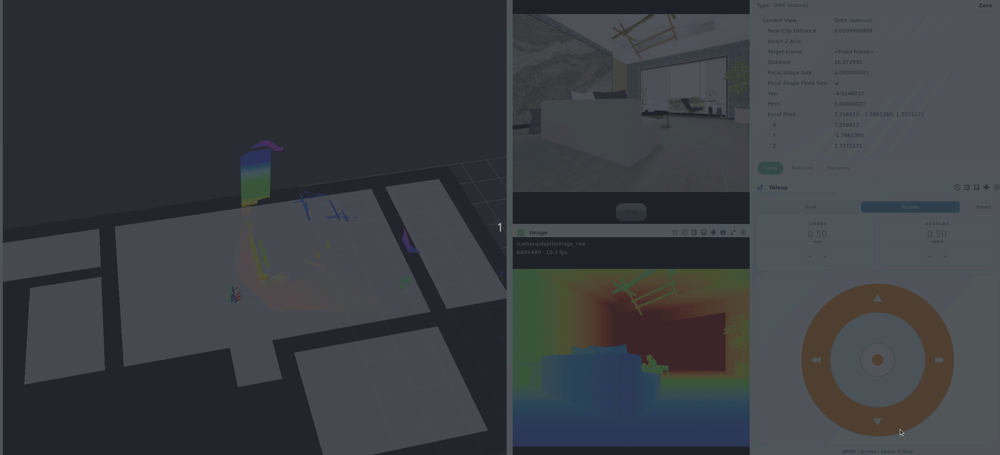

# autosim

多后端**传感器–执行器桥**：经 Autolink 发布传感、订阅 `/cmd_vel`，并对接 TF / 仿真时钟 / 可选真值地图。  
**不实现** MapService / NavigationService / LocalizationService RPC。



> Isaac（酷家乐 InteriorAgent）与 Autoviz：RGB-D、`/map`、`/overall/map`、PhysX。完整文档见 [`docs/`](docs/)。

## 文档

| § | 文档 | 内容 |
|---|------|------|
| 00 | [指南](docs/00_guide.md) | 边界、术语、阅读路径 |
| 01–02 | [概述](docs/01_overview.md) · [架构](docs/02_architecture.md) | 能力与数据流 |
| 03–04 | [快速开始](docs/03_quickstart.md) · [后端](docs/04_backends.md) | 安装启动与三后端 |
| 05–06 | [配置](docs/05_configuration.md) · [话题](docs/06_topics.md) | YAML 与 Autolink 通道 |
| 07–08 | [Isaac](docs/07_isaac.md) · [地图与可视化](docs/08_map_and_viz.md) | USD / PhysX / Autoviz |
| 09–10 | [测试](docs/09_testing.md) · [排错](docs/10_troubleshooting.md) | pytest 与常见问题 |
| 11 | [数据采集](docs/11_dataset.md) | LeRobot v2.1 模仿学习落盘 |
| 12 | [HuNav Isaac](docs/12_hunav_isaac.md) | Autolink ComputeAgents / manager |
| 13 | [Atlas 验证](docs/13_atlas_validation.md) | RGB-D + IMU、真值轨迹、稠密点云与栅格地图 |
| 14 | [Habitat humanoids](docs/14_habitat_humanoids.md) | Habitat SMPL-X 动态人体（本地 `data/humanoids/`） |

索引：[`docs/README.md`](docs/README.md)。

## 包结构

| 层 | 路径 | 职责 |
|----|------|------|
| 编排 | `runtime/` | Runner、Config、paths |
| 引擎 | `backends/` | 契约（protocol/registry）+ habitat/fake/isaac |
| ↳ Habitat 行人 | `backends/habitat/humanoids/` | Traffic → kinematic SMPL-X（RGB-D 可见） |
| 场景 | `scene/` | Map、World、Traffic、`gen/`、`agents/` |
| 桥接 | `bridge/` | Bridge、Messages、Teleop、Sensors |
| 机器人 | `robot/` | plant、URDF、profiles、`policy/` |
| 数据集 | `dataset/` | LeRobot 采集 |
| 人体资产 | `data/humanoids/` | SMPL-X URDF + motion pickle（gitignore，需下载） |

详见 [架构](docs/02_architecture.md) · [数据集](docs/11_dataset.md) · [Habitat 人体](docs/14_habitat_humanoids.md)。

## 后端一览

| `habitat.backend` | 配置 | 说明 |
|-------------------|------|------|
| `habitat` | `config/default.yaml` | Habitat-Sim + GLB / MP3D |
| ↳ 行人 | `config/habitat_people.yaml` | CPU SFM + 本地 SMPL-X 动态人体（`data/humanoids/`） |
| `fake` | `config/fake.yaml` | 无引擎：差速 + RGBD raycast + scenario |
| `isaac` | `config/isaac.yaml` | Isaac Sim + USD；PhysX、相机、真值地图、动态体（默认 turtlebot3） |
| ↳ 导航 | `config/isaac_nav.yaml` | 差速 turtlebot + 真人行人；对接外部导航/SLAM |

## 快速命令

```bash
cd /workspace/autonomy

# Fake
CONFIG=src/autonomy/autosim/config/fake.yaml src/autonomy/autosim/scripts/run.sh sim

# Habitat（默认 GLB / MP3D）
CONFIG=src/autonomy/autosim/config/default.yaml \
  src/autonomy/autosim/scripts/run.sh sim

# Habitat + 动态人体（需先准备 data/humanoids/humanoid_data）
cd src/autonomy/autosim && python3 scripts/download_humanoids.py && cd -
CONFIG=src/autonomy/autosim/config/habitat_people.yaml \
  src/autonomy/autosim/scripts/run.sh sim

# Isaac（需 Isaac Lab Python）
ISAACLAB_PATH=/workspace/isaaclab \
CONFIG=src/autonomy/autosim/config/isaac.yaml \
  src/autonomy/autosim/scripts/run.sh sim

# 遥控（另终端，需 TTY 焦点）
src/autonomy/autosim/scripts/run.sh teleop
```

Habitat 行人：平面运动走 `scenario.pedestrian`（agents YAML / SFM），外观为本地
SMPL-X（`avatar` / `skin` 可配）。详见 [14](docs/14_habitat_humanoids.md)。

## Atlas 验证（RGB-D + IMU）

`config/atlas.yaml` 使用 Habitat 发布同步 RGB-D、IMU、TF、仿真时钟和
`/gt/odometry`；Atlas 独占 `map -> odom`、稠密点云与占用栅格。启动前先
确认没有其他 Atlas 或地图发布进程：

```bash
docker exec -it SpaceHero /bin/bash
pgrep -af autonomy.localization
```

若有旧进程，先通过对应 launch 停止，不能同时运行两个 Atlas。完整验证按
下面顺序使用四个终端。

### 1. 编译

```bash
docker exec -it SpaceHero /bin/bash
cd /workspace/autonomy
colcon build --packages-up-to autonomy
```

### 2. 启动仿真、Atlas 和遥控

终端一启动 Habitat：

```bash
docker exec -it SpaceHero /bin/bash
cd /workspace/autonomy
CONFIG=src/autonomy/autosim/config/atlas.yaml \
  src/autonomy/autosim/scripts/run.sh sim
```

终端二启动 Atlas。这里必须从源码根目录启动，使 launch 内的相对配置路径
能够正确解析：

```bash
docker exec -it SpaceHero /bin/bash
source /workspace/autonomy/install/setup.bash
cd /workspace/autonomy/src/autonomy
export PATH=/workspace/autonomy/build/autonomy/bin:$PATH
export AUTOLINK_LAUNCH_PATH=$PWD/autonomy/localization/launch
autolink launch start localization_atlas_autosim.launch
```

终端三遥控机器人，让相机经过有纹理、包含转弯和回访的路线：

```bash
docker exec -it SpaceHero /bin/bash
cd /workspace/autonomy
CONFIG=src/autonomy/autosim/config/atlas.yaml \
  src/autonomy/autosim/scripts/run.sh teleop
```

### 3. 录制并评测

终端四录制 120 秒。`--require-maps` 会在轨迹、稠密点云或占用栅格没有
有效数据时返回非零：

```bash
docker exec -it SpaceHero /bin/bash
cd /workspace/autonomy
source install/setup.bash
export PYTHONPATH=/workspace/autonomy/install/autonomy/python:/workspace/autonomy/install/autonomy/lib/python:${PYTHONPATH:-}
export LD_LIBRARY_PATH=/workspace/autonomy/install/autonomy/lib:/workspace/autonomy/build/autonomy/lib:${LD_LIBRARY_PATH:-}
python3 src/autonomy/autonomy/localization/atlas/examples/record_autosim_trajectories.py \
  --duration-sec 120 \
  --require-maps \
  --output-dir /workspace/autonomy/data/atlas_autosim

python3 src/autonomy/autonomy/localization/atlas/examples/evaluate_autosim.py \
  /workspace/autonomy/data/atlas_autosim/ground_truth_trajectory.tum \
  /workspace/autonomy/data/atlas_autosim/atlas_trajectory.tum \
  --output /workspace/autonomy/data/atlas_autosim/trajectory_metrics.json
```

结果目录包含 `atlas_trajectory.tum`、`ground_truth_trajectory.tum`、
`validation_summary.json` 和 `trajectory_metrics.json`。可省略
`--duration-sec`，按 Ctrl-C 时记录器仍会原子写完文件。

### 4. 停止

在终端二停止 Atlas，再分别在 sim 和 teleop 终端按 Ctrl-C：

```bash
autolink launch stop localization_atlas_autosim.launch
```

Fake 后端只适合消息冒烟测试；ATE/RPE 和地图验收应使用带纹理的 Habitat
或 Isaac 场景。输入输出话题、外参覆盖与指标说明见
[`docs/13_atlas_validation.md`](docs/13_atlas_validation.md)。

## 资源

| 路径 | 内容 |
|------|------|
| [`docs/`](docs/) | 完整文档与索引 |
| [`images/`](images/) | 演示动图 |
| [`usd/`](usd/) | Isaac USD（大场景见 `usd/.gitignore`） |
| [`data/humanoids/`](data/humanoids/) | Habitat SMPL-X 人体（`scripts/download_humanoids.py`） |
| [`config/`](config/) | YAML（含 `habitat_people.yaml`、`scenarios/agents_*.yaml`） |
| [`robot/`](robot/) | 机器人 URDF + meshes |
| [`scripts/`](scripts/) | `run.sh`、`download_humanoids.py` 等 |
| [`tests/`](tests/) | pytest |

## 安装（摘要）

```bash
cd src/autonomy/autosim
pip install -e ".[dev]"            # 测试
pip install -e ".[habitat,dev]"    # Habitat
pip install -e ".[isaac,dev]"      # Isaac extras（仍需 Isaac 环境）
```

`colcon build --packages-select autonomy` 时若 `BUILD_AUTOSIM=ON`（默认）会 `pip install -e autosim`。

细节、配置字段、话题表与排错见 [`docs/`](docs/)。
