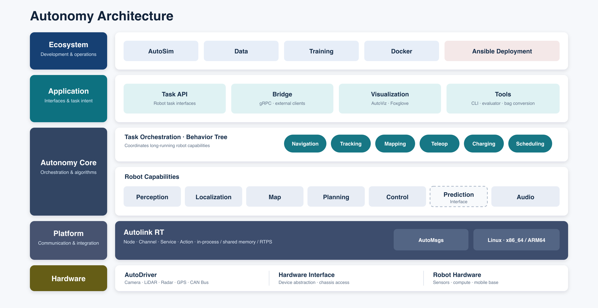
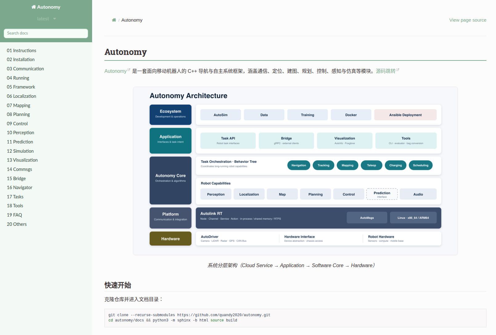

(instructions-overview)=
# 1. 概览

Autonomy 是 CMake + C++17 的整机软件：驱动、SLAM、感知、导航、机械臂、任务和机上管理。可以不绑 ROS 2；导航语义大体跟 Navigation2 对齐。



说「源码根」时，指带顶层 `CMakeLists.txt` 的那个目录。任务编排在 `autonomy/task`（文档里有时叫 Navigator），管理面在 `autonomy/system`，消息与驱动分别是 `automsgs/`、`autodriver/`。环境准备好后：

```bash
source scripts/setup_environment.bash
autolink_launch autonomy.launch
```

目录大致这样分：`autodriver` / `vehicle` / `sensor` 管底盘与传感；`localization` 定位；`perception` / `prediction` 感知预测；`map` / `planning` / `control` 导航；`automanip` 机械臂；`task` 跑 BT；`system` 管监控、安全、OTA；`autolink` / `automsgs` / `bridge` 负责通信和对外接口。域用 `AUTONOMY_BUILD_*` 裁，产品子工程用 `BUILD_*`。平台按 x86-64 / aarch64，推荐 Ubuntu 22.04。



本手册 01–02 入门安装，03–04 通信与运行，05–09 框架到控制，10–13 感知到可视化，14–16 消息、Bridge、编排，17–20 Tasks、Tools、FAQ、其它。本地构建：

```bash
cd docs && pip install -r requirements.txt && sphinx-build -b html source build
```

在线版：https://autonomy.readthedocs.io/en/latest/index.html 。当前版本 **0.2.0**（`version.json`），C++17、CMake ≥ 3.20、Apache 2.0。变更记在 [`CHANGELOG.rst`](https://github.com/quandy2020/autonomy/blob/main/CHANGELOG.rst)；格式化可用 `tools/python/clang_format_sources.py`。
