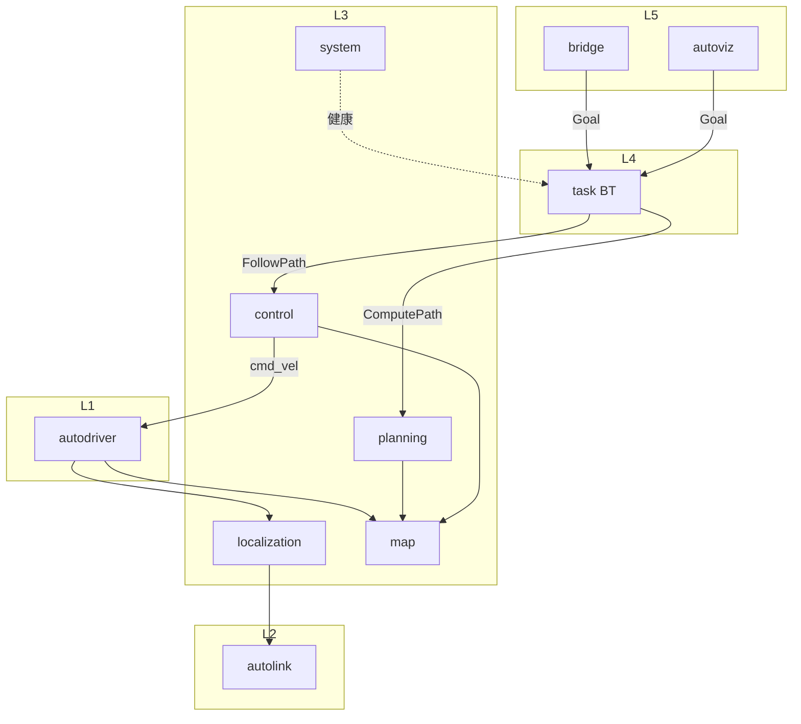

# 3. 架构与能力

## 背景

改模块或排「该找哪个进程」，需要先弄清分层边界、能力域职责，以及移动导航从 Goal 到 `cmd_vel` 的数据路径。总图与目录开关分别见 [§1](01_overview.md)、[§4](04_repository.md)。

## 思路

自上而下：应用 → 任务 BT → 能力域 → Autolink 平台 → 驱动。多进程经 **Autolink** 通信、**automsgs** 传消息；导航语义与 Nav2 大致对齐，但实现分布在 `autonomy/*` 各域。


## 步骤

### 1. 分层与边界

| 层 | 做什么 | 不做什么 |
|----|--------|----------|
| L5 应用 | Bridge RPC、Autoviz/OrbisView、Ansible | 不算路径、不控电机 |
| L4 编排 | `task` 加载 BT，协调导航/跟随/建图/遥操/回充 | 不实现规划器/控制器算法 |
| L3 能力 | 地图、规划、控制、定位、感知、机械臂、monitor/OTA | 一般不碰驱动寄存器 |
| L2 平台 | Autolink、automsgs、TF、common | 不含业务策略 |
| L1 硬件 | `autodriver` 采传感、发 `cmd_vel` | 不含全局规划 |

### 2. 能力域对照

| 域 | 模块 | 职责 | 文档 |
|----|------|------|------|
| 驱动 | `autodriver` | 相机/雷达/IMU，底盘 `cmd_vel` | 仓库 `autodriver/` |
| SLAM / 定位 | `localization` | 建图、位姿、TF（cartographer / atlas / argus） | [06](../06_Localization/index.rst) |
| 感知 / 预测 | `perception` · `prediction` | 检测跟踪、意图 | [10](../10_Perception/index.rst) · [11](../11_Prediction/index.rst) |
| 地图 | `map` | Occupancy / Costmap2D | [07](../07_Map/00_guide.md) |
| 全局规划 | `planning` | `ComputePath` → Path | [08](../08_Planning/00_guide.md) |
| 局部控制 | `control` | `FollowPath` → `cmd_vel` | [09](../09_Control/00_guide.md) |
| 操作 | `automanip` | 规划栈 + bolza | 顶层 `automanip/` |
| 编排 | `task` | 多域 BT（Navigator） | [16](../16_Navigator/00_guide.md) |
| 管理 | `system` | monitor、安全、OTA、launch | [04 Running](../04_Running/00_guide.md) |
| 对外 | `bridge` | gRPC | [15](../15_Bridge/00_guide.md) |
| 通信 / 消息 | `autolink` · `automsgs` | IPC 与类型 | [03](../03_Communication/00_guide.md) · [14](../14_Commsgs/index.rst) |

车上可只开子集，见 [Installation §6](../02_Installation/06_build.md)。

### 3. 移动导航流水线

```text
Goal → task(BT) → planning(Path) → control(FollowPath → cmd_vel)
↘ Costmap2D / TF（map → odom → base_link）
↑ localization / autodriver
```

| 层 | 模块 | 频率量级 |
|----|------|----------|
| 代价地图 | `map` | 1–10 Hz |
| 全局规划 | `planning` | 1–5 Hz（事件触发为主） |
| 局部控制 | `control` | 10–50 Hz |
| 编排 | `task` | tick / 事件 |

坐标系：`map` → `odom` → `base_link`。`navigator.pb.txt` 与各域 conf 中 `global_frame`、`robot_base_frame` 须一致。

| Nav2 | Autonomy |
|------|----------|
| `nav2_bt_navigator` | `autonomy/task` |
| `nav2_planner` | `autonomy/planning` |
| `nav2_controller` | `autonomy/control` |
| `nav2_costmap_2d` | `autonomy/map` |
| `nav2_msgs` | `automsgs` |

### 4. 模块路径与配置根

| 模块 | 源码 | 进程 / 产物 | 文档 |
|------|------|-------------|------|
| Autolink | `autolink/` | `autolink`、launch | [03](../03_Communication/00_guide.md) |
| AutoMsgs | `automsgs/` | 消息 / RPC | [14](../14_Commsgs/index.rst) |
| AutoDriver | `autodriver/` | 驱动主进程 | 仓库 `autodriver/` |
| Localization | `autonomy/localization/` | `autonomy.localization` | [06](../06_Localization/index.rst) |
| Perception | `autonomy/perception/` | 感知进程 | [10](../10_Perception/index.rst) |
| Map | `autonomy/map/` | costmap | [07](../07_Map/index.rst) |
| Planning | `autonomy/planning/` | `autonomy.planning` | [08](../08_Planning/index.rst) |
| Control | `autonomy/control/` | `autonomy.control` | [09](../09_Control/index.rst) |
| Task | `autonomy/task/` | `autonomy.task` | [16](../16_Navigator/index.rst) |
| System | `autonomy/system/` | `autonomy.monitor`、`autonomy.ota` | [04](../04_Running/00_guide.md) |
| Bridge | `autonomy/bridge/` | `autonomy.bridge` | [15](../15_Bridge/index.rst) |

配置：`autonomy/system/conf/` · `autonomy/task/conf/` · `autonomy/<域>/conf/` · `autodriver/config/`。

### 5. 运行时数据流



1. 传感上行：`autodriver` → 定位 / 感知 / 地图  
2. 任务下行：Bridge/UI → `task` → 规划 / 控制  
3. 执行闭环：`control` → `cmd_vel` → `autodriver`  
4. 管理旁路：`system` 采集健康，不替代 task 决策  

### 6. 常见误解与部署入口

| 误解 | 事实 |
|------|------|
| 只开 `system` 就能导航 | `task` 依赖 control / map 等域，需按 [§6.2](../02_Installation/06_build.md) 成组打开 |
| 定位模式随意填 | 仅 `cartographer` · `atlas` · `argus` |
| 全栈与 task 可并行 | 勿同时开 `autonomy.launch` 与 `task.launch` |

| 场景 | 做法 |
|------|------|
| 全栈联调 | `source scripts/setup_environment.bash` → `autolink_launch autonomy.launch` |
| 仅导航三件套 | `autolink launch start task.launch` |
| 板端 / 内存紧 | 减小 `-j`；build 放本地盘；`BUILD_AUTOVIZ=OFF` |
