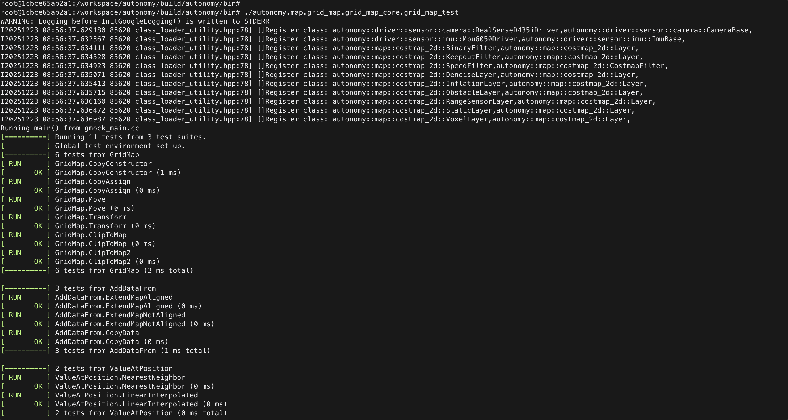

# 5. Docker 运行时

## 背景

宿主机怎么起容器、怎么挂数据、进去以后怎么 `autolink_launch`。镜像构建与容器内编译见 [02 Installation · Docker](../02_Installation/05_docker.md)。

## 思路

宿主机负责镜像、挂卷与设备权限；容器内 `autolink_launch` 与裸机相同前提是 prefix 与 `AUTOLINK_PATH` 一致。避免 workspace 挂载路径与镜像内 install 前缀混用两套 build。

## 步骤

### 1. 启动

```bash
export AUTONOMY_ENV=/path/to/autonomy
python3 "$AUTONOMY_ENV/docker/run_autonomy.py" -p x86_64
docker exec -it SpaceHero /bin/bash   # 名可用 AUTONOMY_CONTAINER_NAME 改
```

### 2. 参数

| 参数 / 变量 | 作用 |
|-------------|------|
| `-p x86_64` \| `aarch64` | 平台 |
| `-n yes` \| `no` \| `auto` | NVIDIA |
| `--data-volume` / `AUTONOMY_DATA_VOLUMES` | 数据盘 |
| `--datasets` / `AUTONOMY_DATASETS` | 离线数据集 → `/data:ro` |
| `AUTONOMY_FORCE_RECREATE=1` | 改挂载后重建 |
| `--as-host-user` | 宿主机 uid:gid |
| `AUTONOMY_NETWORK` | 默认 `host` |

环境变量全表：[§4](04_environment.md)。数据集：[Tools §8](../18_Tools/08_datasets.md)。

### 3. 容器内运行

```bash
cd /workspace/autonomy
source scripts/setup_environment.bash
autolink_launch autonomy.launch
```

默认 `--entrypoint /bin/bash`。


