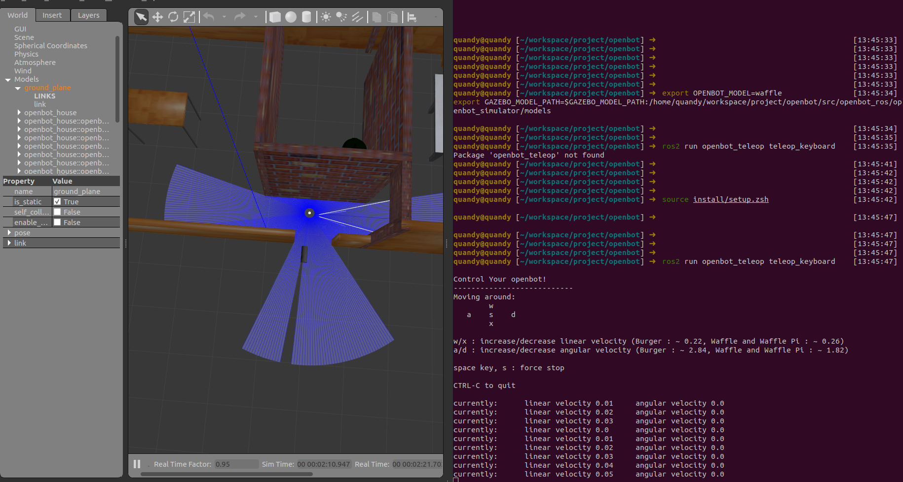

# 6. ROS 2 集成（可选）

核心栈可不依赖 ROS 2。本节只在你要 RViz2、Gazebo 或与现有 ROS 2 工具链并存时读。

核心栈可不依赖 ROS 2；本节只在需要 RViz2、Gazebo 或并存现有 ROS 工具链时读。车内语义以 commsgs/automsgs 为准，`autonomy_ros` 是桥接层而非唯一真相源。

## 组件

| 组件 | 说明 |
|------|------|
| `libautonomy` / 多进程栈 | CMake；主路径 |
| `autonomy_ros`（可选） | ROS 2 包装、launch、Topic 桥 |
| `commsgs` | 与 ROS 消息结构兼容的 C++ 类型 |

若仓库无 `autonomy_ros`，命令需在对应 overlay 中执行。

## 环境

```bash
export GLOG_logtostderr=1
source /opt/ros/humble/setup.bash
source /path/to/autonomy/install/setup.bash   # 若用 colcon overlay
```

## Launch

```bash
ros2 launch autonomy_ros autonomy.launch.py
ros2 launch autonomy_ros autonomy.launch.py use_gazebo:=true world_type:=house
```

| 参数 | 默认 | 说明 |
|------|------|------|
| `use_sim_time` | `true` | 仿真时钟 |
| `use_gazebo` | `false` | Gazebo |
| `world_type` | `house` | 世界 |
| `x_pose` / `y_pose` | `-2.0` / `-0.5` | 初始位姿 |



Gazebo 世界见 [12 Simulation](../12_Simulation/index.rst)。

## Docker + ROS 2

```bash
docker exec -it SpaceHero /bin/bash
source /opt/ros/humble/setup.bash
source /workspace/autonomy/install/setup.bash
ros2 launch autonomy_ros autonomy.launch.py
```

## 选型

| 场景 | 推荐 |
|------|------|
| 算法验证 / CI / 生产 | `autolink_launch autonomy.launch` |
| 可视化 | ROS 2 + RViz2 或 Foxglove |
| 仿真 | Gazebo + ROS 2 launch |
