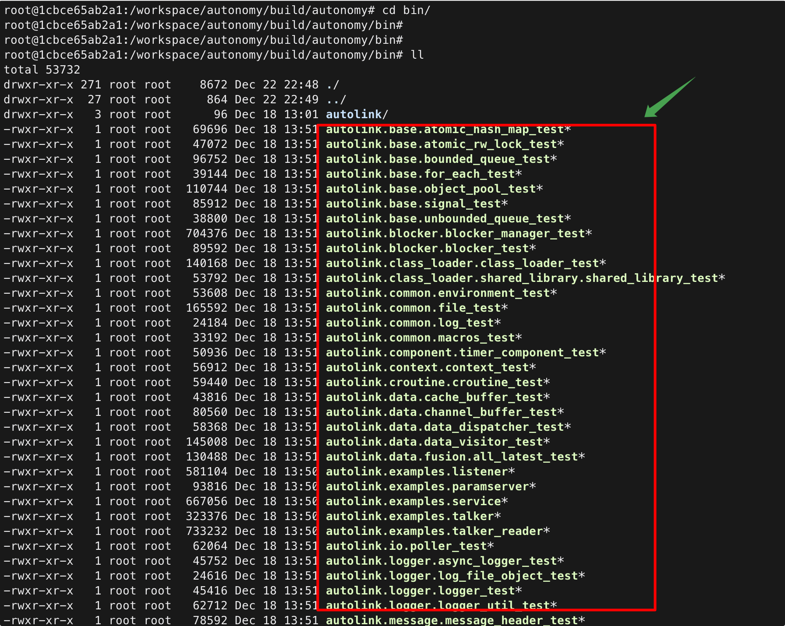

(running-troubleshooting)=
# 8. 故障排查

板端资源对照：[§9](09_board_task_launch_benchmark.md)。

## 8.1 可执行文件

| 现象 | 处理 |
|------|------|
| 找不到 `autonomy.planning` 等 | `ninja -C build`；检查模块 CMake |
| 找不到 `autolink_launch` | `PATH` 含 `build/bin`；或 `source setup` |
| `.so: cannot open` | `LD_LIBRARY_PATH` 含 `build/lib` 与 `/usr/local/lib` |

## 8.2 导航 / BT

| 现象 | 处理 |
|------|------|
| BT 插件 load 失败 | `export AUTONOMY_BT_PLUGIN_PATH=build/lib` |
| `GetPlan failed` | 起终点在障碍上；调坐标 |
| `TransformAvailable` 失败 | 统一 `global_frame` / `base_frame` |
| `no robot pose` | 仿真 / Bridge 注入 odom+TF |

## 8.3 Docker

| 现象 | 处理 |
|------|------|
| 挂载为空 | `AUTONOMY_ENV` 指向源码根 |
| 数据盘不可写 | `--data-volume` |
| `docker exec` 失败 | `docker ps`；检查容器名 |
| GPU 不可用 | NVIDIA Container Toolkit |

## 8.4 ROS 2

| 现象 | 处理 |
|------|------|
| 节点无法启动 | `source /opt/ros/humble/setup.bash` |
| 无话题 | 查 `ros2 launch` 日志 |

## 8.5 板端资源

| 现象 | 对照 | 处理 |
|------|------|------|
| 空闲 CPU ≫ 8% 单核 | [§9.1](09_board_task_launch_benchmark.md) | 查残留 `autonomy.*` |
| RSS ≫ 400 MiB | 同左 ≈360–370 | 查 costmap / 泄漏 |
| 启动很慢 | [§9.2](09_board_task_launch_benchmark.md) | 查磁盘 / setup |
