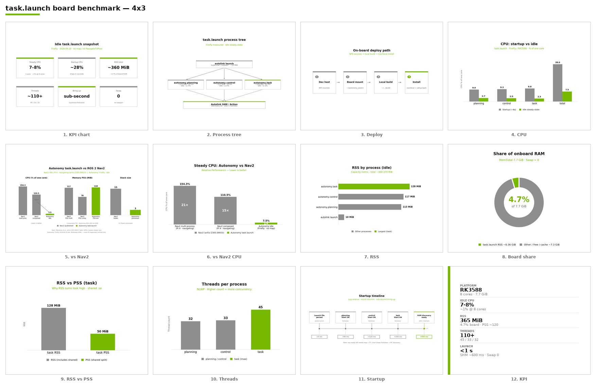

# 9. 板端部署资源报告

RK3588 上只起 `task.launch`（planning + control + task）时的 CPU / 内存参考。换 planner/controller 或开 perception 会明显变；Nav2 对比来自文献，**非同机同工况**。

## 核心参数

| 指标 | 数值 |
|------|------|
| 平台 | RK3588 · 8 核 · Mem 7.7 GiB · Swap 0 |
| 稳态 CPU（合计） | 7–8% 单核（约 1% @ 8 核） |
| 启动 CPU（~6 s） | 约 28% 单核 |
| RSS / PSS（合计） | 360–370 / 估约 120 MiB |
| 线程（合计） | 约 110+（task / control / planning = 45 / 33 / 32） |
| 拉起 | 亚秒；SHM ready 约 600 ms |
| 进程数 | 3（+ `autolink launch` 监督） |

## 分进程

| 进程 | 启动 CPU | 空闲 CPU | RSS | 线程 |
|------|----------|----------|-----|------|
| `autonomy.task` | 约 9.8% | 约 2.2–2.4% | 124–128 MiB | 45 |
| `autonomy.control` | 约 9.3% | 约 2.5% | 114–117 MiB | 33 |
| `autonomy.planning` | 约 9.0% | 约 2.5–2.8% | 111–113 MiB | 32 |
| `autolink launch` | 可忽略 | 可忽略 | 10–11 MiB | 1 |
| **合计** | **约 28%** | **约 7–8%** | **360–370 MiB** | **110+** |

启动时序（约）：

| 时刻 | 事件 |
|------|------|
| +0 ms | 解析 launch |
| ~80 / 120 / 160 ms | planning / control / task Start OK |
| ~600 ms | SHM discovery |

## vs Nav2

| 维度 | Nav2 多进程 | Nav2 组合 | Autonomy 空闲 |
|------|-------------|-----------|---------------|
| CPU % 单核 | 154.3 | 110.5 | 7–8 |
| PSS MiB | 116.6 | 77.8 | 估约 118 |
| RSS MiB | 文献未列 | 文献未列 | 360–370 |
| 节点/进程 | 15 | 单容器 | 3 |
| 拉起 | Lifecycle（秒级） | 同左 | 亚秒 |

Nav2 数据：[arXiv:2305.09933](https://arxiv.org/abs/2305.09933) Table I（Pi 4 · Gazebo 稳态导航）。正式 A/B 需同板 + 同图 + 同 `NavigateToPose`。
