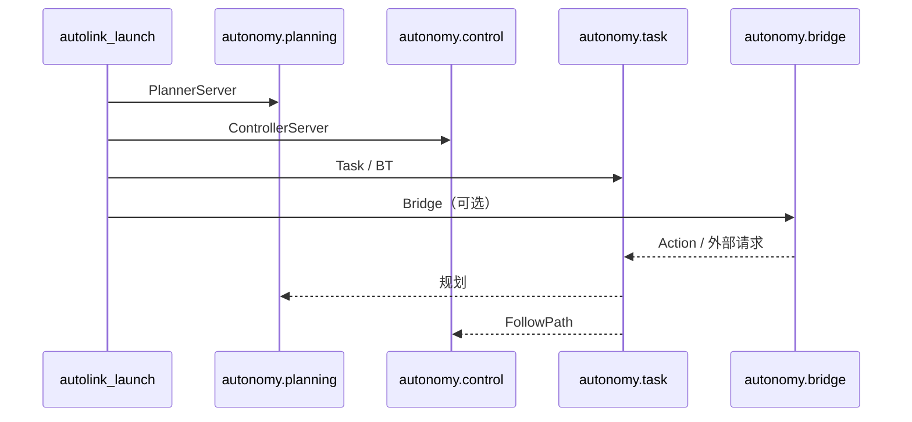

# 3. 框架架构

Server、插件、commsgs 与 autolink 怎么叠在一起。改导航链路或加 Server 时读这一页。

## 分层

```text
进程层：autolink_launch · autonomy.launch → 各 *_main
│
Server 层：Map · Planner · Controller · Transform · Task
│ 插件接口
插件层：GlobalPlanner · Controller · BT Nodes（.so / 进程内注册）
│
基础层：commsgs · autolink · common
```

## 启动顺序



各进程独立加载 conf，非进程内一次装配。见 [04 Running §3](../04_Running/03_autonomy_process.md)。

## 导航数据流

```text
Bridge / Action Client → task
→ ComputePath → planning
→ FollowPath → control → cmd_vel → 底盘 / 仿真
```

## 线程

| 组件 | 策略 |
|------|------|
| 各 `*_main` | 主线程 + `WaitForShutdown` |
| Costmap | 独立更新线程 + mutex |
| Autolink 回调 | Scheduler 协程 / 线程池 |
| BT tick | task 内 `tickOnce` |

## 与 Autolink 边界

| 层 | 职责 |
|----|------|
| Framework | 创建哪些 Server、如何传 `*Options` |
| Server 内部 | `CreateNode`，注册 Writer/Reader/Action |
| 应用 | launch + Bridge / Action，非进程内聚合 API |
