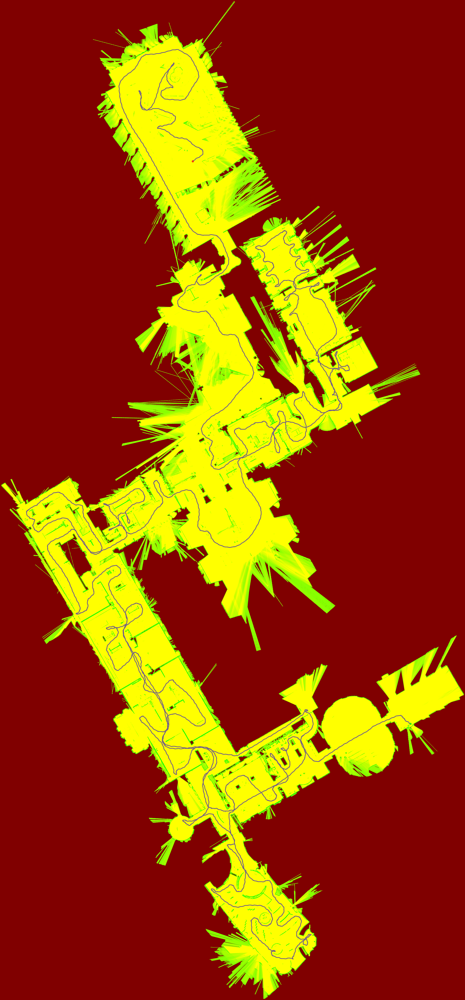

(cartographer-guide)=
# Cartographer 激光 SLAM

## 背景

**何时用：** 激光（+ 可选 IMU）为主的 2D/3D 建图或纯定位；需要 `.pbstream` / PGM 工作流时。多相机 LIO/LIVO 请转 [Atlas](../08_atlas/guide.md) 或 [Argus](../06_argus.md)。


## 步骤

`autonomy/localization/cartographer`：Google Cartographer，经 autolink 提供 2D/3D 建图、纯定位、`/map` 与 `.pbstream`。

> 公式 [§3.12](../03_math.md#312-cartographer)；架构 [§5.2](../05_architecture.md#52-cartographer)。

---

### 1. . 能力与二进制

| 能力 | 说明 |
|------|------|
| 2D / 3D SLAM | 子图 + 扫描匹配 + 位姿图 |
| 纯定位 | 加载冻结 `.pbstream` + `pure_localization_trimmer` |
| 占据栅格 | 节点内嵌 `/map`，或独立 `cartographer_occupancy_grid_node` |
| 导出 | 运行时 PGM；`cartographer_pbstream_to_map` 离线 |

| 二进制 | 作用 |
|--------|------|
| `localization` | 主节点（`--localization_mode=cartographer`，默认） |
| `cartographer_occupancy_grid_node` | 独立 `/map` |
| `cartographer_pbstream_to_map` | `.pbstream` → `map.pgm` + `map.yaml` |

---

### 2. . 快速开始（Backpack 2D）

```bash
# 1) bag → record
python -m autonomy.tools.bag_convert \
~/Downloads/b2-2016-04-27-12-31-41.bag \
-o ./data/records --backpack-2d

# 2) SLAM（内嵌 /map）
export PATH=$PWD/build/bin:$PATH
export AUTOLINK_LAUNCH_PATH=$PWD/autonomy/localization/launch
autolink launch start cartographer_2d.launch

# 等价：
# localization \
# --configuration_directory=config/localization/cartographer \
# --configuration_basename=backpack_2d.lua
```

| 输入 | 类型 |
|------|------|
| `echoes_1` | MultiEchoLaserScan |
| `imu` | Imu（`use_imu_data=true`） |
| `tf` / 静态外参 | Transform |

| 输出 | 话题/文件 |
|------|-----------|
| 占据栅格 | `map` |
| 位姿 | `tracked_pose`、TF `map→odom→base_link` |
| 子图 | `submap_list` |
| 图片 | `data/map.pgm`（可配置） |



---

### 3. . 启动模式

| 场景 | Launch | 配置 | 进程 |
|------|--------|------|------|
| 2D SLAM（入门） | `cartographer_2d.launch` | `backpack_2d.lua` | 1 |
| 2D + 独立 grid | `localization_server.launch` | `backpack_2d_with_grid.lua` | 2 |
| 纯定位 | `cartographer_2d_localization.launch` | `backpack_2d_localization.lua` | 2 |

**纯定位**：先 `--save_state_filename=maps/map.pbstream` 建图；再在 launch 设 `--load_state_filename`，Lua：

```lua
TRAJECTORY_BUILDER.pure_localization_trimmer = { max_submaps_to_keep = 3 }
```

`--load_frozen_state=true`。

---

### 4. . 命令行参数

| 参数 | 默认 | 说明 |
|------|------|------|
| `--localization_mode` | `cartographer` | `cartographer` \| `atlas` \| `argus` |
| `--configuration_directory` | `config/localization/cartographer` | Lua 目录 |
| `--configuration_basename` | `backpack_2d.lua` | 主配置 |
| `--load_state_filename` | `""` | 加载 `.pbstream` |
| `--load_frozen_state` | `true` | 冻结轨迹 |
| `--save_state_filename` | `""` | 退出时序列化 |

Atlas / Argus：[§4](../04_usage.md)。

---

### 5. . 配置

目录：`config/localization/cartographer/`

| 文件 | 用途 |
|------|------|
| `backpack_2d.lua` | 默认 2D（MultiEcho + 内嵌 grid） |
| `backpack_2d_with_grid.lua` | grid 由独立节点发 |
| `backpack_2d_localization.lua` | 纯定位 |
| `trajectory_builder_2d.lua` | 2D 前端 |
| `pose_graph.lua` | 回环 / 优化 |
| `*_static_transform.yaml` | 外参（与 basename 自动对应） |

**`backpack_2d.lua` 要点**：`map_frame` / `tracking_frame` / `odom_frame`；`multi_echo_laser_scan_topics = {"echoes_1"}`；`publish_occupancy_grid`；`num_accumulated_range_data`。

| 块 | 关键参数 |
|----|----------|
| `submaps` | `num_range_data`、`resolution` |
| `ceres_scan_matcher` | `occupied_space_weight` |
| `motion_filter` | `max_distance_meters` |
| `pose_graph` | `optimize_every_n_nodes`、`constraint_builder.min_score` |

静态 TF 例：`base_link`→`imu_link` / `horizontal_laser_link`（偏移约 0.1007, 0, 0.0558 m）。

---

### 6. . 话题与服务

**订阅**：`scan` / `echoes_*` / `points2` / `imu` / `odom` / `tf`（按 Lua 开关）。

**发布**：`map`、`submap_list`、`tracked_pose`、`tf`（`map→odom`）。

**服务**：`submap_query`、`start_trajectory`、`finish_trajectory`、`write_state`。

---

### 7. . 地图持久化

```bash
# 运行结束写 pbstream
localization ... --save_state_filename=output/map.pbstream

# 离线 → ROS 地图
cartographer_pbstream_to_map \
-pbstream_filename=output/map.pbstream \
-map_filestem=output/map -resolution=0.05
```

运行时亦可 `save_map_image=true` 周期写 PGM，或调用 `write_state`。

---

### 8. . 源码要点

`cartographer/node/`：`cartographer_node`、`map_builder_bridge`、`sensor_bridge`、`occupancy_grid_node`、`pbstream_to_map_main`。引擎：`mapping/{2d,3d}`、`io/`、`common/`。

---

### 9. . 调参与排错

| 现象 | 处理 |
|------|------|
| 漂移 / 模糊 | 查 IMU 外参；调 `ceres_scan_matcher` 权重 |
| 回环慢 | 减小 `optimize_every_n_nodes` |
| 实时性差 | 增大 `motion_filter`；减小 `num_accumulated_range_data` |
| 无 `/map` | `publish_occupancy_grid` 或启动 occupancy_grid 节点 |
| 无激光 | backpack 需 `echoes_1`，非 `scan` |
| TF 超时 | 检查 `*_static_transform.yaml` |
| 纯定位跳变 | 同一机器人配置 + pbstream |

---

### 10. . 与 cartographer_ros

| 项 | Autonomy |
|----|----------|
| 中间件 | autolink + `commsgs` |
| 配置 | 同 Lua 语义，目录见上 |
| 启动 | `autolink launch` |
| 数据 | `bag_convert` → `.record` |

官方：[Cartographer 文档](https://google-cartographer.readthedocs.io/)。
