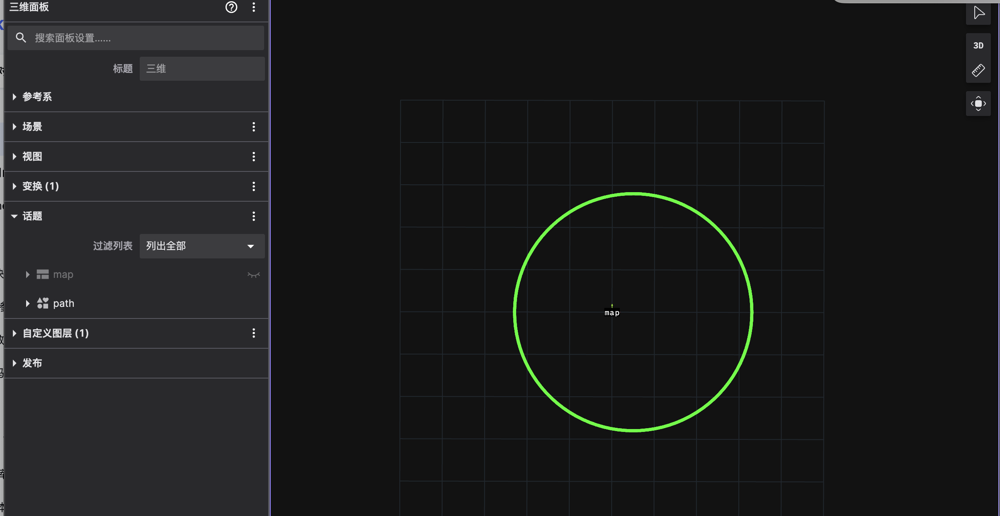
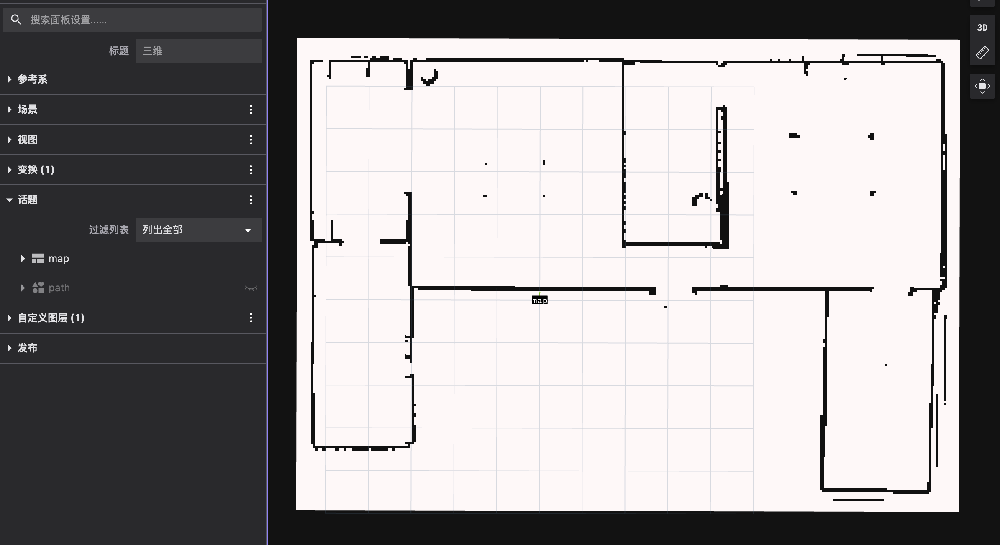

# 3. 数据类型

在 Autoviz / Foxglove / RViz 里订阅话题前，确认 commsgs 类型与 ROS 显示插件的对应关系。

可视化消费的是 **commsgs struct**（经 bridge 转成 ROS 类型，或 Autoviz 直接读 Autolink）。定义分散在 `autonomy/commsgs` 与各 proto。

| 要看什么 | 典型话题（以 launch/common.lua 为准） |
|----------|----------------------------------------|
| 全局地图 | `/map` 或 `map` |
| 规划路径 | `/plan` 或 `/planning/path` |
| 激光 | `/scan` |
| Follow 栅格 | `/perception/follow/grid`（GridMap） |

### 高频类型

| 包 | 类型 | 显示用途 |
|----|------|----------|
| sensor_msgs | LaserScan, PointCloud2, Image, Imu | 激光、点云、相机 |
| geometry_msgs | PoseStamped, TransformStamped | 位姿、TF |
| map_msgs | OccupancyGrid, GridMap | 地图、Follow 栅格 |
| planning_msgs | Path, Odometry | 路径、里程计 |
| visualization_msgs | Marker, MarkerArray | 标记（边界转换见下） |
| vision_msgs | Detection2DArray 等 | 检测框 |

### 转换完整度（联调相关）

| 包 | 栈内 struct | 过 Autolink/Proto | 备注 |
|----|-------------|-------------------|------|
| sensor / map / planning | 常用 | 大部分可用 | 大包体需实测 |
| visualization_msgs | 有 | **stub 为主** | RViz Marker 走 bridge 前先测 |
| vision_msgs | 有 | 部分 | 与 [14 §9](../14_Commsgs/09_survey.md) 一致 |

没有域内「VisualizationServer」帮你统一转 ROS；要么 **autonomy_ros**，要么 **Autoviz** 原生订阅。

### 示例图

### 常见坑

| 现象 | 说明 |
|------|------|
| Marker 不显示 | visualization ToProto stub |
| GridMap 在 RViz 无插件 | 需 Foxglove 或 Autoviz 或自定义 |
| 话题名对不上 | 以实际 launch 为准，勿死记表 |

### 延伸阅读

[14 Commsgs](../14_Commsgs/00_guide.md) · [§6 Foxglove](06_foxglove.md)
