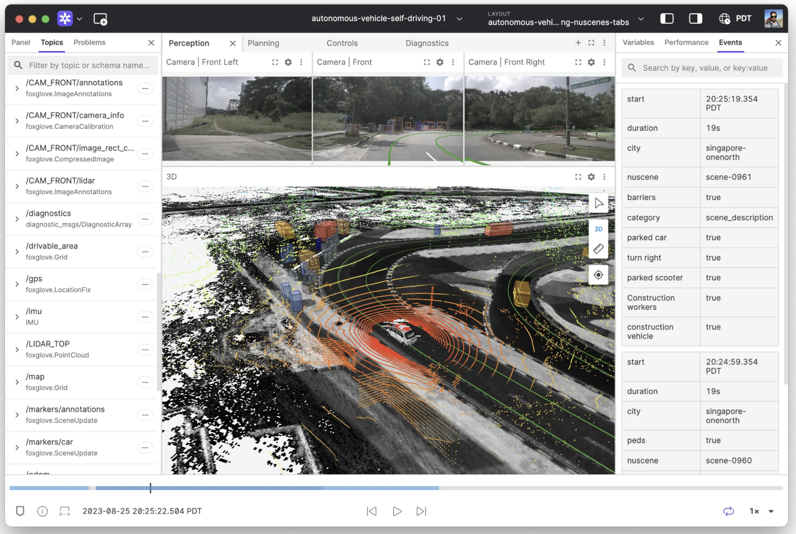
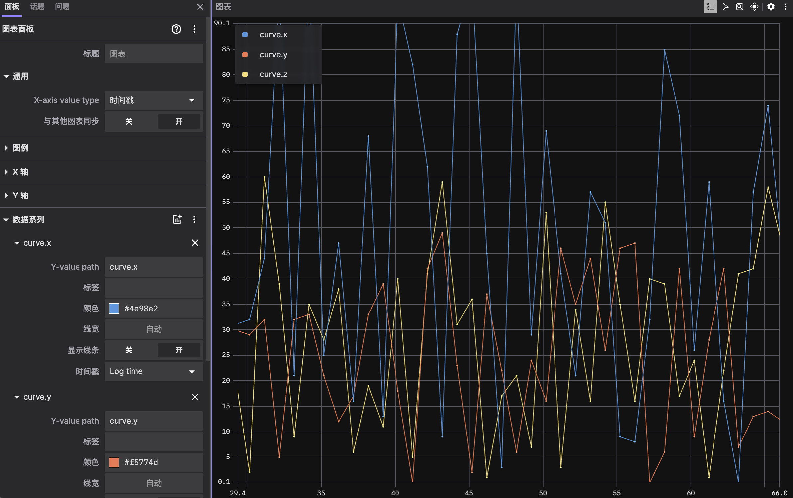

# 6. Foxglove

[Foxglove Studio](https://foxglove.dev/)：多模态可视化（ROS、MCAP、WebSocket）。



### 6.1 接入

```
libautonomy → autonomy_ros → foxglove_bridge → ws://host:8765 → Studio
```

```bash
sudo apt install ros-humble-foxglove-bridge
ros2 run foxglove_bridge foxglove_bridge
# Studio: Open connection → Foxglove WebSocket → ws://localhost:8765
```

离线：拖入 MCAP/bag。Docker 可选安装见 `install_ros2.sh`。

### 6.2 推荐面板

| 面板 | 订阅 | 用途 |
|------|------|------|
| 3D | `/map`,`/plan`,`/scan`,TF | 导航全貌 |
| Plot | `/cmd_vel`, odom | 控制曲线 |
| Image | `/sensor/camera` | 视觉 |
| Raw Messages | 任意 | 排错 |



### 6.3 规划 API / MCAP

`VisualizationServer` **不存在**。配置将读 `visualization.lua`。`install_mcap.sh` 已装依赖，C++ 无 MCAP 调用。

### 6.4 参见

- [§4](04_configuration.md) · [15 Bridge 综述](../15_Bridge/05_survey.md)
