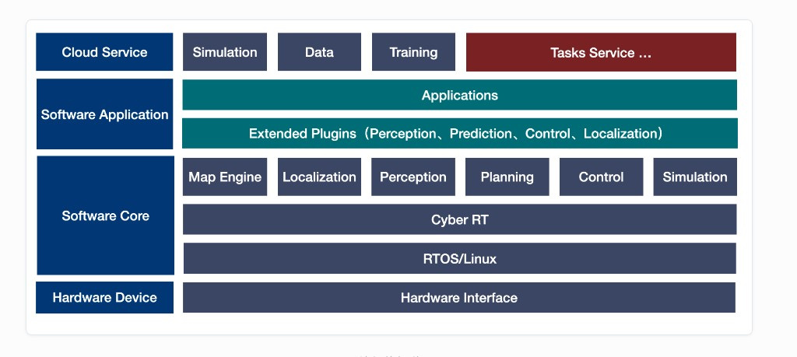

.. Copyright 2026 The OpenRobotic Beginner Authors (duyongquan)

.. Licensed under the Apache License, Version 2.0 (the "License");
   you may not use this file except in compliance with the License.
   You may obtain a copy of the License at

..      http://www.apache.org/licenses/LICENSE-2.0

.. Unless required by applicable law or agreed to in writing, software
   distributed under the License is distributed on an "AS IS" BASIS,
   WITHOUT WARRANTIES OR CONDITIONS OF ANY KIND, either express or implied.
   See the License for the specific language governing permissions and
   limitations under the License.

============
Autonomy
============

`Autonomy <https://github.com/quandy2020/autonomy>`_ 是面向移动机器人的 C++ 整机栈：通信、定位、建图、规划、控制、感知与仿真等。推荐从下方「01 入门指引」读起。`源码 <https://github.com/quandy2020/autonomy>`_

   系统分层（云服务 → 应用 → 软件核心 → 硬件）

本地预览文档
------------

.. code-block:: bash

   git clone --recurse-submodules https://github.com/quandy2020/autonomy.git
   cd autonomy/docs && python3 -m sphinx -b html source build

章节
----

.. toctree::
  :maxdepth: 1

  01 入门指引 <01_Instructions/index>
  02 安装构建 <02_Installation/index>
  03 通信层 <03_Communication/index>
  04 运行部署 <04_Running/index>
  05 框架核心 <05_Framework/index>
  06 定位 <06_Localization/index>
  07 地图 <07_Map/index>
  08 规划 <08_Planning/index>
  09 控制 <09_Control/index>
  10 感知 <10_Perception/index>
  11 预测 <11_Prediction/index>
  12 仿真 <12_Simulation/index>
  13 可视化 <13_Visualization/index>
  14 消息定义 <14_Commsgs/index>
  15 通信桥接 <15_Bridge/index>
  16 导航编排 <16_Navigator/index>
  17 导航任务 <17_Tasks/index>
  18 开发工具 <18_Tools/index>
  19 常见问题 <19_FAQs/index>
  20 其他 <20_Other/index>

